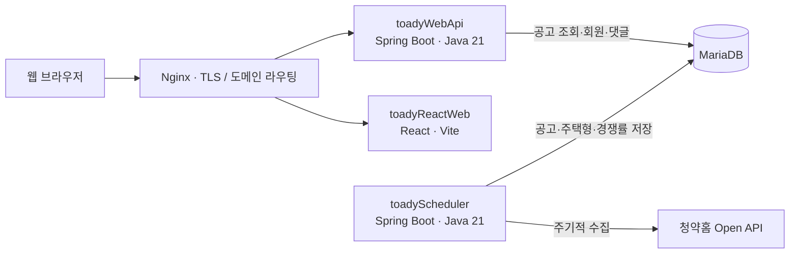
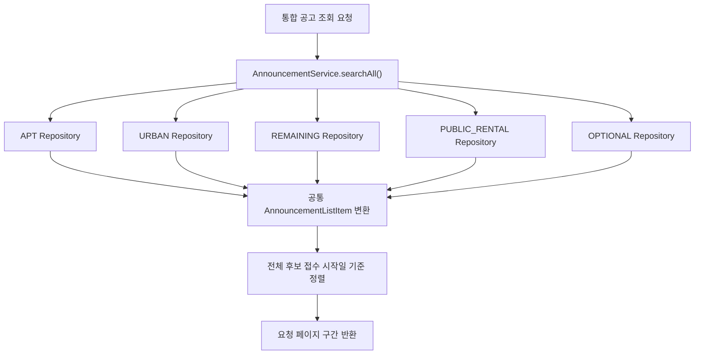
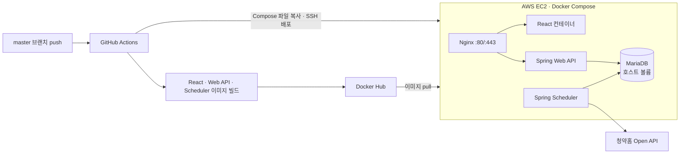

# TOADY - 청약 일정 캘린더 및 분양 정보 플랫폼

청약홈 공공데이터를 수집하고, 분양 공고의 일정·주택형·경쟁률 정보를 캘린더와 상세 화면으로 제공하는 풀스택 모노리포 프로젝트입니다.

- 서비스: <https://www.toady.co.kr>
- REST API: <https://api.toady.co.kr>
- API 문서: <https://www.toady.co.kr/swagger-ui/index.html>

## 프로젝트 구조

```text
toady/
├── toadyReactWeb/   # React 웹 애플리케이션
├── toadyWebApi/     # 사용자 요청을 처리하는 REST API
├── toadyScheduler/  # 청약홈 공공데이터 수집 배치
└── docker-compose.yml
```

웹 API와 수집 스케줄러는 별도 애플리케이션·컨테이너로 실행하며 MariaDB를 공유합니다. 데이터 수집 작업이 API 애플리케이션과 같은 프로세스에서 실행되지 않도록 분리한 구조입니다. 다만 두 서비스는 호스트 자원과 데이터베이스를 공유하므로, 이 분리가 모든 장애나 자원 경합으로부터 API를 격리한다는 뜻은 아닙니다.



운영 환경에서 Nginx는 프론트엔드 및 API 도메인의 요청을 각각 전달합니다. 프론트엔드 개발 서버에서는 Vite가 `/api`와 `/webApi` 요청을 로컬 API 서버로 프록시합니다. 프로덕션 프론트엔드는 `https://api.toady.co.kr`를 API 주소로 사용하므로, 운영 도메인과 Nginx 라우팅·CORS 설정은 배포 환경에 맞게 구성되어야 합니다.

## 하위 프로젝트

| 프로젝트 | 역할 | 주요 기술 | 문서 |
| --- | --- | --- | --- |
| `toadyReactWeb` | 반응형 청약 캘린더 및 분양 정보 웹 UI | React 18, Vite, TanStack Query, MUI, FullCalendar | [README](./toadyReactWeb/README.md) |
| `toadyWebApi` | 공고 조회, 인증, 회원 및 댓글 REST API | Java 21, Spring Boot 3.5, Spring Data JPA, Spring Security, MariaDB | [README](./toadyWebApi/README.md) |
| `toadyScheduler` | 청약홈 공공데이터 수집 및 DB 적재 | Java 21, Spring Boot 3.5, Spring Data JPA, MariaDB | [README](./toadyScheduler/README.md) |

## 주요 엔지니어링 내용

### 서로 다른 5개 공고 유형의 통합 검색

APT, URBAN, REMAINING, PUBLIC_RENTAL, OPTIONAL 공고는 저장 테이블과 접수일 필드 등이 서로 다릅니다. API는 유형별 JPA Repository에 공통 검색 조건을 적용하고, 필요한 후보를 `AnnouncementListItem`으로 변환해 모은 뒤 접수 시작일 최신순으로 정렬하고 요청한 페이지를 구성합니다.



### 전체 기간 자동완성과 캘린더 이동

캘린더의 현재 월 데이터만으로는 과거 공고를 찾을 수 없으므로, 별도 제안 API가 전체 기간의 공고를 검색합니다. 프론트엔드는 2자 이상 입력 시 300ms 디바운스로 API를 호출합니다. 사용자가 결과를 선택하면 접수 시작일에 해당하는 월로 캘린더를 이동하고 공고 상세 화면을 엽니다. API는 각 공고 유형에서 상위 후보를 제한 조회한 뒤 전체 결과를 접수 시작일 최신순으로 정렬해 최대 20건 반환합니다.

### 수집 작업과 사용자 API 분리

`toadyScheduler`는 Spring `@Scheduled` 기반으로 청약홈 공고·주택형·경쟁률 데이터를 가져와 MariaDB에 저장합니다. API 서버는 별도 프로세스로 DB 데이터를 조회해 응답합니다. 배치 작업의 외부 API 대기와 대량 적재가 API 요청 처리와 같은 JVM의 스레드·메모리를 직접 공유하지 않도록 실행 경계를 분리했습니다. 스케줄러에는 중복 수집을 방지하기 위한 MariaDB advisory lock이 구현되어 있습니다. 배치와 API가 같은 DB 및 호스트 자원을 사용하므로 DB 장애나 호스트 전체 자원 문제까지 분리되는 것은 아닙니다.

### 컨테이너 배포

루트 `docker-compose.yml`은 MariaDB, 웹 API, 스케줄러, 프론트엔드, Nginx, Certbot 서비스를 정의합니다. GitHub Actions workflow는 `master` 브랜치 push 시 세 앱의 Docker 이미지를 빌드·푸시한 뒤 Compose 파일을 서버로 복사하고 원격에서 컨테이너를 갱신합니다. 현재 workflow에 자동 테스트나 별도 헬스 체크 단계가 있다고 가정하지 않습니다.

### 이슈 및 해결 과정

아래는 실제 구현과 테스트로 확인할 수 있는 데이터 특성 및 운영 조건, 그리고 이에 적용한 대응을 정리한 내용입니다.

#### 공고 유형마다 다른 접수일 필드와 날짜 형식

- **문제:** 5개 공고 유형은 접수 시작일 필드명이 다르고, 일부 데이터는 `yyyy-MM-dd`, 일부는 `yyyyMMdd` 형식으로 저장됩니다. 이를 그대로 비교하면 통합 정렬이나 기간 검색 결과가 유형별로 달라질 수 있습니다.
- **대응:** 공고 유형별 접수일 필드로 조회하고, 날짜 비교 전 숫자만 추출해 정규화합니다. 통합 목록은 공통 DTO로 변환해 동일한 정렬 규칙을 적용합니다. 유형별 데이터가 섞이는 통합 검색은 H2 기반 테스트에서 순서와 응답 필드를 검증합니다.

#### 청약홈 페이지 응답의 누락 및 중복 데이터

- **문제:** 외부 API는 페이지 단위로 응답하고, 공고 상세에서 주택형 API를 다시 호출해야 합니다. 페이지를 일부만 읽거나 동일 행을 그대로 저장하면 데이터 누락 또는 중복이 생길 수 있습니다.
- **대응:** 수집기는 `matchCount`에 도달할 때까지 페이지를 순회하고, 예상 건수에 못 미친 상태에서 빈 페이지가 오면 성공으로 간주하지 않고 오류 처리합니다. 상세 공고의 복합키로 주택형을 조회하며, 일반 유형은 복합키 기준 `merge`를 사용하고 경쟁률 데이터는 `ON DUPLICATE KEY UPDATE`로 반영합니다. 도시형 주택형 응답은 반복되는 동일 행을 값으로 비교해 중복 저장을 방지합니다.

#### 스케줄러 다중 실행에 따른 중복 수집

- **문제:** 배포·재시작 과정에서 스케줄러 인스턴스가 둘 이상 동작하면 같은 수집 작업이 동시에 실행될 수 있습니다.
- **대응:** MariaDB advisory lock을 획득한 실행만 동기화를 진행하도록 했습니다. 잠금을 획득하지 못하면 다른 작업이 실행 중인 것으로 처리하고 중복 수집을 시작하지 않습니다.

## 운영 인프라 및 CI/CD

현재 운영 구성은 AWS EC2 인스턴스에서 Docker Compose로 애플리케이션을 실행합니다. DNS는 서비스 도메인으로 연결하고, Nginx 컨테이너가 80/443 포트를 받아 프론트엔드 및 API 요청을 전달합니다. TLS 인증서는 Certbot 컨테이너로 발급하며, 인증서와 Nginx 설정은 EC2 호스트 디렉터리를 컨테이너에 마운트합니다. MariaDB 데이터와 앱 로그도 호스트 볼륨에 저장해 컨테이너 재생성 후에도 유지합니다.



배포 workflow는 `master` push 시 GitHub-hosted runner에서 세 Docker 이미지를 빌드해 Docker Hub에 push하고, `docker-compose.yml`을 EC2에 복사합니다. 이후 SSH로 접속해 이미지를 pull하고 Compose 서비스를 갱신하며 사용하지 않는 이미지를 정리합니다. Docker build 단계에서 테스트를 실행하지 않고 배포 후 별도 헬스 체크도 수행하지 않으므로, 현재 파이프라인은 자동 테스트 검증이나 헬스 체크를 포함한 무중단 배포로 설명하지 않습니다.

운영용 DB 비밀번호, JWT 키, 외부 API 키 등은 서버의 각 앱 환경 파일과 GitHub Actions Secrets를 통해 관리합니다. 이 저장소의 Compose 설정에는 운영 경로가 포함되어 있으므로 다른 서버에 적용할 때는 경로, 도메인, 환경 파일을 조정해야 합니다.

## 로컬 개발 및 테스트

세부 환경 변수와 실행 방법은 각 하위 프로젝트 README를 참고하세요. API와 스케줄러는 MariaDB 접속 정보가 필요하며, 공공데이터 수집에는 청약홈 API 키가 필요합니다. 프론트엔드 개발 서버는 기본적으로 `http://localhost:3000`에서 실행되고 `/api`, `/webApi` 요청을 `http://localhost:8081`로 프록시합니다.

```bash
# 각 프로젝트 디렉터리에서 실행
cd toadyWebApi && ./gradlew test
cd ../toadyScheduler && ./gradlew test
cd ../toadyReactWeb && npm ci && npm run build
```
