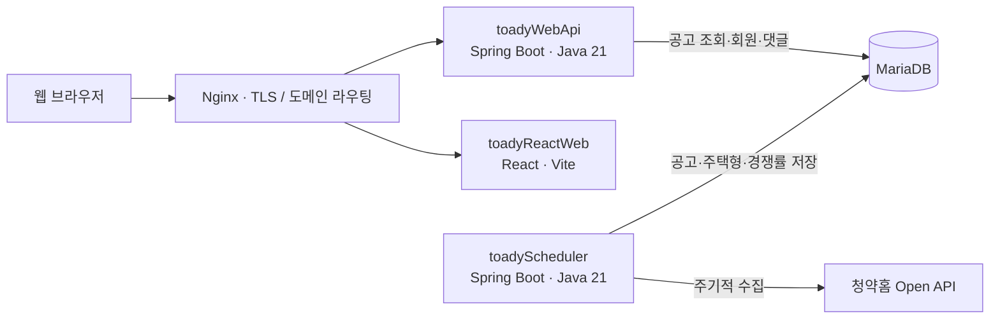
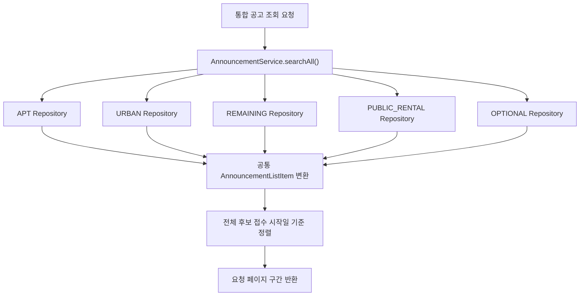

# TOADY (토디) - 청약 일정 캘린더 및 분양 정보 플랫폼

청약홈 공공데이터를 수집하고, 분양 공고의 일정·주택형·경쟁률 정보를 캘린더와 상세 화면으로 제공하는 풀스택 모노리포 프로젝트입니다.

- 서비스: <https://www.toady.co.kr>
- REST API: <https://api.toady.co.kr>
- API 문서: <https://www.toady.co.kr/swagger-ui/index.html>

## 프로젝트 구조

```text
toady/
├── toadyReactWeb/   # React 웹 애플리케이션
├── toadyWebApi/     # 사용자 요청을 처리하는 REST API
├── toadyScheduler/  # 청약홈 공공데이터 수집 배치
└── docker-compose.yml
```

웹 API와 수집 스케줄러는 별도 애플리케이션·컨테이너로 실행하며 MariaDB를 공유합니다. 데이터 수집 작업이 API 애플리케이션과 같은 프로세스에서 실행되지 않도록 분리한 구조입니다. 다만 두 서비스는 호스트 자원과 데이터베이스를 공유하므로, 이 분리가 모든 장애나 자원 경합으로부터 API를 격리한다는 뜻은 아닙니다.



운영 환경에서 Nginx는 프론트엔드 및 API 도메인의 요청을 각각 전달합니다. 프론트엔드 개발 서버에서는 Vite가 `/api`와 `/webApi` 요청을 로컬 API 서버로 프록시합니다. 프로덕션 프론트엔드는 `https://api.toady.co.kr`를 API 주소로 사용하므로, 운영 도메인과 Nginx 라우팅·CORS 설정은 배포 환경에 맞게 구성되어야 합니다.

## 하위 프로젝트

| 프로젝트 | 역할 | 주요 기술 | 문서 |
| --- | --- | --- | --- |
| `toadyReactWeb` | 반응형 청약 캘린더 및 분양 정보 웹 UI | React 18, Vite, TanStack Query, MUI, FullCalendar | [README](./toadyReactWeb/README.md) |
| `toadyWebApi` | 공고 조회, 인증, 회원 및 댓글 REST API | Java 21, Spring Boot 3.5, Spring Data JPA, Spring Security, MariaDB | [README](./toadyWebApi/README.md) |
| `toadyScheduler` | 청약홈 공공데이터 수집 및 DB 적재 | Java 21, Spring Boot 3.5, Spring Data JPA, MariaDB | [README](./toadyScheduler/README.md) |

## 주요 엔지니어링 내용

### 서로 다른 5개 공고 유형의 통합 검색

APT, URBAN, REMAINING, PUBLIC_RENTAL, OPTIONAL 공고는 저장 테이블과 접수일 필드 등이 서로 다릅니다. API는 유형별 JPA Repository에 공통 검색 조건을 적용하고, 필요한 후보를 `AnnouncementListItem`으로 변환해 모은 뒤 접수 시작일 최신순으로 정렬하고 요청한 페이지를 구성합니다.



### 전체 기간 자동완성과 캘린더 이동

캘린더의 현재 월 데이터만으로는 과거 공고를 찾을 수 없으므로, 별도 제안 API가 전체 기간의 공고를 검색합니다. 프론트엔드는 2자 이상 입력 시 300ms 디바운스로 API를 호출합니다. 사용자가 결과를 선택하면 접수 시작일에 해당하는 월로 캘린더를 이동하고 공고 상세 화면을 엽니다. API는 각 공고 유형에서 상위 후보를 제한 조회한 뒤 전체 결과를 접수 시작일 최신순으로 정렬해 최대 20건 반환합니다.

### 수집 작업과 사용자 API 분리

`toadyScheduler`는 Spring `@Scheduled` 기반으로 청약홈 공고·주택형·경쟁률 데이터를 가져와 MariaDB에 저장합니다. API 서버는 별도 프로세스로 DB 데이터를 조회해 응답합니다. 스케줄러에는 중복 수집을 방지하기 위한 MariaDB advisory lock이 구현되어 있습니다. 배치와 API가 같은 DB를 사용하므로 DB 장애나 호스트 전체 자원 문제까지 분리되는 것은 아닙니다.

### 컨테이너 배포

루트 `docker-compose.yml`은 MariaDB, 웹 API, 스케줄러, 프론트엔드, Nginx, Certbot 서비스를 정의합니다. GitHub Actions workflow는 `master` 브랜치 push 시 세 앱의 Docker 이미지를 빌드·푸시한 뒤 Compose 파일을 서버로 복사하고 원격에서 컨테이너를 갱신합니다. 현재 workflow에 자동 테스트나 별도 헬스 체크 단계가 있다고 가정하지 않습니다.

## 로컬 개발 및 테스트

세부 환경 변수와 실행 방법은 각 하위 프로젝트 README를 참고하세요. API와 스케줄러는 MariaDB 접속 정보가 필요하며, 공공데이터 수집에는 청약홈 API 키가 필요합니다. 프론트엔드 개발 서버는 기본적으로 `http://localhost:3000`에서 실행되고 `/api`, `/webApi` 요청을 `http://localhost:8081`로 프록시합니다.

```bash
# 각 프로젝트 디렉터리에서 실행
cd toadyWebApi && ./gradlew test
cd ../toadyScheduler && ./gradlew test
cd ../toadyReactWeb && npm ci && npm run build
```

## 운영 구성

현재 Compose 설정은 AWS EC2에서 Docker Compose로 각 컨테이너를 실행하고, 호스트의 Nginx와 Certbot 인증서 볼륨을 사용하도록 작성되어 있습니다. 해당 Compose 파일에는 운영 서버의 경로와 환경 파일 경로가 포함되어 있으므로, 다른 환경에서 사용할 때는 볼륨·환경변수·도메인 설정을 조정해야 합니다. 비밀번호, API 키, 서명 키 등 비밀값은 저장소에 커밋하지 말고 배포 환경의 안전한 설정으로 주입하세요.
