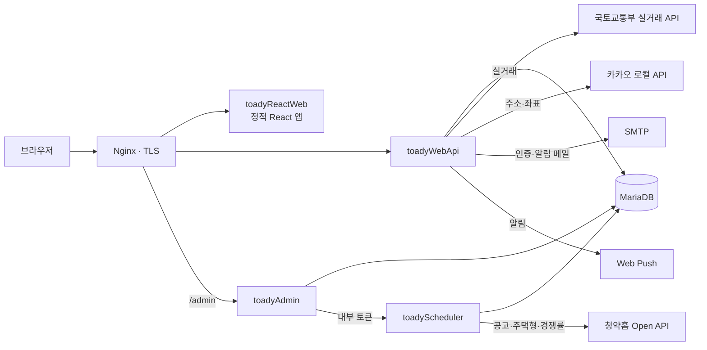
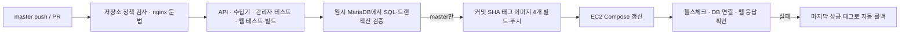

# TOADY · 청약 정보를 한 화면에서

**청약홈 공고 찾기 → 생활권 검색 → 상세·주소 → 지도 → 동네 분위기 → 주변 시세로 흩어져 있던 청약 준비 동선을 한 화면에 모은 서비스입니다.**

[서비스 바로가기 (www.toady.co.kr)](https://www.toady.co.kr)

청약을 준비하는 사람은 청약홈에서 공고를 찾고, 주소를 지도에 따로 검색하고, 카페에서 분위기를 묻고, 실거래가 사이트에서 주변 시세를 비교합니다. TOADY는 공공데이터(청약홈·국토교통부 실거래)를 직접 수집·가공해 이 과정을 공고 하나의 상세 화면 안에서 끝낼 수 있게 합니다. 기획·설계·개발·배포·운영을 혼자 맡아 실제 도메인으로 운영하고 있습니다.

| 구성 | 역할 | 문서 |
| --- | --- | --- |
| [`toadyReactWeb`](toadyReactWeb) | 사용자 화면 (React 18 · MUI · Vite) | [README](toadyReactWeb/README.md) |
| [`toadyWebApi`](toadyWebApi) | 공고·실거래·회원·커뮤니티 REST API (Spring Boot 3.5 · Java 21) | [README](toadyWebApi/README.md) |
| [`toadyScheduler`](toadyScheduler) | 청약홈 데이터 수집기 · 수집 내부 API (Spring Boot 3.5 · Java 21) | [README](toadyScheduler/README.md) |
| [`toadyAdmin`](toadyAdmin) | 운영 관리자 사이트 (Kotlin · Spring Boot · Thymeleaf) | [README](toadyAdmin/README.md) |

---

## 주요 기능

**공고 탐색**
- 월별 청약 캘린더(데스크톱·모바일 별도 화면)와 지역·공급유형 필터, 전체 기간 자동완성 검색
- 생활권 검색(운정·동탄·검단 등), 이번 주 청약·지역별 청약·무순위(줍줍) 모음
- 5개 공고 유형(APT·도시형/오피스텔·잔여세대·공공지원민간임대·임의공급)을 하나의 목록으로 통합

**공고 상세**
- 공급유형별 일정, 주택형별 분양가, 모집공고문 PDF, 경쟁률·당첨가점·특별공급 현황
- **분양가 vs 주변 시세**: 국토교통부 실거래로 같은 면적(±5㎡)·최근 6개월 거래 범위와 비교, 신축 기준 선택
- **위치 탭 실거래 지도**: 주변 단지별 가격 말풍선, 면적·가격·연식 필터, 넓게 보면 법정동·시군구 묶음, 전체 화면, 거리 재기·드래그 반경 그리기(반경 안 시세 요약), 주소·동·장소 검색과 자동완성
- 단지별 '이야기'(댓글·답글) 커뮤니티, 경쟁률 예상 투표, 이미지로 저장·공유

**개인화와 재방문**
- 가점 계산기(가점이 오르는 날 캘린더 저장), 조건으로 넣을 수 있는 공고를 찾는 맞춤 청약
- 나의 청약: 관심 공고 저장(비회원은 브라우저), 진행 단계(신청 예정 → 당첨 → 계약 완료 → 입주까지 남은 기간), 메모·비교
- 알림: 웹 푸시(관심 공고 일정·생활권 새 공고·주간 브리핑), 이메일 일정 알림, 개인 캘린더 구독(ICS)
- 내 정보: 닉네임·비밀번호 변경, 프로필 캐릭터, 내가 쓴 이야기와 받은 답글 알림, 탈퇴

**운영**
- 관리자 사이트: 방문·재방문·유입 경로·방문 → 알림 흐름 지표, 회원 잠금, 댓글 숨김·복구, 수집 실행·자동 일정
- 검색 노출용 서버 HTML(공고·생활권·주간·무순위·FAQ)과 사이트맵, 공유 미리보기 이미지

## 시스템 구성



- 네 앱은 한 저장소에서 관리하고 각각 별도 컨테이너로 실행합니다. AWS EC2의 Docker Compose로 운영합니다.
- 수집기와 API는 서로 다른 JVM이며 MariaDB를 공유합니다. 외부 API 대기·대량 적재가 사용자 요청의 스레드·메모리를 쓰지 않게 하려는 분리입니다(호스트·DB 장애까지 격리하지는 않습니다).
- 자동 수집: 공고·주택형 매일 03:15, 경쟁률·가점·특별공급 매일 04:15·20:15(한국시간), 90일 전부터 오늘까지 재조회.

| 영역 | 기술 |
| --- | --- |
| Frontend | React 18, Vite 5, MUI 5, TanStack Query v5, Zustand, React Router 6, FullCalendar, Kakao Maps SDK |
| Backend | Java 21, Spring Boot 3.5, Spring Data JPA, Spring Security, JWT, JdbcTemplate |
| Admin | Kotlin, Spring Boot 3.5, Thymeleaf, 세션 인증·CSRF |
| Data | MariaDB 11.4, 청약홈 Open API, 국토교통부 실거래 API, 카카오 로컬 API |
| Test | JUnit 5, Spring Boot Test, Mockito, H2(MariaDB 모드), Node test runner, JSDOM |
| Delivery | Docker, Docker Compose, Nginx, Certbot, GitHub Actions |

---

## 기술적으로 고민한 점

### 1. 형식이 다른 5개 공고 유형을 하나의 캘린더로
청약홈은 유형마다 API·필드명·날짜 형식(`yyyy-MM-dd`, `yyyyMMdd`)이 다릅니다. 저장은 유형별 테이블 구조를 유지하고, 조회 시 유형별 Repository에 같은 검색 조건을 적용한 뒤 공통 `AnnouncementListItem`으로 바꿔 접수 시작일 기준으로 병합·정렬합니다. 목록의 댓글 수는 반환할 페이지의 공고 키를 한 번에 집계해 N+1 조회를 피합니다.
→ [AnnouncementSearchService](toadyWebApi/src/main/java/com/toady/web/app/announcement/service/AnnouncementSearchService.java) · [AnnouncementListMapper](toadyWebApi/src/main/java/com/toady/web/app/announcement/service/AnnouncementListMapper.java)

### 2. 수집 데이터가 비거나 어긋나도 기존 데이터를 지키는 수집기
- 응답의 `matchCount`에 닿을 때까지 페이지를 돌고, 중간에 건수가 바뀌거나 모자라면 저장하지 않고 실패로 둡니다.
- 제공처가 빈 응답을 주면 기존 주택형·경쟁률을 지우지 않습니다. 변경된 행만 트랜잭션 안에서 교체합니다.
- MariaDB advisory lock으로 여러 인스턴스의 동시 수집을 막고, 401·403·429는 즉시 멈춰 일일 한도를 더 쓰지 않습니다.
→ [ApplyhomeSyncService](toadyScheduler/src/main/java/com/toady/web/apt/service/ApplyhomeSyncService.java) · [ApplyhomeSyncLock](toadyScheduler/src/main/java/com/toady/web/apt/service/ApplyhomeSyncLock.java)

### 3. 위치를 '확정 / 후보 / 미확인'으로 구분하는 공통 판정
분양 공고 주소는 지번이 아닌 '○○지구 3블록'인 경우가 많습니다. 정확한 지번·도로명이고 시군구가 일치할 때만 핀을 놓고, 단지명 검색 결과는 '후보'로만 보여 주며, 지구·블록 주소는 법정동 일대를 점선 원으로 표시합니다. 특정 단지를 위한 예외 파싱은 두지 않고 모든 공고에 같은 규칙을 씁니다.
→ [resolveLocation.js](toadyReactWeb/src/features/announcement/location/resolveLocation.js)

### 4. 외부 API 호출 한도 안에서 실거래 지도를 빠르게
지도를 옮기면 화면에 걸친 시·군·구마다 12개월치 거래를 불러야 합니다.
- 달·시군구 단위로 캐시하고, 응답 시간 안에 못 받은 달은 '일부 응답(partial)'으로 먼저 보낸 뒤 화면이 이어서 받습니다.
- 국토부 호출은 동시 3개·간격 0.12초로 조절하고, 429·한도 초과·키 오류를 받으면 전체 호출을 잠시 멈추는 차단기를 둡니다(초당 한도 1분, 일일 한도 자정까지).
- 실거래 자료에는 좌표가 없어 지번을 카카오로 좌표 변환해 DB에 남기고, 찾지 못한 지번은 30일 뒤 다시 확인합니다.
→ [NeighborhoodResearchService](toadyWebApi/src/main/java/com/toady/web/app/planner/research/NeighborhoodResearchService.java) · [ComplexPriceService](toadyWebApi/src/main/java/com/toady/web/app/planner/research/ComplexPriceService.java)

### 5. 팝업·상세·전체 화면 지도를 브라우저 히스토리와 일치시키기
모바일에서 뒤로가기를 눌렀을 때 화면이 통째로 닫히거나, 닫은 팝업이 다시 열리는 문제를 줄이기 위해 팝업을 히스토리 state의 레이어로 다룹니다. 맨 위 레이어만 뒤로가기로 닫고, 아래 레이어를 닫을 때는 위 레이어까지 함께 걷어 내며, 고른 단지가 있는 채로 전체 화면을 열면 레이어 순서를 바꿔 쌓습니다. 새로고침해도 같은 화면이 복원됩니다.
→ [useHistoryOverlay](toadyReactWeb/src/hooks/useHistoryOverlay.js) · [overlay.util.js](toadyReactWeb/src/utils/overlay.util.js)

### 6. 인증과 남용 방지
- JWT에 비밀번호 기반 확인값(credentialVersion)을 넣어 비밀번호 변경·잠금·탈퇴 시 다른 기기의 토큰을 즉시 무효화합니다. 토큰을 갱신해도 최초 로그인 시각(`tca`)을 이어받아 최대 14일이 지나면 다시 로그인하게 합니다.
- 로그인·현재 비밀번호 확인은 IP와 계정 기준으로 함께 제한하고, 계정 변경은 행 잠금으로 직렬화한 뒤 잠금 안에서 다시 검사합니다.
- 관리자 사이트는 CSRF·세션 쿠키(`Path=/admin`, `SameSite=Strict`)를 쓰고, 수집 실행은 32자 이상 공유 토큰의 내부 API로만 요청합니다.
→ [JwtProviderImpl](toadyWebApi/src/main/java/com/toady/web/core/security/jwt/impl/JwtProviderImpl.java) · [AccountService](toadyWebApi/src/main/java/com/toady/web/app/user/service/AccountService.java) · [RequestLimitFilter](toadyWebApi/src/main/java/com/toady/web/core/security/RequestLimitFilter.java)

### 7. 무료 메일 한도 안에서 인증 메일 지키기
Gmail 한 계정(하루 약 500통)으로 가입 인증·비밀번호 찾기·일정 알림을 모두 보냅니다. 최근 24시간 발송 시도를 DB에서 세고, 알림이 한도를 다 쓰지 못하도록 인증용 여유분을 따로 남기며, 결과가 불확실한 발송은 자동 재발송하지 않습니다. 발신 주소는 설정값이라 메일 서비스를 옮길 때 코드 변경이 없습니다.
→ [MailBudget](toadyWebApi/src/main/java/com/toady/web/app/planner/MailBudget.java)

### 8. 개인정보 없이 유입·재방문 측정
회원 ID·검색어·URL 전체를 보내지 않고 브라우저 무작위 ID로 페이지 조회와 행동(상세 열람·관심 저장·알림 켬·지도 기능 사용)을 기록합니다. 관리자 사이트는 주간 방문·재방문, 유입 도메인, 방문 → 상세 → 저장 → 알림 흐름과 신규 방문자의 재방문율(알림 켠 사람과 아닌 사람 비교)을 보여 줍니다. 운영자 브라우저는 집계에서 뺄 수 있습니다.
→ [MetricsService](toadyAdmin/src/main/kotlin/com/toady/admin/metrics/MetricsService.kt) · [UsageEventController](toadyWebApi/src/main/java/com/toady/web/app/analytics/UsageEventController.java)

---

## 테스트와 배포

| 대상 | 테스트 | 내용 |
| --- | --- | --- |
| toadyWebApi | 168개 | 통합 공고 조회, 가입 → 메일 인증 → 로그인 → 댓글 → 비밀번호 변경 흐름, 토큰 무효화, 계정 변경·대입 제한, 실거래 호출 속도 조절·차단기, 공개 페이지 |
| toadyScheduler | 62개 | 청약홈 응답 매핑, 페이지 순회·건수 검증, 빈 응답 보호, 수집 작업·자동 일정, 보관 기간 정리, `database.sql` 전체 실행(H2 MariaDB 모드) |
| toadyAdmin | 15개 | 로그인 제한·CSRF, 회원 잠금, 댓글 숨김·복구, 지표 집계(재방문·흐름), 스케줄러 장애 시 화면 |
| toadyReactWeb | 146개 | JSDOM에 실제 App·라우터를 띄운 화면 흐름, 히스토리 레이어, 인증 토큰 경합, 지도 규칙(위치 판정·반경 요약·자동완성) |



배포 확인에 실패하면 앱 컨테이너를 마지막 성공 태그로 되돌립니다(DB 변경은 되돌리지 않습니다). → [deploy.yml](.github/workflows/deploy.yml) · [check-deployment.sh](scripts/check-deployment.sh)

## 저장소 구조

```text
.
├── toadyReactWeb/        # 사용자 화면
├── toadyWebApi/          # REST API · 공개 HTML · 사이트맵
├── toadyScheduler/       # 청약홈 수집기 · 수집 내부 API
├── toadyAdmin/           # 관리자 사이트
├── scripts/              # 저장소 정책 검사 · 배포 확인
├── .github/workflows/    # 검증·배포 파이프라인
├── docker-compose.yml    # 운영 구성(앱 4개 · MariaDB · Nginx · Certbot)
└── database.sql          # 공유 DB 변경 SQL(구역 번호로 관리)
```

## 로컬에서 실행하기

필요 환경: Java 21, Node.js 22, npm. 테스트는 실제 DB·외부 API 키 없이 실행됩니다.

```bash
(cd toadyWebApi && ./gradlew test)
(cd toadyScheduler && ./gradlew test)
(cd toadyAdmin && ./gradlew test)
(cd toadyReactWeb && npm ci && npm test && npm run build)
python3 scripts/check-repository.py
```

화면 개발 서버는 `toadyReactWeb`에서 `npm run dev`로 띄우며 `http://localhost:3000`에서 열리고 `/api`는 `localhost:8081`의 API로 프록시합니다. API·수집기를 띄우려면 MariaDB 스키마와 각 앱의 `.env`가 필요합니다(각 README 참고). 저장소는 전체 초기 스키마를 제공하지 않고, `database.sql`은 운영 DB에 적용해 온 변경 SQL을 구역 번호로 모은 파일입니다.

## 저장소 관리 원칙

- 실제 환경 설정(`.env*`), 인증서·키, 빌드 산출물, 로그는 추적하지 않습니다. 환경 설정은 값이 빈 `.env.example`만 공개합니다.
- `VITE_*` 값은 브라우저 번들에 포함되므로 서버 비밀값을 넣지 않습니다.
- `scripts/check-repository.py`가 파일 정책과 식별 가능한 키 형식을 검사하며 CI에서도 같은 검사를 실행합니다.

---

<details>
<summary><b>운영 메모 — 배포·롤백·인증서·DB 변경</b></summary>

### 배포와 롤백
- GitHub Actions가 `master` 푸시마다 검증 후 네 이미지를 같은 커밋 SHA로 태깅해 Docker Hub에 올리고, EC2의 `~/toady`에서 Compose로 갱신합니다. 관리자 사이트는 서버에 `toadyAdmin/.env.prod`가 채워져 있을 때만 함께 배포합니다.
- CI는 `docker-compose.yml`·`scripts/check-deployment.sh`를 `~/toady/.incoming/`에 받은 뒤 기존 파일을 `.rollback/`에 보관하고 교체합니다. `docker-compose config`가 실패하면 이전 파일로 되돌립니다.
- 마지막 성공 태그는 `~/toady/.deployed-image-tag`와 `~/toady/.env`의 `IMAGE_TAG=`에 기록합니다. 이미지 pull·`up`·배포 확인 중 하나라도 실패하면 앱 컨테이너를 이전 태그로 다시 올립니다.
- Compose는 앱 이미지에 `${IMAGE_TAG:?...}`를 써서 태그 없이 `latest`로 넘어가지 않습니다.

수동 배포:
```bash
cd ~/toady
export DOCKER_USERNAME=dukkeoba IMAGE_TAG=배포할_커밋_SHA
docker-compose -p toady pull toadyWebApi toadyScheduler toadyAdmin toadyReactWeb
docker-compose -p toady up -d --no-deps toadyWebApi toadyScheduler toadyAdmin toadyReactWeb
docker exec nginx nginx -s reload      # 앞단 nginx가 새 컨테이너 IP를 다시 읽게 한다(502 방지)
bash scripts/check-deployment.sh
```

`check-deployment.sh`는 API·스케줄러 `/internal/health`(DB 연결 포함), 웹 응답, 컨테이너 상태, 서버 자신을 거친 `https://www.toady.co.kr/` 응답을 확인합니다. `/internal/schema`가 알려 주는 누락 테이블은 경고만 남깁니다.

### Nginx와 인증서
- 웹 컨테이너·CI 문법 검사·앞단 nginx는 같은 `nginx:1.30-alpine`을 씁니다. 앞단 nginx 버전 변경은 서버에서 `docker-compose -p toady pull nginx && docker-compose -p toady up -d --no-deps nginx`로 적용합니다.
- 인증서는 certbot `--keep-until-expiring`으로 만료가 가까울 때만 다시 발급합니다. 서버 cron 예시:
  ```cron
  0 4 * * 1 cd /home/ec2-user/toady && docker-compose -p toady run --rm --no-deps certbot renew && docker exec nginx nginx -s reload
  ```
- 관리자 위치(`/admin`)는 `proxy_set_header X-Real-IP $remote_addr;`를 꼭 둡니다(관리자 로그인 실패 제한이 이 값을 씁니다).

### DB 변경 (`database.sql`)
두 앱 모두 `ddl-auto=none`이며 SQL은 배포 전에 관리 계정으로 직접 실행합니다. `CREATE ... IF NOT EXISTS` 형태라 이미 적용한 구역을 다시 실행해도 됩니다. 단, 주석으로만 둔 구역(4·5·6, 14·19의 권한 문)은 실제 구조를 확인한 뒤 따로 적용합니다.

```bash
mariadb -h DB호스트 -u 관리계정 -p DB이름 < database.sql
```

| 구역 | 내용 |
| --- | --- |
| 1 | 수집 실행 이력·자동 일정 |
| 2 | 공고 댓글 |
| 3 | 경쟁률·당첨가점·특별공급 현황 |
| 4~6 | 도시형 주택형 PK 변경·권한·인증 메일 본문 확장(참고용 주석) |
| 7~9 | 방문 로그, 관심 공고·메일 발송량·알림 이력, 익명 행동 집계 |
| 10 | 방문 로그의 유입 도메인 |
| 11 | 회원 캘린더 구독 주소 |
| 12 | 경쟁률 예상 투표 |
| 13 | 웹 푸시 구독·생활권 새 공고 판정 |
| 14·15 | 유입·푸시 조회 인덱스, 보관 기간 정리 권한, 새 공고 판정 시각 |
| 16 | 나의 청약 진행 단계 |
| 17 | 오피스텔·공공지원민간임대 경쟁률 모델번호 길이 |
| 18 | 공고별 주변 시세 비교 요약 |
| 19 | 관리자 사이트 전용 DB 계정 |
| 20 | 지표에서 뺄 운영자 브라우저 |
| 21 | 관리자가 숨긴 댓글 기록 |
| 22 | 실거래 단지 좌표 |
| 23 | 회원 프로필 캐릭터 |
| 24 | 회원별 이야기 조회 인덱스 |

전체 초기 스키마는 제공하지 않으므로 새 DB에는 공고·주택형·회원 테이블을 따로 준비해야 합니다. 앱 이미지 롤백은 DB 변경을 되돌리지 않습니다.

</details>
