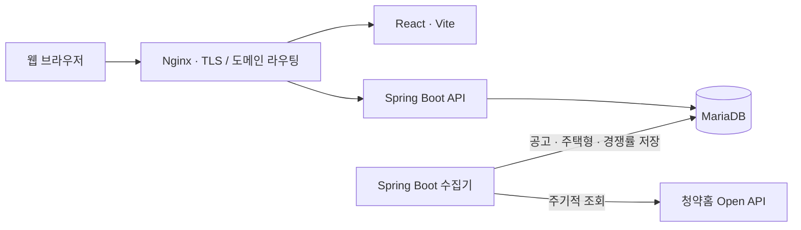
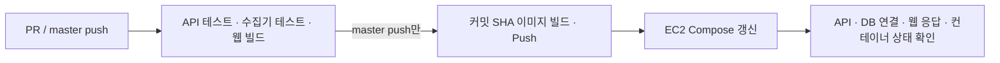

# TOADY · 청약 일정 캘린더 및 분양 정보 플랫폼

**유형별로 나뉜 청약홈 공공데이터를 모아, 청약 일정부터 경쟁률·당첨 가점까지 한 화면에서 확인하는 웹 서비스입니다.**

월별 일정 조회, 지역·공급유형 필터, 전체 기간 공고 검색, 공고 상세와 커뮤니티 기능을 제공합니다. 프론트엔드·API·데이터 수집기를 별도 애플리케이션으로 구성하고 Docker Compose로 배포합니다.

[서비스 바로가기](https://www.toady.co.kr) · [API 문서](https://www.toady.co.kr/swagger-ui/index.html)

## 프로젝트에서 해결한 문제

청약 정보는 주택 유형별로 API와 데이터 형식이 나뉘어 있습니다. 같은 접수 일정도 필드명과 날짜 형식이 달라, 그대로는 하나의 캘린더와 검색 결과로 표현하기 어렵습니다. 또 사용자 요청마다 외부 API를 호출하면 외부 서비스의 응답 지연에 영향을 받습니다.

TOADY는 **데이터 수집을 사용자 요청 처리와 분리**하고, 저장된 공고를 **공통 목록 계약으로 변환**해 캘린더와 검색 화면에 제공합니다.

| 구현 범위 | 내용 |
| --- | --- |
| 사용자 화면 | 데스크톱·모바일 캘린더, 지역·공급유형 필터, 전체 기간 자동완성, 상세 패널 |
| API | 5개 공고 유형 통합 조회, 상세·경쟁률·가점, JWT 인증, 이메일 인증, 댓글 |
| 수집 | 공고·주택형·경쟁률 수집, 페이지 순회, 중복 실행 방지, 기존 데이터 갱신 |
| 운영 구성 | Docker Compose, Nginx·TLS 연동, GitHub Actions 검증·이미지 배포 |

## 주요 사용자 흐름

1. 캘린더에서 월별 청약 일정을 확인하고 지역·공급유형을 선택합니다.
2. 지역이나 단지명으로 검색합니다. 전체 기간 검색 결과를 선택하면 해당 접수 월로 이동합니다.
3. 공고를 선택해 상세, 경쟁률·가점, 위치, 댓글을 확인합니다.
4. 로그인한 사용자는 공고에 댓글과 답글을 작성하고 본인 글을 수정·삭제합니다.

## 시스템 구성



세 앱은 하나의 저장소에서 관리하며 별도 애플리케이션·컨테이너로 실행합니다. 수집기와 API는 서로 다른 JVM을 사용하고 MariaDB를 공유합니다. 현재 배포 구성은 AWS EC2의 Docker Compose를 기준으로 합니다. 기본 자동 수집은 한국시간 공고·주택형 매일 03:15, 경쟁률·가점·특별공급 현황 매일 04:15와 20:15에 실행하며 90일 전부터 오늘까지의 공고를 재조회합니다. 시각은 일 단위 갱신 문서를 바탕으로 정한 운영 정책입니다.

| 영역 | 사용 기술 |
| --- | --- |
| Frontend | React 18, Vite 5, TanStack Query v5, Zustand, MUI, FullCalendar |
| Backend | Java 21, Spring Boot 3.5, Spring Data JPA, Spring Security, JWT |
| 수집 관리자 | Thymeleaf, 세션 인증, 기간별 백필, DB 기반 자동 스케줄·실행 이력 |
| Data | MariaDB, 청약홈 Open API, Spring `@Scheduled` |
| Validation | JUnit 5, Spring Boot Test, Mockito, H2 |
| Delivery | Docker, Docker Compose, Nginx, Certbot, GitHub Actions |
| DB 변경 관리 | 별도 실행하는 Flyway 구성, 버전별 SQL |

## 설계 판단과 구현 근거

### 1. 수집기와 사용자 API의 실행 경계 분리

외부 API 대기와 데이터 적재가 사용자 요청과 같은 JVM의 스레드·메모리를 직접 사용하지 않도록 수집기를 분리했습니다. 수집기는 조회·변환·저장을 담당하고, API는 DB의 데이터를 조회해 응답합니다.

대신 호스트와 DB는 공유하므로 DB 부하나 호스트 장애까지 격리되지는 않습니다. 현재 규모에서 운영 복잡도를 제한하면서 필요한 실행 경계를 확보한 구성입니다.

구현: [수집 동기화 서비스](toadyScheduler/src/main/java/com/toady/web/apt/service/ApplyhomeSyncService.java) · [스케줄 실행](toadyScheduler/src/main/java/com/toady/web/apt/scheduler/ApplyhomeSyncScheduler.java)

### 2. 서로 다른 5개 공고 유형을 공통 목록으로 통합

APT·URBAN·REMAINING·PUBLIC_RENTAL·OPTIONAL은 저장 테이블과 접수일 필드가 다릅니다. 유형별 Repository에 검색 조건을 적용하고, 공통 `AnnouncementListItem`으로 변환한 뒤 접수 시작일 기준으로 병합·정렬합니다. 날짜 비교에서는 `yyyy-MM-dd`와 `yyyyMMdd`의 차이를 정규화합니다.

유형별 저장 구조를 유지하면서 클라이언트에 일관된 목록을 제공합니다. 다만 깊은 페이지일수록 가져오는 후보가 늘어납니다. 실제 데이터량과 응답 시간을 측정한 뒤 DB 통합 조회나 공통 조회 테이블을 검토할 지점입니다.

구현: [검색 서비스](toadyWebApi/src/main/java/com/toady/web/app/announcement/service/AnnouncementSearchService.java) · [유형별 DTO 변환](toadyWebApi/src/main/java/com/toady/web/app/announcement/service/AnnouncementListMapper.java)

### 3. 현재 월을 넘어서는 검색과 캘린더 이동

현재 월 데이터만 검색하면 과거 공고를 찾을 수 없습니다. 별도 자동완성 API가 전체 기간의 주택명·주소를 검색하고, 화면에서는 2자 이상 입력 시 300ms 디바운스를 적용합니다. 결과를 선택하면 접수 월로 이동하고 상세 패널을 엽니다. 입력이 바뀐 뒤 도착한 이전 요청의 응답은 무시합니다.

구현: [검색·필터 훅](toadyReactWeb/src/views/main/hooks/useAnnouncementSearch.js) · [필터 UI](toadyReactWeb/src/views/main/components/AnnouncementFilters.jsx)

### 4. 수집 데이터의 누락·중복과 동시 실행 대응

- 응답의 `matchCount`에 도달할 때까지 페이지를 조회하고, 예상 건수에 못 미친 상태에서 빈 페이지가 오면 실패 처리합니다.
- 공고 복합키로 연결된 주택형을 조회합니다. 일반 데이터는 JPA `merge`, 경쟁률은 `ON DUPLICATE KEY UPDATE`로 갱신합니다.
- 도시형 주택형은 실제 `ID`를 식별자로 조회하며, 공고별 최신 응답과 DB를 비교해 변경 없는 행은 유지하고 사라지거나 변경된 행은 트랜잭션 안에서 교체합니다. 응답 내 동일 행은 중복 저장하지 않습니다.
- MariaDB advisory lock을 획득한 실행만 동기화를 진행합니다.

구현: [동기화](toadyScheduler/src/main/java/com/toady/web/apt/service/ApplyhomeSyncService.java) · [DB 잠금](toadyScheduler/src/main/java/com/toady/web/apt/service/ApplyhomeSyncLock.java) · [경쟁률 저장](toadyScheduler/src/main/java/com/toady/web/apt/service/ApplyhomeCompetitionPersistenceService.java)

### 5. 기능 변경의 영향을 줄이는 책임 분리

메인 화면의 검색·필터, 필터 UI, 공고 원문 표시를 훅과 컴포넌트로 분리했습니다. 서버 상태는 TanStack Query로 관리하며 댓글 변경 후 관련 쿼리를 무효화합니다. API의 공고 조회 진입점은 유지하고 검색·상세·경쟁률 서비스를 나눴습니다.

구현: [메인 화면](toadyReactWeb/src/views/main/Main.jsx) · [공고 Query 훅](toadyReactWeb/src/features/announcement/hooks/useAnnouncements.js) · [조회 진입점](toadyWebApi/src/main/java/com/toady/web/app/announcement/service/AnnouncementService.java)

## 수집 관리자

`toadyScheduler`에 Thymeleaf 관리자 화면을 제공합니다. 공고·주택형, 전체 경쟁률·가점·특별공급, APT 가점 단독 및 전체 수집을 기간별로 실행하고 자동 스케줄 사용 여부·cron·재조회 일수를 관리합니다. 과거 가점이 자동 재조회 범위 밖이면 관리자 화면에서 모집공고일을 지정해 복원할 수 있습니다.

기본값은 비활성화이며 관리자 테이블 두 개와 계정을 준비한 뒤 활성화합니다. [테이블 생성 SQL](db/migration/V3__create_scheduler_admin_tables.sql)과 [관리자 활성화·접속 안내](toadyScheduler/README.md#thymeleaf-수집-관리자)를 참고하세요. 현재 실행 상태는 5초마다 갱신되며 중지 요청·같은 기간 재실행도 지원합니다.

## 검증과 배포

PR과 `master` push에서 API·수집기의 단위 및 H2 회귀 테스트, 프론트 회귀 테스트·빌드와 격리된 MariaDB 검증을 수행합니다. `master` 배포는 검증 성공 후 진행하며 세 이미지를 동일한 커밋 SHA로 태깅합니다. 배포 후에는 API·DB 연결, 웹 응답, 앱 컨테이너 실행 상태를 확인합니다.



| 검증 범위 | 근거 |
| --- | --- |
| 통합 공고 조회·날짜 필터·자동완성·인증 등 | [API 통합 테스트](toadyWebApi/src/test/java/com/toady/web/MainApplicationTests.java) |
| DB 연결 성공·실패 시 준비 상태 응답 | [준비 상태 테스트](toadyWebApi/src/test/java/com/toady/web/core/health/HealthControllerTest.java) |
| 외부 API 요청 구성·매핑·수집 흐름 | [수집기 테스트](toadyScheduler/src/test/java/com/toady/web/apt) |
| 배포 전 검증·커밋별 이미지 배포 | [GitHub Actions](.github/workflows/deploy.yml) |
| 배포 후 준비 상태 | [확인 스크립트](scripts/check-deployment.sh) |

H2 회귀 테스트는 PK 매핑·날짜 정렬·스냅샷 갱신을, 프론트 테스트는 전체 페이지 조회·토큰 갱신·늦은 인증 응답 처리를 검증합니다. 별도 `mariadbTest`로 개발 DB의 실제 PK·SQL·DML도 확인할 수 있습니다. 테스트 결과는 운영 부하나 가용성을 측정한 수치가 아니며, 프론트 빌드에는 번들 크기 경고가 남아 있습니다.

추가한 배포·마이그레이션 구성은 로컬 Docker 및 운영 환경에서 실행 검증하지 않았습니다. 배포 후 확인은 외부 DNS·TLS·수집 완료를 보장하지 않으며, 무중단 배포와 자동 롤백은 구현하지 않았습니다.

## 저장소 안내

```text
.
├── toadyReactWeb/           # React 화면 · API 클라이언트 · 서버 상태 관리
├── toadyWebApi/             # 공고 조회 · 인증 · 댓글 REST API
├── toadyScheduler/          # 청약홈 데이터 수집 · 저장
├── db/                     # 공유 DB 버전별 마이그레이션 SQL
├── scripts/                # 배포 후 상태 확인
├── .github/workflows/      # 검증 및 배포 파이프라인
├── docker-compose.yml      # 운영 앱 · DB · Nginx · Certbot 구성
└── compose.migrations.yml  # 명시적으로 실행하는 DB 변경 작업
```

[프론트엔드 실행 안내](toadyReactWeb/README.md) · [API 실행·명세](toadyWebApi/README.md) · [수집기 실행·설정](toadyScheduler/README.md)

## 로컬에서 확인하기

필요 환경은 Java 21, Node.js 22, npm입니다. 기본 테스트에는 실제 DB와 청약홈 API 키가 필요하지 않습니다. 개발 DB 검증은 API 폴더에서 `bash ./gradlew mariadbTest`로 별도 실행하며, 고유한 테스트 행의 변경은 롤백합니다. 상세 설정은 API README를 참고하세요.

```bash
# 저장소 루트에서 실행
(cd toadyWebApi && bash ./gradlew test)
(cd toadyScheduler && bash ./gradlew test)
(cd toadyReactWeb && npm ci && npm test && npm run build)
```

화면 개발 서버는 다음과 같이 실행합니다.

```bash
cd toadyReactWeb
cp .env.example .env.local
npm ci
npm run dev
```

`http://localhost:3000`에서 열리며, 데이터 조회·인증에는 `localhost:8081`의 API가 필요합니다. 지도는 본인의 Kakao JavaScript 키를 설정한 경우 사용할 수 있습니다.

**전체 서비스 실행에는 별도로 준비된 MariaDB 스키마가 필요합니다.** 현재 저장소는 전체 초기 스키마를 제공하지 않으며 `ddl-auto=none`입니다. Flyway 버전 1은 기존 DB를 기준으로 등록하는 도입 경로로, 빈 DB 초기화 기능이 아닙니다. API·수집기 실행 전 각 README와 [공유 DB 변경 관리](#공유-db-변경-관리)를 확인하세요.

## 저장소 관리

- 소스·테스트·문서·SQL·Gradle Wrapper·`package-lock.json`은 추적합니다.
- 실제 환경 설정, 인증서·개인키, IDE 설정, 의존성, 빌드 산출물, 로그·DB 백업은 제외합니다.
- 환경 설정은 `.env.example` 등 값이 비어 있거나 예시인 파일만 공개합니다.
- 프론트엔드는 npm으로 통일하고, 사용하지 않는 기존 폰트와 Yarn 잠금 파일은 추적에서 제외합니다.
- `VITE_*` 값은 브라우저 번들에 포함됩니다. DB 비밀번호·JWT 비밀키·서버용 API 키를 넣지 않습니다.

README는 루트와 세 애플리케이션의 최상위 폴더에 하나씩만 유지합니다. 다른 경로의 README와 이 문서에 통합된 개발 메모는 Git 추적에서 제외합니다. 이미 추적된 금지 파일도 `scripts/check-repository.py`로 검사하며 PR·master CI에 동일하게 적용합니다.

```bash
python3 scripts/check-repository.py
git diff --check
git status --short
git diff --cached --stat
```

검사는 파일 정책과 일부 식별 가능한 키 형식을 확인하며 모든 비밀값 탐지를 보장하지는 않습니다. 스테이징된 diff도 직접 확인합니다. 이미 적용된 Git 이력을 삭제하는 작업은 수행하지 않습니다.


## 수동 배포와 상태 확인

서버에는 Docker Compose, `bash`, `curl`이 필요합니다. 배포 전에 GitHub Actions Secret `VITE_KAKAO_MAP_KEY`와 기존 EC2·Docker Hub Secrets를 설정합니다. 지도 키는 이미지 빌드 시 전달되며, 런타임 환경변수 변경만으로 정적 앱에 반영되지 않습니다.

세 앱의 `DOCKER_USERNAME`, `IMAGE_TAG`를 동일하게 지정해 배포합니다. 새 CI는 커밋 SHA 태그를 사용하고 `latest`를 갱신하지 않습니다.

```bash
cd ~/toady
export DOCKER_USERNAME=dukkeoba
export IMAGE_TAG=배포할_커밋_SHA
docker-compose -p toady pull toadyWebApi toadyScheduler toadyReactWeb
docker-compose -p toady up -d toadyWebApi toadyScheduler toadyReactWeb
bash scripts/check-deployment.sh
```

상태 검사는 API `/internal/health`와 DB 연결, 웹 컨테이너의 정적 페이지 응답, 세 앱 컨테이너의 실행·재시작 상태를 확인합니다. 수집 작업의 완료나 외부 DNS·TLS·Nginx 경로를 검증하지는 않습니다.

CI는 마지막 검증 성공 태그를 서버 `~/toady/.deployed-image-tag`에 기록합니다. 이전 커밋 태그를 지정하면 앱 이미지를 롤백할 수 있습니다. 배포 실패 시 현재 컨테이너 이미지와 마지막 성공 태그가 다를 수 있으므로 실제 상태를 확인합니다. 앱 이미지 롤백은 DB 변경을 되돌리지 않습니다.


## 공유 DB 변경 관리

API와 수집기가 공유하는 스키마의 신규 변경은 `db/migration`에서 관리합니다.
두 애플리케이션의 자동 DDL 설정은 계속 `none`으로 유지합니다. 앱 기동이나
일반 배포에서 마이그레이션을 자동 실행하지 않습니다. 변경 담당자는 배포 전에
별도 유지보수 단계로 한 번 실행하고, 두 앱과의 호환성을 확인합니다.

### 기존 DB 도입

현재 저장소에는 전체 초기 스키마가 없습니다. 버전 1은 **이미 구성된 기존 DB**를
의미하며, 빈 DB를 만드는 초기화 스크립트가 아닙니다. 기존 수동 SQL 중 경쟁률
테이블과 도시형 주택형 PK 변경은 이미 적용되어 있는지 먼저 확인해야 합니다.
과거 SQL은 `toadyScheduler/src/main/resources/db/manual`에 참고용으로 남겨 두며
자동 재실행하지 않습니다. 특히 도시형 PK 변경 SQL은 재실행하면 실패합니다.

1. DB 백업과 복원 점검 후 운영 DB의 복제본에서 먼저 검증합니다.
2. 공고·주택형·경쟁률·회원 테이블 및 도시형 주택형의 `ID` PK를 확인합니다.
3. 루트 `.env.migrations` 파일에 아래 값을 설정합니다. 이 파일은 Git에서 제외됩니다.

   ```dotenv
   MIGRATION_DB_URL=jdbc:mariadb://mariadb:3306/실제_DB명
   MIGRATION_DB_USERNAME=마이그레이션_계정
   MIGRATION_DB_PASSWORD=실제_비밀번호
   MIGRATION_NETWORK=toady_default
   ```

4. 저장소 루트에서 다음 명령으로 상태를 확인하고 기존 DB의 버전 1을 등록합니다.
   `baseline`은 스키마를 검사하거나 생성하는 명령이 아니므로 사전 확인이 필요합니다.

   ```bash
   docker compose --env-file .env.migrations -f compose.migrations.yml run --rm migrate info
   docker compose --env-file .env.migrations -f compose.migrations.yml run --rm migrate baseline
   docker compose --env-file .env.migrations -f compose.migrations.yml run --rm migrate migrate
   docker compose --env-file .env.migrations -f compose.migrations.yml run --rm migrate validate
   ```

Compose v1 환경에서는 `docker compose` 대신 `docker-compose`를 사용합니다.
위 네트워크는 기존 `docker-compose -p toady up -d`가 생성한 네트워크여야 합니다.

### 관리 범위와 후속 변경

현재 `V2__create_announcement_comments.sql`에는 수동 권한 부여 SQL이 들어 있습니다. 해당 내용은 유지하며, 댓글 테이블을 생성하는 마이그레이션으로 간주하지 않습니다. 권한 SQL의 대상 범위·구문과 실행 계정을 확인하기 전에는 위 `migrate` 명령을 실행하지 마세요. 이미 V2를 적용한 DB는 파일 변경에 따른 Flyway 체크섬도 확인해야 합니다.

댓글 테이블의 원래 생성 SQL은 `toadyWebApi/src/main/resources/db/schema/TB_LTTOT_PBLANC_COMMENT.sql`에서 확인할 수 있습니다. 이 경로는 기존 스키마의 참고 자료이고 신규 스키마 변경의 원본은 `db/migration`입니다.

- 새 변경은 `V3__설명.sql`, `V4__설명.sql` 순으로 추가합니다.
- 적용된 파일은 수정하지 않습니다. Flyway가 이력과 체크섬을 검사합니다.
- 두 앱 모두 실행 가능한 확장 변경을 먼저 배포하고, 기존 열 제거는 후속 배포로 나눕니다.
- MariaDB DDL은 자동 롤백을 기대하지 않습니다. 실패 시 실제 스키마를 확인하고
  후속 수정 또는 백업 복원으로 대응합니다. 상태 확인 없이 `repair`하지 않습니다.
- 앱 이미지 롤백은 DB 변경을 되돌리지 않습니다.

이 구성은 기존 DB의 버전 관리 도입 경로입니다. 전체 DB의 신규 구축에는 별도로
검증된 전체 스키마 덤프 또는 초기화 마이그레이션이 필요합니다.
