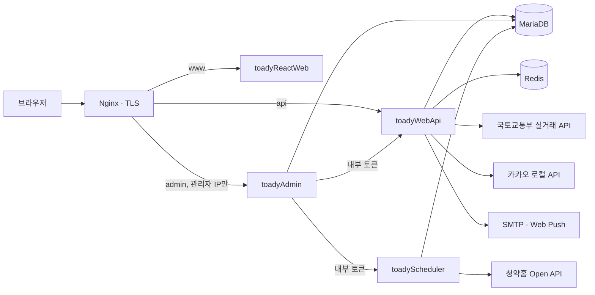
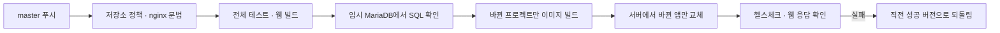

# TOADY

청약 공고를 찾고, 위치와 주변 시세를 확인하고, 다른 사람들 이야기를 보는 일을 한 화면에서 할 수 있게 만든 서비스입니다.

[www.toady.co.kr](https://www.toady.co.kr)

청약을 준비하다 보면 청약홈에서 공고를 찾고, 주소를 지도 앱에 다시 검색하고, 카페에서 분위기를 묻고, 실거래가 사이트에서 주변 시세를 따로 비교하게 됩니다. TOADY는 청약홈과 국토교통부 실거래 공공데이터를 직접 수집해서 이 과정을 공고 상세 화면 하나에서 끝낼 수 있게 합니다. 기획부터 개발, 배포, 운영까지 혼자 하고 있고 실제 도메인으로 서비스 중입니다.

| 프로젝트 | 하는 일 | 기술 |
| --- | --- | --- |
| [toadyReactWeb](toadyReactWeb/README.md) | 사용자 화면 | React 18, MUI 5, Vite |
| [toadyWebApi](toadyWebApi/README.md) | 공고·실거래·회원·커뮤니티 API | Java 21, Spring Boot 3.5 |
| [toadyScheduler](toadyScheduler/README.md) | 청약홈 데이터 수집 | Java 21, Spring Boot 3.5 |
| [toadyAdmin](toadyAdmin/README.md) | 운영 관리자 사이트 | Kotlin, Spring Boot 3.5, Thymeleaf |

## 할 수 있는 것

공고 찾기
- 월별 청약 캘린더(PC와 모바일 화면을 따로 만듦), 지역·공급유형 필터, 전체 기간 자동완성 검색
- 운정·동탄·검단 같은 생활권 단위 검색, 이번 주 청약, 지역별 청약, 무순위(줍줍) 모음
- APT, 도시형·오피스텔, 잔여세대, 공공지원민간임대, 임의공급 5개 유형을 한 목록으로

공고 상세
- 공급유형별 일정, 주택형별 분양가, 모집공고문, 경쟁률·당첨가점·특별공급 현황
- 분양가와 주변 시세 비교: 같은 면적(±5㎡), 최근 6개월 실거래 범위와 비교하고 신축 기준도 고를 수 있음
- 실거래 지도: 주변 단지 가격 말풍선, 면적·가격·연식 필터, 거리 재기, 반경 그리기와 반경 안 시세 요약, 주소·장소 검색
- 단지별 이야기(댓글·답글), 경쟁률 예상 투표, 이미지로 저장·공유
- 이야기 작성자에게 1:1 쪽지, 차단, 신고

다시 오게 만드는 것
- 가점 계산기, 조건에 맞는 공고 찾기(맞춤 청약)
- 나의 청약: 관심 공고 저장, 신청 예정부터 입주까지 진행 단계, 메모, 비교
- 웹 푸시(관심 공고 일정, 생활권 새 공고, 주간 브리핑), 이메일 일정 알림, 캘린더 구독(ICS)

운영
- 관리자 사이트: 방문·재방문·유입 지표, 회원 제재, 이야기 숨김, 신고 처리, 공지·FAQ·생활권 편집, 수집 실행과 일정 관리
- 검색엔진용 서버 HTML(공고·생활권·이번 주·무순위·FAQ), 사이트맵, 새 공고 RSS, 공유 미리보기 이미지. 공고 주소 `/announcements/…`는 하나만 쓰고, 사람에게는 앱 화면을, 검색·공유 봇에게는 서버 HTML을 줍니다.

## 구성



- 네 앱은 한 저장소에서 관리하고 각각 컨테이너로 띄웁니다. 서버는 AWS Lightsail 한 대(메모리 2GB)이고 Docker Compose로 운영합니다.
- 수집기와 API는 같은 DB를 쓰지만 JVM을 나눴습니다. 외부 API를 기다리거나 대량으로 저장하는 일이 사용자 요청의 스레드와 메모리를 잡아먹지 않게 하려는 것입니다. 서버나 DB 장애까지 나눠 주지는 않습니다.
- Redis에는 API의 요청 제한 기록과 외부 API 결과 캐시를 둡니다. Redis가 멈춰도 API는 메모리로 대신 동작합니다.

### 데이터가 들어오는 시간

| 작업 | 시각(한국시간) | 범위 |
| --- | --- | --- |
| 공고·주택형 | 매일 03:15 | 모집공고일 기준 최근 90일 |
| 경쟁률·가점·특별공급 | 매일 04:15, 20:15 | 최근 90일 |
| 일정 맞춤 경쟁률·가점 | 매시 정각, 18~21시와 7~11시는 10분마다 | 접수일·발표일에 걸린 공고만 |

경쟁률은 접수일 저녁에, 가점은 발표일 오전에 올라오는데 하루 두 번 수집으로는 반나절씩 늦었습니다. 그렇다고 90일치를 10분마다 다시 받으면 공공데이터 하루 호출 한도를 넘깁니다. 그래서 DB에 있는 일정을 보고 지금 결과가 나올 공고만 골라 자주 부르는 작업을 따로 두었습니다. 대상이 없으면 외부 호출을 하지 않고, 놓친 건 매일 도는 90일 재조회가 채웁니다.

## 개발하면서 신경 쓴 부분

### 형식이 다른 공고 5종을 한 캘린더로
청약홈은 공고 유형마다 API, 필드 이름, 날짜 형식(`yyyy-MM-dd`, `yyyyMMdd`)이 다릅니다. 저장은 유형별 테이블 그대로 두고, 조회할 때 유형별 Repository에 같은 검색 조건을 건 다음 공통 형태(`AnnouncementListItem`)로 바꿔 접수 시작일 순으로 합칩니다. 목록의 댓글 수는 그 페이지 공고들 것을 한 번에 세서 N+1 조회가 생기지 않게 했습니다.
[AnnouncementSearchService](toadyWebApi/src/main/java/com/toady/web/app/announcement/service/AnnouncementSearchService.java) · [AnnouncementListMapper](toadyWebApi/src/main/java/com/toady/web/app/announcement/service/AnnouncementListMapper.java)

### 수집 결과가 이상해도 기존 데이터는 지키기
- 응답의 `matchCount`만큼 다 받을 때까지 페이지를 넘기고, 중간에 건수가 바뀌거나 모자라면 저장하지 않습니다.
- 제공처가 빈 응답을 주면 이미 저장된 주택형·경쟁률을 지우지 않습니다. 바뀐 행만 트랜잭션 안에서 교체합니다.
- MariaDB advisory lock으로 수집이 겹치지 않게 하고, 401·403·429를 받으면 바로 멈춰서 하루 한도를 더 쓰지 않습니다.

[ApplyhomeSyncService](toadyScheduler/src/main/java/com/toady/web/apt/service/ApplyhomeSyncService.java) · [ApplyhomeSyncLock](toadyScheduler/src/main/java/com/toady/web/apt/service/ApplyhomeSyncLock.java)

### 위치는 확정, 후보, 미확인으로 나눠서
분양 공고 주소는 지번 대신 "○○지구 3블록"인 경우가 많습니다. 지번이나 도로명이 정확하고 시군구까지 맞을 때만 핀을 찍고, 단지명으로 찾은 결과는 후보로만 보여 줍니다. 지구·블록 주소는 법정동 일대를 점선 원으로 표시합니다. 특정 단지만을 위한 예외 처리는 넣지 않고 모든 공고에 같은 규칙을 씁니다.
[resolveLocation.js](toadyReactWeb/src/features/announcement/location/resolveLocation.js)

### 실거래 지도를 호출 한도 안에서
지도를 움직이면 화면에 걸친 시·군·구마다 12개월치 거래를 불러야 합니다.
- 시군구·월 단위로 캐시하고, 정해진 시간 안에 못 받은 달은 일부 결과(partial)로 먼저 보낸 뒤 화면이 이어서 받습니다.
- 국토부 호출은 동시에 3개, 0.12초 간격으로 보내고, 429나 한도 초과를 받으면 전체 호출을 잠시 멈춥니다.
- 실거래 자료에는 좌표가 없어서 지번을 카카오로 좌표 변환해 DB에 남깁니다.
- 받은 결과는 Redis에도 둬서 배포 직후에 같은 조회로 한도를 다시 쓰지 않습니다.

[NeighborhoodResearchService](toadyWebApi/src/main/java/com/toady/web/app/planner/research/NeighborhoodResearchService.java) · [ComplexPriceService](toadyWebApi/src/main/java/com/toady/web/app/planner/research/ComplexPriceService.java)

### 팝업과 뒤로가기
모바일에서 뒤로가기를 누르면 화면이 통째로 닫히거나, 닫은 팝업이 다시 열리는 문제가 있었습니다. 팝업을 히스토리 state의 레이어로 다뤄서 맨 위 레이어만 뒤로가기로 닫고, 아래 레이어를 닫을 때는 위에 쌓인 것까지 같이 걷어 냅니다. 새로고침해도 같은 화면이 돌아옵니다.
[useHistoryOverlay](toadyReactWeb/src/hooks/useHistoryOverlay.js) · [overlay.util.js](toadyReactWeb/src/utils/overlay.util.js)

### 로그인과 남용 막기
- JWT에 비밀번호에서 만든 확인값을 넣어서, 비밀번호를 바꾸거나 계정이 잠기면 다른 기기의 토큰이 바로 막힙니다. 토큰을 갱신해도 처음 로그인한 시각을 이어받아 14일이 지나면 다시 로그인해야 합니다.
- 요청 제한과 로그인 실패 기록은 Redis 정렬 집합에 두고, 한도 확인과 기록을 Lua 스크립트 한 번으로 처리합니다. 배포해도 제한이 풀리지 않습니다. Redis가 응답하지 않으면 300ms 안에 포기하고 30초 동안 메모리로 대신합니다.
- 계정 변경은 회원 행을 잠근 뒤 잠금 안에서 다시 검사합니다.

[JwtProviderImpl](toadyWebApi/src/main/java/com/toady/web/core/security/jwt/impl/JwtProviderImpl.java) · [AccountService](toadyWebApi/src/main/java/com/toady/web/app/user/service/AccountService.java) · [SlidingWindows](toadyWebApi/src/main/java/com/toady/web/core/redis/SlidingWindows.java)

### Gmail 하루 한도 안에서 인증 메일 지키기
Gmail 계정 하나(하루 약 500통)로 가입 인증, 비밀번호 찾기, 일정 알림을 다 보냅니다. 최근 24시간 발송 시도를 DB에서 세고, 알림이 한도를 다 쓰지 못하게 인증용 여유분을 남겨 둡니다. 결과가 불확실한 발송은 자동으로 다시 보내지 않습니다.
[MailBudget](toadyWebApi/src/main/java/com/toady/web/app/planner/MailBudget.java)

### 개인정보 없이 방문 측정
회원 ID, 검색어, 전체 URL은 보내지 않고 브라우저마다 만든 무작위 ID로 페이지 조회와 행동(상세 열람, 관심 저장, 알림 켬)을 남깁니다. 관리자 화면에서 주간 방문·재방문, 유입 도메인, 방문부터 알림까지 이어지는 흐름을 봅니다.
[MetricsService](toadyAdmin/src/main/kotlin/com/toady/admin/metrics/MetricsService.kt) · [UsageEventController](toadyWebApi/src/main/java/com/toady/web/app/analytics/UsageEventController.java)

### 메모리 2GB 서버에서 배포하기
배포 때 API가 잠깐 끊기는 게 싫어서 블루/그린 배포를 넣었다가, 새 컨테이너와 기존 컨테이너의 JVM이 동시에 뜨면서 메모리가 바닥나 서버가 멈춘 적이 있습니다. 블루/그린은 되돌렸습니다. 대신 바뀐 프로젝트만 빌드하고, 이미지가 바뀐 앱만 재시작하도록 바꿨습니다. 화면만 고친 배포라면 API는 재시작하지 않습니다. swap 2GB도 같이 넣었습니다.
[deploy.yml](.github/workflows/deploy.yml)

## 테스트와 배포

| 프로젝트 | 테스트 수 | 주로 확인하는 것 |
| --- | --- | --- |
| toadyWebApi | 213 | 통합 공고 조회, 가입부터 비밀번호 변경까지 흐름, 토큰 무효화, 요청 제한, 실거래 호출 조절, 쪽지·차단·신고, Redis 대체 동작 |
| toadyScheduler | 72 | 청약홈 응답 매핑, 건수 검증, 빈 응답 보호, 수집 작업과 일정, 일정 맞춤 대상 선정, 보관 기간 정리, `database.sql` 전체 실행 |
| toadyAdmin | 30 | 로그인 제한·CSRF, 회원 제재, 이야기 숨김, 지표 집계, 수집기 장애 때 화면 |
| toadyReactWeb | 164 | JSDOM에 실제 앱을 띄운 화면 흐름, 히스토리 레이어, 토큰 경합, 위치 판정, 지도 규칙 |
| scripts | 27 | 배포 스크립트의 재시작 대상 선정, 롤백, 설정 누락 시 중단 |

외부 API 키나 실제 DB 없이 돌아갑니다. Redis 통합 테스트 2개는 CI에서만 Redis를 띄워 실행합니다.



## 저장소 구조

```text
.
├── toadyReactWeb/       사용자 화면
├── toadyWebApi/         API, 검색엔진용 HTML, 사이트맵
├── toadyScheduler/      청약홈 수집기
├── toadyAdmin/          관리자 사이트
├── nginx/               앞단 nginx 설정 원본
├── scripts/             저장소 검사, 배포 확인, 배포 스크립트 테스트
├── .github/workflows/   검증·배포 파이프라인
├── docker-compose.yml   운영 구성(앱 4개, MariaDB, Redis, Nginx, Certbot)
└── database.sql         DB 변경 SQL(구역 번호로 관리)
```

## 로컬에서 실행

Java 21, Node.js 22가 필요합니다.

```bash
(cd toadyWebApi && ./gradlew test)
(cd toadyScheduler && ./gradlew test)
(cd toadyAdmin && ./gradlew test)
(cd toadyReactWeb && npm ci && npm test && npm run build)
python3 scripts/check-repository.py
```

화면은 `toadyReactWeb`에서 `npm run dev`로 띄우면 `http://localhost:3000`에서 열리고, `/api` 요청은 `localhost:8081`의 API로 넘깁니다. API와 수집기를 띄우려면 MariaDB와 각 프로젝트의 `.env`가 필요합니다. Redis는 없어도 됩니다(`REDIS_HOST`를 비우면 메모리로 동작).

저장소에는 전체 초기 스키마가 없습니다. `database.sql`은 운영 DB에 적용해 온 변경 SQL을 구역 번호로 모아 둔 파일입니다.

## 저장소에 올리지 않는 것

- `.env*`, 인증서와 키, 빌드 결과물, 로그. 환경 설정은 값이 빈 `.env.example`만 올립니다.
- `VITE_*` 값은 브라우저 번들에 그대로 들어가므로 서버 비밀값을 넣지 않습니다.
- `scripts/check-repository.py`가 파일 규칙과 키처럼 보이는 문자열을 검사하고, CI에서도 같은 검사를 돌립니다.

---

<details>
<summary><b>운영 메모</b> (배포, Redis, Nginx와 인증서, DB 변경)</summary>

### 서버
- AWS Lightsail 1대, 메모리 2GB, swap 2GB. 앱 JVM 3개와 MariaDB, Redis, Nginx가 같이 돕니다. CPU보다 메모리가 먼저 모자랍니다.
- 공인 IP가 고정이 아니라서 인스턴스를 중지했다가 시작하면 IP가 바뀝니다. 그때는 DNS A 레코드 4개와 GitHub Actions 비밀값 `EC2_HOST`를 같이 바꿔야 합니다. 서버가 멈추면 중지/시작보다 재부팅을 먼저 해 봅니다.

### 배포와 롤백
- `master`에 푸시하면 GitHub Actions가 검증한 뒤 이미지를 커밋 SHA 태그로 Docker Hub에 올리고, 서버의 `~/toady`에서 Compose로 바꿉니다.
- 빌드는 직전 푸시 이후 폴더가 바뀐 프로젝트만 합니다. 바뀌지 않은 이미지는 직전 이미지에 새 태그만 붙이기 때문에 어느 커밋 태그로 되돌려도 이미지 4개가 다 있습니다.
- 서버는 새 이미지 ID가 지금 컨테이너와 다른 앱만 다시 만듭니다. `docker-compose.yml`이 바뀌면 전부, 앱 폴더의 `.env.prod`가 지난 성공 배포 이후 바뀌었으면 그 앱도 다시 만듭니다(`~/toady/.deployed-env-sums`에 기록).
- 카카오 지도 키(`VITE_KAKAO_MAP_KEY`)를 바꾸거나 기반 이미지를 새로 받고 싶으면 Actions의 Run workflow로 전부 다시 빌드합니다.
- 배포 확인에 실패하면 교체했던 앱만 직전 성공 태그로 되돌립니다. DB 변경은 되돌리지 않습니다.
- 관리자 사이트는 서버에 `toadyAdmin/.env.prod`가 채워져 있을 때만 같이 배포됩니다.
- 일정 맞춤 수집이 들어가기 전 스케줄러(`496da74` 이전)로 직접 되돌릴 때는 먼저 `DELETE FROM TB_SCHEDULER_ADMIN_SCHEDULE WHERE JOB_KIND='SCHEDULED_RESULTS'`를 실행합니다. 이전 버전은 이 작업 종류와 `|`로 이은 cron을 읽지 못합니다.

손으로 배포할 때:
```bash
cd ~/toady
export DOCKER_USERNAME=dukkeoba IMAGE_TAG=배포할_커밋_SHA
docker-compose -p toady pull toadyWebApi toadyScheduler toadyAdmin toadyReactWeb
docker-compose -p toady up -d --no-deps toadyWebApi toadyScheduler toadyAdmin toadyReactWeb
docker exec nginx nginx -s reload
bash scripts/check-deployment.sh
```

`check-deployment.sh`는 API·수집기의 `/internal/health`(DB 연결 포함), 웹 응답, 컨테이너 상태, 서버 자신을 거친 `https://www.toady.co.kr/` 응답을 확인합니다. 없는 테이블이나 Redis 연결 실패는 경고만 남깁니다.

### Redis
- API의 요청 제한·로그인 실패 기록과 외부 API 결과 캐시(국토부 실거래 6시간, 카카오 주변 시설 1일)를 둡니다.
- `redis` 컨테이너는 외부 포트 없이 Compose 네트워크 안에서만 씁니다. 메모리는 96MB까지, 넘으면 오래 안 쓴 키부터 지우고, 5분마다 스냅샷을 남깁니다.
- 비밀번호는 서버의 `toadyWebApi/.env.prod`에 `REDIS_PASSWORD=`(16자 이상)로 넣습니다. Redis와 API가 같은 값을 읽고, 이 값이 없으면 배포가 컨테이너를 건드리지 않고 멈춥니다.
- 비밀번호나 Redis 설정을 바꾸면 다음 배포가 Redis와 API를 같이 다시 만듭니다.
- 확인: `curl -s 127.0.0.1:8080/internal/health`에서 `"redis":"UP"`, 메모리는 `docker exec redis sh -c 'REDISCLI_AUTH="$REDIS_PASSWORD" redis-cli info memory' | grep used_memory_human`.

### Nginx와 인증서
- 도메인: `www.toady.co.kr`(서비스), `api.toady.co.kr`(API), `admin.toady.co.kr`(관리자, 허용한 IP만). `toady.co.kr`은 www로 301 이동합니다.
- 앞단 설정 원본은 [nginx/toady.conf](nginx/toady.conf)이고 CI가 같은 nginx 이미지로 문법을 검사합니다. 서버의 `/usr/local/dockerVolumes/nginx/conf.d/toady.conf`에 복사한 뒤 `docker exec nginx nginx -t && docker exec nginx nginx -s reload`로 적용합니다.
- 관리자 허용 IP는 저장소에 두지 않고 서버의 `conf.d/admin-allow.inc`에만 둡니다(형식은 [nginx/admin-allow.inc.example](nginx/admin-allow.inc.example)).
- 모든 프록시 블록에 `proxy_set_header X-Real-IP $remote_addr;`가 있어야 합니다. API 요청 제한과 관리자 로그인 실패 제한이 이 값을 씁니다.
- 인증서 하나(`toady.co.kr-0002`)에 네 도메인을 담습니다. 도메인을 추가할 때는 DNS를 먼저 만든 뒤 `docker-compose -p toady run --rm --no-deps certbot`으로 다시 받고 nginx를 reload합니다. 갱신은 서버 cron으로 돌립니다.
  ```cron
  0 4 * * 1 cd /home/ec2-user/toady && docker-compose -p toady run --rm --no-deps certbot renew && docker exec nginx nginx -s reload
  ```

### DB 변경 (`database.sql`)
모든 앱이 `ddl-auto=none`이라 테이블은 배포 전에 관리 계정으로 직접 만듭니다. 대부분 `IF NOT EXISTS` 형태라 이미 적용한 구역을 다시 돌려도 됩니다. 주석으로만 둔 구역(4~6)과 권한 문은 실제 구조를 확인하고 따로 실행합니다.

```bash
mariadb -h DB호스트 -u 관리계정 -p DB이름 < database.sql
```

| 구역 | 내용 |
| --- | --- |
| 1 | 수집 실행 이력, 자동 일정 |
| 2 | 공고 이야기(댓글) |
| 3 | 경쟁률, 당첨가점, 특별공급 현황 |
| 4~6 | 도시형 주택형 PK 변경, 권한, 인증 메일 본문 확장(참고용 주석) |
| 7~9 | 방문 로그, 관심 공고·메일 발송량·알림 이력, 익명 행동 기록 |
| 10~13 | 유입 도메인, 캘린더 구독, 경쟁률 예상 투표, 웹 푸시 |
| 14·15 | 지표·푸시 인덱스, 보관 기간 정리 권한, 새 공고 판정 시각 |
| 16~18 | 나의 청약 진행 단계, 경쟁률 모델번호 길이, 주변 시세 비교 요약 |
| 19~21 | 관리자 전용 DB 계정, 지표에서 뺄 운영자 브라우저, 숨긴 이야기 기록 |
| 22~24 | 실거래 단지 좌표, 프로필 캐릭터, 회원별 이야기 인덱스 |
| 25 | 차단, 신고, 쪽지 |
| 26 | 관리자 작업 이력, 회원 제재, 금칙어, 공고 숨김·정정 |
| 27 | 공지, FAQ, 생활권, 서비스 설정, 사용량, 검색 통계, 운영팀 이야기, 회원 메모 |
| 28 | 일정 맞춤 수집 이력 인덱스와 정리 권한 |

</details>
