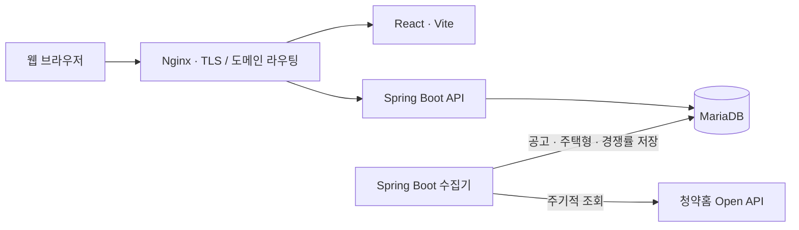
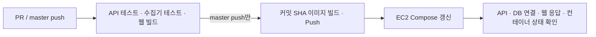

# TOADY · 청약 일정 캘린더 및 분양 정보 플랫폼

**유형별로 나뉜 청약홈 공공데이터를 모아, 청약 일정부터 경쟁률·당첨 가점까지 한 화면에서 확인하는 웹 서비스입니다.**

월별 일정 조회, 생활권·지역 검색, 관심 공고와 나의 청약 일정, 준비 체크리스트·메모·비교, 지도·동네 실거래 조회 동선을 제공합니다. 프론트엔드·API·데이터 수집기를 별도 애플리케이션으로 구성하고 Docker Compose로 배포합니다.

[서비스 바로가기](https://www.toady.co.kr) · [API 문서](https://www.toady.co.kr/swagger-ui/index.html)

## 프로젝트에서 해결한 문제

청약 정보는 주택 유형별로 API와 데이터 형식이 나뉘어 있습니다. 같은 접수 일정도 필드명과 날짜 형식이 달라, 그대로는 하나의 캘린더와 검색 결과로 표현하기 어렵습니다. 또 사용자 요청마다 외부 API를 호출하면 외부 서비스의 응답 지연에 영향을 받습니다.

TOADY는 **데이터 수집을 사용자 요청 처리와 분리**하고, 저장된 공고를 **공통 목록 계약으로 변환**해 캘린더와 검색 화면에 제공합니다.

| 구현 범위 | 내용 |
| --- | --- |
| 사용자 화면 | 데스크톱·모바일 캘린더, 지역·공급유형 필터, 전체 기간 자동완성, 상세 패널 |
| API | 5개 공고 유형 통합 조회, 상세·경쟁률·가점, JWT 인증, 이메일 인증, 댓글 |
| 수집 | 공고·주택형·경쟁률 수집, 페이지 순회, 중복 실행 방지, 기존 데이터 갱신 |
| 운영 구성 | Docker Compose, Nginx·TLS 연동, GitHub Actions 검증·이미지 배포 |

## 주요 사용자 흐름

1. 캘린더에서 월별 청약 일정을 확인하고 지역·공급유형을 선택합니다.
2. 지역이나 단지명으로 검색합니다. 전체 기간 검색 결과를 선택하면 해당 접수 월로 이동합니다.
3. 공고를 선택해 상세, 경쟁률·가점, 위치, 댓글을 확인합니다.
4. 내게 맞는 청약에서 조건을 한 번 고르면 넣을 수 있는 공고와 가능한 특별공급, 분양가 대비 주변 실거래, 입주까지 필요한 자금을 함께 봅니다.
5. 로그인한 사용자는 공고에 댓글과 답글을 작성하고 본인 글을 수정·삭제합니다.

## 시스템 구성



세 앱은 하나의 저장소에서 관리하며 별도 애플리케이션·컨테이너로 실행합니다. 수집기와 API는 서로 다른 JVM을 사용하고 MariaDB를 공유합니다. 현재 배포 구성은 AWS EC2의 Docker Compose를 기준으로 합니다. 기본 자동 수집은 한국시간 공고·주택형 매일 03:15, 경쟁률·가점·특별공급 현황 매일 04:15와 20:15에 실행하며 90일 전부터 오늘까지의 공고를 재조회합니다. 시각은 일 단위 갱신 문서를 바탕으로 정한 운영 정책입니다.

| 영역 | 사용 기술 |
| --- | --- |
| Frontend | React 18, Vite 5, TanStack Query v5, Zustand, MUI, FullCalendar |
| Backend | Java 21, Spring Boot 3.5, Spring Data JPA, Spring Security, JWT |
| 수집 관리자 | Thymeleaf, 세션 인증, 기간별 백필, DB 기반 자동 스케줄·실행 이력 |
| Data | MariaDB, 청약홈 Open API, Spring `@Scheduled` |
| Validation | JUnit 5, Spring Boot Test, Mockito, H2 |
| Delivery | Docker, Docker Compose, Nginx, Certbot, GitHub Actions |
| DB 설정 | 직접 실행하는 단일 `database.sql` |

## 설계 판단과 구현 근거

### 1. 수집기와 사용자 API의 실행 경계 분리

외부 API 대기와 데이터 적재가 사용자 요청과 같은 JVM의 스레드·메모리를 직접 사용하지 않도록 수집기를 분리했습니다. 수집기는 조회·변환·저장을 담당하고, API는 DB의 데이터를 조회해 응답합니다.

대신 호스트와 DB는 공유하므로 DB 부하나 호스트 장애까지 격리되지는 않습니다. 현재 규모에서 운영 복잡도를 제한하면서 필요한 실행 경계를 확보한 구성입니다.

구현: [수집 동기화 서비스](toadyScheduler/src/main/java/com/toady/web/apt/service/ApplyhomeSyncService.java) · [스케줄 실행](toadyScheduler/src/main/java/com/toady/web/apt/scheduler/ApplyhomeSyncScheduler.java)

### 2. 서로 다른 5개 공고 유형을 공통 목록으로 통합

APT·URBAN·REMAINING·PUBLIC_RENTAL·OPTIONAL은 저장 테이블과 접수일 필드가 다릅니다. 유형별 Repository에 검색 조건을 적용하고, 공통 `AnnouncementListItem`으로 변환한 뒤 접수 시작일 기준으로 병합·정렬합니다. 날짜 비교에서는 `yyyy-MM-dd`와 `yyyyMMdd`의 차이를 정규화합니다.

유형별 저장 구조를 유지하면서 클라이언트에 일관된 목록을 제공합니다. 다만 깊은 페이지일수록 가져오는 후보가 늘어납니다. 실제 데이터량과 응답 시간을 측정한 뒤 DB 통합 조회나 공통 조회 테이블을 검토할 지점입니다.

구현: [검색 서비스](toadyWebApi/src/main/java/com/toady/web/app/announcement/service/AnnouncementSearchService.java) · [유형별 DTO 변환](toadyWebApi/src/main/java/com/toady/web/app/announcement/service/AnnouncementListMapper.java)

### 3. 현재 월을 넘어서는 검색과 캘린더 이동

현재 월 데이터만 검색하면 과거 공고를 찾을 수 없습니다. 별도 자동완성 API가 전체 기간의 주택명·주소를 검색하고, 화면에서는 2자 이상 입력 시 300ms 디바운스를 적용합니다. 결과를 선택하면 접수 월로 이동하고 상세 패널을 엽니다. 입력이 바뀐 뒤 도착한 이전 요청의 응답은 무시합니다.

구현: [검색·필터 훅](toadyReactWeb/src/views/main/hooks/useAnnouncementSearch.js) · [필터 UI](toadyReactWeb/src/views/main/components/AnnouncementFilters.jsx)

### 4. 수집 데이터의 누락·중복과 동시 실행 대응

- 응답의 `matchCount`에 도달할 때까지 페이지를 조회하고, 예상 건수에 못 미친 상태에서 빈 페이지가 오면 실패 처리합니다.
- 공고 복합키로 연결된 주택형을 조회합니다. 일반 데이터는 JPA `merge`, 경쟁률은 `ON DUPLICATE KEY UPDATE`로 갱신합니다.
- 도시형 주택형은 실제 `ID`를 식별자로 조회하며, 공고별 최신 응답과 DB를 비교해 변경 없는 행은 유지하고 사라지거나 변경된 행은 트랜잭션 안에서 교체합니다. 응답 내 동일 행은 중복 저장하지 않습니다.
- MariaDB advisory lock을 획득한 실행만 동기화를 진행합니다.

구현: [동기화](toadyScheduler/src/main/java/com/toady/web/apt/service/ApplyhomeSyncService.java) · [DB 잠금](toadyScheduler/src/main/java/com/toady/web/apt/service/ApplyhomeSyncLock.java) · [경쟁률 저장](toadyScheduler/src/main/java/com/toady/web/apt/service/ApplyhomeCompetitionPersistenceService.java)

### 5. 기능 변경의 영향을 줄이는 책임 분리

메인 화면의 검색·필터, 필터 UI, 공고 원문 표시를 훅과 컴포넌트로 분리했습니다. 서버 상태는 TanStack Query로 관리하며 댓글 변경 후 관련 쿼리를 무효화합니다. API의 공고 조회 진입점은 유지하고 검색·상세·경쟁률 서비스를 나눴습니다.

구현: [메인 화면](toadyReactWeb/src/views/main/Main.jsx) · [공고 Query 훅](toadyReactWeb/src/features/announcement/hooks/useAnnouncements.js) · [조회 진입점](toadyWebApi/src/main/java/com/toady/web/app/announcement/service/AnnouncementService.java)

## 수집 관리자

`toadyScheduler`에 Thymeleaf 관리자 화면을 제공합니다. 공고·주택형, 전체 경쟁률·가점·특별공급, APT 가점 단독 및 전체 수집을 기간별로 실행하고 자동 스케줄 사용 여부·cron·재조회 일수를 관리합니다. 과거 가점이 자동 재조회 범위 밖이면 관리자 화면에서 모집공고일을 지정해 복원할 수 있습니다.

`/admin/metrics`에서는 최근 8주 방문자·세션·재방문 비율·활성 탐색자(한 주에 공고 2개 이상 열람 또는 관심 저장)·관심 저장·공유와 최근 28일 유입 경로를 확인합니다. API가 쌓는 `TB_PAGE_VIEW`·`TB_USAGE_EVENT`를 읽으므로 스케줄러 DB 계정에 두 테이블의 SELECT 권한이 필요합니다.

기본값은 비활성화이며 관리자 테이블 두 개와 계정을 준비한 뒤 활성화합니다. [테이블 생성 SQL](database.sql)과 [관리자 활성화·접속 안내](toadyScheduler/README.md#thymeleaf-수집-관리자)를 참고하세요. 현재 실행 상태는 5초마다 갱신되며 중지 요청·같은 기간 재실행도 지원합니다.

## 검증과 배포

PR과 `master` push에서 API·수집기의 단위 및 H2 회귀 테스트, 프론트 회귀 테스트·빌드와 격리된 MariaDB 검증을 수행합니다. `master` 배포는 검증 성공 후 진행하며 세 이미지를 동일한 커밋 SHA로 태깅합니다. 배포 후에는 API·스케줄러의 준비 상태와 DB 연결, 웹 응답, 앱 컨테이너 실행 상태를 확인합니다.



| 검증 범위 | 근거 |
| --- | --- |
| 통합 공고 조회·날짜 필터·자동완성·인증 등 | [API 통합 테스트](toadyWebApi/src/test/java/com/toady/web/MainApplicationTests.java) |
| 가입 → 이메일 인증 → 로그인 → 댓글 CRUD·소유권 → 비밀번호 변경·기존 JWT 거부 | [사용 흐름 통합 테스트](toadyWebApi/src/test/java/com/toady/web/ApplicationFlowRegressionTest.java) |
| 가입 실패 롤백·인증 코드 동시 사용·재발송 | [인증 트랜잭션 테스트](toadyWebApi/src/test/java/com/toady/web/CertifyTransactionTest.java) |
| 댓글 커서·신규 등록/삭제·동일 시각 정렬·게시글 공개 기간·잘못된 입력 | [사용 흐름 회귀 테스트](toadyWebApi/src/test/java/com/toady/web/ApplicationFlowRegressionTest.java) |
| 탭 간 계정 변경·이전 응답 차단·캐시 취소·지도 SDK 타임아웃 | [프론트 회귀 테스트](toadyReactWeb/tests/announcement-auth.test.mjs) |
| DB 연결 성공·실패 시 준비 상태 응답 | [준비 상태 테스트](toadyWebApi/src/test/java/com/toady/web/core/health/HealthControllerTest.java) |
| 외부 API 요청 구성·매핑·수집 흐름 | [수집기 테스트](toadyScheduler/src/test/java/com/toady/web/apt) |
| 배포 전 검증·커밋별 이미지 배포 | [GitHub Actions](.github/workflows/deploy.yml) |
| 배포 후 준비 상태 대기·실패 처리 | [확인 스크립트](scripts/check-deployment.sh), [격리된 배포 검증 테스트](scripts/tests/test_deployment.py) |

H2 회귀 테스트는 PK 매핑·날짜 정렬·스냅샷 갱신을, 프론트 테스트는 전체 페이지 조회·토큰 갱신·늦은 인증 응답 처리를 검증합니다. 별도 `mariadbTest`로 개발 DB의 실제 PK·SQL·DML도 확인할 수 있습니다. 테스트 결과는 운영 부하나 가용성을 측정한 수치가 아니며, 프론트 빌드에는 번들 크기 경고가 남아 있습니다.

전체 흐름 점검은 개별 기능 테스트와 함께 위 통합 시나리오를 실행합니다. 공유 공고·주택형 10개 테이블의 API/수집기 매핑과 경쟁률 관련 8개 테이블의 SQL/수집 복합키도 대조했습니다. 실제 운영 DB의 스키마, 외부 API의 최신 응답, 운영 Nginx·DNS·TLS와 실제 기기/메일 클라이언트의 동작은 이 로컬 검증과 별도로 확인해야 합니다. 로컬 점검 중 실제 메일을 발송하거나 운영 DB 데이터를 변경하지 않습니다.

추가한 배포 구성은 로컬 Docker 및 운영 환경에서 실행 검증하지 않았습니다. 배포 후 확인은 외부 DNS·수집 완료를 보장하지 않으며, 무중단 배포는 구현하지 않았습니다. 배포 확인에 실패하면 앱 컨테이너만 마지막 성공 태그로 자동으로 되돌립니다(DB 변경은 되돌리지 않음).

## 저장소 안내

```text
.
├── toadyReactWeb/           # React 화면 · API 클라이언트 · 서버 상태 관리
├── toadyWebApi/             # 공고 조회 · 인증 · 댓글 REST API
├── toadyScheduler/          # 청약홈 데이터 수집 · 저장
├── scripts/                # 배포 후 상태 확인
├── .github/workflows/      # 검증 및 배포 파이프라인
├── docker-compose.yml      # 운영 앱 · DB · Nginx · Certbot 구성
└── database.sql            # 공유 DB 테이블 생성·수동 변경 참고 SQL
```

[프론트엔드 실행 안내](toadyReactWeb/README.md) · [API 실행·명세](toadyWebApi/README.md) · [수집기 실행·설정](toadyScheduler/README.md)

## 로컬에서 확인하기

필요 환경은 Java 21, Node.js 22, npm입니다. 기본 테스트에는 실제 DB와 청약홈 API 키가 필요하지 않습니다. 개발 DB 검증은 API 폴더에서 `bash ./gradlew mariadbTest`로 별도 실행하며, 고유한 테스트 행의 변경은 롤백합니다. 상세 설정은 API README를 참고하세요.

```bash
# 저장소 루트에서 실행
(cd toadyWebApi && bash ./gradlew test)
(cd toadyScheduler && bash ./gradlew test)
(cd toadyReactWeb && npm ci && npm test && npm run build)
```

화면 개발 서버는 다음과 같이 실행합니다.

```bash
cd toadyReactWeb
cp .env.example .env.local
npm ci
npm run dev
```

`http://localhost:3000`에서 열리며, 데이터 조회·인증에는 `localhost:8081`의 API가 필요합니다. 지도는 본인의 Kakao JavaScript 키를 설정한 경우 사용할 수 있습니다.

**전체 서비스 실행에는 별도로 준비된 MariaDB 스키마가 필요합니다.** 현재 저장소는 전체 초기 스키마를 제공하지 않으며 `ddl-auto=none`입니다. `database.sql`은 댓글·경쟁률·관리자 테이블의 추가 설정이며, 공고 상세·주택형·회원 등을 포함한 전체 DB 초기화 파일은 아닙니다. API·수집기 실행 전 각 README와 [공유 DB 변경 관리](#공유-db-변경-관리)를 확인하세요.

## 저장소 관리

- 소스·테스트·문서·SQL·Gradle Wrapper·`package-lock.json`은 추적합니다.
- 실제 환경 설정, 인증서·개인키, IDE 설정, 의존성, 빌드 산출물, 로그·DB 백업은 제외합니다.
- 환경 설정은 `.env.example` 등 값이 비어 있거나 예시인 파일만 공개합니다.
- 프론트엔드는 npm으로 통일하고, 사용하지 않는 기존 폰트와 Yarn 잠금 파일은 추적에서 제외합니다.
- `VITE_*` 값은 브라우저 번들에 포함됩니다. DB 비밀번호·JWT 비밀키·서버용 API 키를 넣지 않습니다.

README는 루트와 세 애플리케이션의 최상위 폴더에 하나씩만 유지합니다. 다른 경로의 README와 이 문서에 통합된 개발 메모는 Git 추적에서 제외합니다. 이미 추적된 금지 파일도 `scripts/check-repository.py`로 검사하며 PR·master CI에 동일하게 적용합니다.

```bash
python3 scripts/check-repository.py
git diff --check
git status --short
git diff --cached --stat
```

검사는 파일 정책과 일부 식별 가능한 키 형식을 확인하며 모든 비밀값 탐지를 보장하지는 않습니다. 스테이징된 diff도 직접 확인합니다. 이미 적용된 Git 이력을 삭제하는 작업은 수행하지 않습니다.


## 수동 배포와 상태 확인

서버에는 Docker Compose, `bash`, `curl`이 필요합니다. 배포 전에 GitHub Actions Secret `VITE_KAKAO_MAP_KEY`와 기존 EC2·Docker Hub Secrets를 설정합니다. 지도 키는 이미지 빌드 시 전달되며, 런타임 환경변수 변경만으로 정적 앱에 반영되지 않습니다.

세 앱의 `DOCKER_USERNAME`, `IMAGE_TAG`를 동일하게 지정해 배포합니다. 새 CI는 커밋 SHA 태그를 사용하고 `latest`를 갱신하지 않습니다.

```bash
cd ~/toady
export DOCKER_USERNAME=dukkeoba
export IMAGE_TAG=배포할_커밋_SHA
docker-compose -p toady pull toadyWebApi toadyScheduler toadyReactWeb
docker-compose -p toady up -d --no-deps toadyWebApi toadyScheduler toadyReactWeb
docker exec nginx nginx -s reload
bash scripts/check-deployment.sh
```

`docker-compose.yml`은 세 앱 이미지에 `${IMAGE_TAG:?...}`를 써서 태그가 없으면 `latest`로 넘어가지 않고 바로 실패합니다. compose는 파일 전체를 해석하므로 `mariadb`·`nginx`·`certbot`만 다루는 명령에도 `IMAGE_TAG`가 필요합니다. CI가 첫 배포에 성공하면 `~/toady/.env`에 `IMAGE_TAG=`를 기록하므로 그 뒤로는 별도 지정 없이 실행됩니다. 이 변경 전에 배포된 서버처럼 `.env`에 값이 없으면 한 번만 다음으로 만듭니다.

```bash
cd ~/toady
umask 077; touch .env
grep -q '^IMAGE_TAG=' .env || printf 'IMAGE_TAG=%s\n' "$(tr -d '[:space:]' < .deployed-image-tag)" >> .env
```

앱 컨테이너를 다시 만들 때는 `--no-deps`를 붙여 compose 설정 변경으로 `mariadb`·`nginx`까지 다시 만들어지지 않게 합니다.

상태 검사는 API `/internal/health`와 DB 연결, 웹 컨테이너의 정적 페이지 응답, 세 앱 컨테이너의 실행·재시작 상태(실패 시 서비스 이름 출력)를 확인합니다. API `/internal/schema`가 알려 주는 누락 테이블은 경고만 남깁니다(`/internal/schema`가 없는 이전 API 이미지는 건너뜀). 이어서 서버 자신에게 `--resolve`로 접속해 앞단 nginx를 거친 `https://www.toady.co.kr/`와 `https://www.toady.co.kr/api/v1/planner/settings`의 HTTP 상태를 확인합니다. 연결 거부·시간 초과·502/503/504는 배포 실패로 보고 롤백하며, DNS·TLS·인증서 오류(curl 종료 코드 6, 35, 51, 60 등)나 예상과 다른 그 밖의 상태는 서버마다 인증서·도메인 구성이 다를 수 있어 경고만 남깁니다(`PUBLIC_HOST`로 도메인 변경 가능). 수집 작업의 완료나 외부 DNS는 검증하지 않습니다.

앞단 nginx는 업스트림 컨테이너 IP를 기억하므로, CI는 앱 컨테이너를 다시 만든 뒤 `docker exec nginx nginx -s reload`를 실행합니다. 수동 배포 후 502가 나면 같은 명령을 실행합니다.

배포 검증은 API와 스케줄러의 `/internal/health` 응답을 기다립니다. 스케줄러는 Spring 초기화·자동 스케줄 등록과 DB 연결이 완료되어야 준비 완료를 반환합니다.

CI는 마지막 검증 성공 태그를 서버 `~/toady/.deployed-image-tag`에 기록하고, 같은 값을 `~/toady/.env`의 `IMAGE_TAG=` 줄에 저장합니다(다른 줄은 유지). 그래서 서버에서 `IMAGE_TAG`를 지정하지 않고 실행하는 `docker-compose` 명령(재시작, certbot 갱신 등)도 `latest`가 아닌 배포된 태그를 씁니다. 이미지 pull, `docker-compose up`, 배포 확인(`check-deployment.sh`) 중 어느 단계가 실패해도 CI는 실패 단계를 출력하고 세 앱 컨테이너를 기록된 이전 태그로 다시 올린 뒤 확인을 한 번 더 실행하고 실패로 끝납니다(롤백 `up` 자체가 실패하면 `ROLLBACK FAILED`를 출력). 성공 기록은 같은 폴더의 임시 파일에 쓴 뒤 `mv`로 교체하며 기존 `.env` 권한을 유지합니다(새로 만들면 600). 이전 기록이 없으면 되돌리지 않고 실패만 알립니다. 이전 커밋 태그를 지정해 수동으로 롤백할 수도 있습니다. 앱 이미지 롤백은 DB 변경을 되돌리지 않습니다.

### Nginx 버전과 인증서 갱신

웹 컨테이너(`toadyReactWeb/Dockerfile`), CI의 `nginx -t` 검사, 앞단 `nginx` 서비스는 모두 `nginx:1.27-alpine`을 씁니다. 앞단 nginx의 버전 변경은 CI 배포(앱 3개만 재생성)로는 적용되지 않고, 서버에서 `docker-compose -p toady pull nginx && docker-compose -p toady up -d --no-deps nginx`로 nginx 컨테이너를 다시 만들 때 적용됩니다. 서버의 기존 설정에 있는 `listen 443 ssl http2;`는 1.25 이후 사용 중단 경고가 출력되지만 그대로 동작합니다(나중에 `listen 443 ssl;` + `http2 on;`으로 바꿀 수 있음). 재생성 전에 `docker run --rm -v /usr/local/dockerVolumes/nginx/nginx.conf:/etc/nginx/nginx.conf:ro -v /usr/local/dockerVolumes/nginx/conf.d:/etc/nginx/conf.d:ro -v /usr/local/dockerVolumes/certbot/conf:/etc/nginx/ssl:ro nginx:1.27-alpine nginx -t`로 문법을 확인합니다(업스트림 이름을 시작 시 해석하는 설정이면 compose 네트워크 밖에서 실패할 수 있으니, 그 경우 오류 내용만 확인).

compose의 certbot은 `--keep-until-expiring`으로 만료가 가까울 때만 다시 발급합니다(이전 `--force-renewal`은 실행할 때마다 재발급해 발급 한도를 소모). 갱신은 서버 cron으로 주 1회 실행합니다.

```cron
# crontab -e (예: 매주 월요일 04:00). cron 환경에는 PATH가 짧으므로 docker-compose 경로를 확인해 넣습니다.
0 4 * * 1 cd /home/ec2-user/toady && docker-compose -p toady run --rm --no-deps certbot renew && docker exec nginx nginx -s reload
```

`--no-deps`는 certbot의 `depends_on`(nginx → 앱)을 다시 띄우지 않게 합니다. 갱신은 최초 발급 때 저장된 webroot 설정을 그대로 씁니다.


## 공유 DB 변경 관리

DB 설정은 루트 [database.sql](database.sql) 한 파일로 관리합니다. 앱과 일반 배포에서 자동 실행하지 않으며, 두 애플리케이션의 `ddl-auto=none` 설정을 유지합니다.

```bash
# 저장소 루트에서 필요한 DB를 선택해 직접 실행
mariadb -h DB호스트 -u 관리계정 -p DB이름 < database.sql
```

| 구역 | 내용 | 실행 방식 |
| --- | --- | --- |
| 1 | 수집 관리자 실행 이력·자동 스케줄 테이블 | 없는 테이블만 생성 |
| 2 | 공고 댓글 테이블 | 없는 테이블만 생성 |
| 3 | 경쟁률·당첨 가점·특별공급 현황 테이블 | 없는 테이블만 생성 |
| 4 | 기존 도시형 주택형의 ID PK 변경 | 참고용 주석, 구조 확인 후 별도 적용 |
| 5 | 기존 권한 부여 명령 | 참고용 주석, 대상 범위·구문 검토 후 별도 적용 |
| 6 | 인증 이메일 본문 컬럼의 TEXT 확장 | 참고용 주석, 미적용 DB에만 별도 적용 |
| 7~9 | 방문 로그, 관심 공고·메일 발송량·알림 이력, 익명 행동 집계 | 없는 테이블만 생성 |
| 10 | 방문 로그의 유입 도메인 컬럼(`REFERRER_HOST`) | 없는 컬럼만 추가, 미적용이어도 API는 유입 없이 저장 |
| 11 | 회원 캘린더 구독 주소(`TB_CALENDAR_FEED`) | 없는 테이블만 생성, 캘린더 연결 배포 전 필수 |
| 12 | 경쟁률 예상 투표(`TB_RATE_POLL`) | 없는 테이블만 생성, 미적용 시 투표 카드만 숨김 |
| 13 | 웹 푸시 구독·생활권 새 공고 판정(`TB_PUSH_SUBSCRIPTION`, `TB_PUSH_AREA_SEEN`) | 없는 테이블만 생성, 미적용 시 알림 켜기 화면만 숨김 |
| 14 | 유입 경로·푸시 발송 조회 인덱스, 스케줄러 계정의 보관 기간 정리 권한 | 없는 인덱스만 생성(`CREATE INDEX IF NOT EXISTS`, 10번 컬럼 필요), 권한은 참고용 주석이라 관리 계정으로 별도 적용 |
| 15 | 생활권 새 공고 판정의 마지막 확인 시각(`TB_PUSH_AREA_SEEN.LAST_SEEN_DT`) | 없는 컬럼·인덱스만 추가, 미적용이면 API는 기록을 건너뛰고 스케줄러는 해당 정리를 건너뜀 |

`CREATE TABLE IF NOT EXISTS`는 기존 테이블의 열·인덱스 차이를 보정하지 않습니다. 기존 도시형 PK 변경은 이미 반영한 DB에서 재실행하면 안 되므로 자동 실행문에 포함하지 않습니다. 권한 변경 역시 DB 관리 계정에서 확인 후 적용합니다.

전체 초기 스키마는 제공하지 않으므로 새 DB에는 공고·주택형·회원 등의 스키마를 별도로 준비해야 합니다. 기존 테이블을 변경할 때는 실제 구조와 백업을 확인하고 두 앱의 호환성을 검증한 뒤 필요한 구역을 적용합니다. 앱 이미지 롤백은 DB 변경을 되돌리지 않습니다.

## 청약 조사와 나의 일정

- 생활권 검색: 운정·동탄·다산·검단·위례·광교와 일부 역/신도시 별칭을 단지명·주소 검색으로 연결합니다. 행정 경계의 정확한 공간 검색은 아니며, 지역별 보조 키워드는 API `LivingAreas`에서 관리합니다.
- 공고 조사: 기존 지도·경쟁률·가점에 접수/발표 요약, APT 주택형별 최고 공급금액, 주변 법정동의 국토교통부 실거래 조회와 지도·실거래가 원문 링크를 연결합니다. 네이버 검색 API는 사용하지 않으며 신고 거래를 현재 시세로 계산하지 않습니다.
- 재방문: 관심 공고 최대 50개, 준비 체크리스트 5개, 비공개 메모, 최대 3개 공고 비교, 최근 본 공고 8개, 광역지역/검색 조건/보기 방식 기억, 전체/개별 ICS 캘린더 내려받기를 제공합니다.
- 비회원 관심 공고는 기기에 저장하며 최신 공고 요약을 재조회합니다. 로그인 회원은 DB에 저장합니다. 기기 공고 가져오기는 사용자가 직접 선택할 때만 실행하고 계정의 기존 메모를 덮어쓰지 않습니다.
- `/my`에서 나의 일정과 이메일 알림 설정/전체 해제를 관리합니다. Gmail 하나로 오늘·내일 일정을 일별 한 통에 묶고 최근 24시간 공통 발송량을 제한합니다. 서버가 전송 결과를 확신할 수 없는 경우 자동 재발송하지 않습니다.
- 생활권 공개 페이지 `/areas`, `/areas/{slug}`(예: `/areas/unjeong`)는 같은 생활권 기준으로 접수 중·예정·최근 마감 공고를 서버 HTML로 제공합니다. ‘캘린더 열기’는 `/?area={slug}&month=YYYY-MM`으로 앱을 열어 생활권 검색과 첫 접수월을 한 번만 적용한 뒤 주소에서 지웁니다. 생활권 사이트맵은 `/sitemaps/areas.xml`입니다.
- 회원은 `/my`의 ‘캘린더 연결’에서 개인 구독 주소(`/calendar/{token}.ics`)를 만들어 구글·아이폰 캘린더에 연결합니다. 저장한 공고 일정이 자동 반영되고 전날 오전 9시 알림이 붙어 메일 발송량을 쓰지 않습니다. 주소를 다시 만들거나 해지하면 이전 주소는 즉시 끊깁니다. 비회원은 로그인 안내와 일회성 일정 파일을 제공합니다.
- 공개 모음 페이지 `/zupzup`(APT 무순위·잔여세대·임의공급)과 `/weekly`(이번 주 접수·APT 당첨자 발표·다음 주 접수 시작)는 공고 데이터로 매번 자동 생성합니다. 생활권 페이지에는 로그인 없는 공개 캘린더 구독 `/calendar/areas/{slug}.ics`(알림 없음)를 둡니다.
- `/score` 청약 가점 계산기는 무주택 기간·부양가족·통장 가입기간으로 84점 만점 가점을 계산해 브라우저에만 저장하고, `/api/v1/public/score-benchmarks`의 생활권별 최근 3년 공개 당첨가점(공고별 최저·최고)과 비교합니다. 공고 경쟁률 탭에서도 같은 값으로 내 가점을 비교하고, 접수 마감 전까지 경쟁률 예상 투표를 받습니다.
- `/match` 내게 맞는 청약: 사는 곳·무주택·세대주·통장 기간·혼인·자녀 등 조건을 한 번 고르면(브라우저에만 저장, 서버 전송 없음) `/api/v1/public/eligibility/announcements`의 전국 접수 중·예정 APT 공고를 일반공급 순위와 가능한 특별공급(신혼·생애최초·다자녀·신생아·노부모·청년)으로 1차 판정해 가능성 높은 순으로 보여줍니다. 판정은 공통 요건을 단순화한 것이며 소득·자산·예치금·거주기간은 '확인할 것'으로 안내합니다. 공고 상세에도 같은 판정과 이유를 보여줍니다.
- `/match/zupzup` 무순위·줍줍: 무순위·잔여세대·임의공급 공고를 접수 상태순으로 모으고, 웹 푸시 알림 주제 `zupzup-capital`(수도권)·`zupzup-all`(전국)로 새 공고를 생활권 알림과 같은 묶음에 넣습니다(구독 범위 6개에 함께 포함, DB 변경 없음).
- 공고 상세 '청약 정보'에는 주택형별 최고 공급금액과 주변 실거래 중간값(`/api/v1/research/price-gap`, 최근 6개월·전용 ±5㎡, 같은 법정동 거래가 3건 미만이면 같은 시·군·구)을 나란히 보여주고, 계약금·중도금·잔금과 입주 때 필요한 내 돈을 계산하는 자금 계획을 둡니다. 정확한 주소로 확인된 공고만 실거래와 비교합니다.
- 웹 푸시 알림: 관심 공고 저장 직후와 나의 청약에서 '알림 켜기'를 누를 때만 권한을 요청하고, 관심 공고의 내일 일정과 고른 생활권의 새 공고를 하루 한 번(18시 무렵) 묶어 보냅니다. 아이폰은 iOS 16.4 이상에서 홈 화면에 추가한 앱으로 열어야 받을 수 있어 그 방법을 안내합니다. 운영 활성화에는 `database.sql` 13번과 API 환경변수 `WEB_PUSH_VAPID_PUBLIC_KEY`·`WEB_PUSH_VAPID_PRIVATE_KEY`·`WEB_PUSH_SUBJECT`·`PUSH_DIGEST_ENABLED=true`가 필요합니다(API README 참고).
- 방문 로그는 세션 첫 조회의 외부 유입 도메인만 저장합니다. 공고·생활권 공개 페이지를 거쳐 앱으로 들어오면 원래 검색·메신저 도메인을 이어받고, 전체 URL·검색어는 저장하지 않습니다.
- `/announcements/{type}/{house}/{notice}`는 운영 프론트 Nginx에서 API의 HTML 요약으로 연결합니다. 검색·공유용 메타와 본문을 서버에서 제공하며, 전체 기능 버튼은 기존 React 상세로 연결합니다. React 내부에서도 같은 경로로 상세를 열 수 있습니다. 동적 공고 사이트맵은 `/announcement-sitemap.xml`입니다.

**배포 전 필수:** `database.sql` 8번(관심 공고·메일 발송량·알림 이력)과 9번(행동 집계)을 먼저 생성합니다. 기존 7번 방문 로그가 없으면 함께 생성합니다. Gmail 한도 관리가 기존 인증 메일에도 적용되므로 8번 생성은 이메일 알림 활성화 여부와 관계없이 필요합니다. `TB_MAIL_BUDGET` 초기 행 INSERT도 실행해야 합니다. 새 테이블에 API 계정의 SELECT/INSERT/UPDATE/DELETE 권한을 확인합니다. 기존 Gmail SMTP 설정을 유지하고, 준비 후 API 환경변수 `PLANNER_REMINDERS_ENABLED=true`로 일정 알림을 활성화합니다. 자세한 동작과 검증 범위는 API/웹 README에 있습니다.
