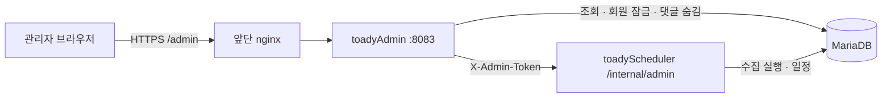

# TOADY 관리자 사이트 (`toadyAdmin`)

서비스 운영에 필요한 화면을 한곳에 모은 관리자 앱입니다. Kotlin·Spring Boot 3.5·Thymeleaf로 만들었고, 사용자용 API·수집기와 별도 컨테이너로 실행합니다.

| 화면 | 주소 | 내용 |
|---|---|---|
| 지표 | `/admin/` | 오늘 방문자·가입·회원·관심 저장·알림 구독, 최근 8주 방문·재방문·활성 탐색자, 최근 28일 유입 경로 |
| 회원 | `/admin/members` | 이메일·닉네임 검색, 상태별 목록, 잠금·해제(다음 로그인부터 막힘) |
| 댓글 | `/admin/comments` | 최신 댓글·숨긴 댓글 검색, 숨기기(원댓글이면 답글 포함)·되살리기 |
| 공고·알림 | `/admin/operations` | 유형별 마지막 수집 시각, 주변 시세 비교 계산 상태, 웹 푸시 전달 현황 |
| 수집 | `/admin/jobs` | 기간 수동 수집, 중지·다시 실행, 자동 일정(cron·재조회 일수) |

## 구조



- 수집 실행기와 자동 일정 타이머는 스케줄러 프로세스에 있으므로, 실행·중지·일정 변경은 스케줄러 내부 API로 요청합니다. 내부 API는 공유 토큰(32자 이상)이 맞을 때만 응답하고, 앞단 nginx는 `/internal`을 외부로 내보내지 않습니다.
- 로그인은 환경변수 계정 하나(BCrypt)이며, 같은 IP에서 15분 안에 5번 실패하면 15분 동안 막습니다. 모든 변경 요청은 CSRF 토큰을 요구합니다.
- DB 계정은 관리자 전용(`toady_admin`)으로, 화면에 쓰는 테이블·컬럼만 읽고 회원 잠금·댓글 숨김만 바꿀 수 있습니다. 비밀번호 해시와 푸시 구독 키는 읽지 못합니다([database.sql](../database.sql) 19번).

## 로컬 실행

```bash
cp .env.example .env.local   # DB·관리자 계정·스케줄러 토큰을 채운다
./run-local.sh               # http://localhost:8083/admin/
./run-local.sh test          # 테스트(H2, 외부 연결 없음)
```

수집 화면을 쓰려면 스케줄러를 관리자 기능과 같은 토큰(`SCHEDULER_INTERNAL_TOKEN`)으로 함께 실행합니다(`SCHEDULER_BASE_URL=http://localhost:8082`).

## 운영 배포 순서

1. DB: [database.sql](../database.sql) 19번으로 `toady_admin` 계정과 권한을 만듭니다.
2. 토큰: `openssl rand -base64 48`로 만든 값을 스케줄러 `toadyScheduler/.env.prod`의 `SCHEDULER_INTERNAL_TOKEN`과 아래 파일에 같은 값으로 넣습니다.
3. 서버에 `~/toady/toadyAdmin/.env.prod`를 만듭니다(`.env.example` 항목 참고, `chmod 600`). 이 파일이 비어 있으면 배포 스크립트가 관리자 컨테이너를 띄우지 않습니다.
4. 앞단 nginx의 `/admin` 위치가 관리자 사이트를 가리키는지 확인합니다(예전에는 스케줄러 8082였습니다).

```nginx
location /admin {
    proxy_set_header Host $host;
    # 필수: 로그인 실패 제한(IP별)이 이 값을 쓴다. 이 줄이 없으면 접속자가 보낸 X-Real-IP가 그대로 전달되어
    # 요청마다 IP를 바꿔 제한을 피할 수 있다. location에 proxy_set_header가 하나라도 있으면 server 블록의 설정은 상속되지 않는다.
    proxy_set_header X-Real-IP $remote_addr;
    proxy_pass http://$toady_admin;   # set $toady_admin toadyAdmin:8083;
}
```

스케줄러의 이전 관리자 화면(`/admin`, `/admin/metrics`)은 제거했습니다. 스케줄러는 `/internal/health`와 내부 API(`/internal/admin`)만 열고 나머지 경로는 403으로 막으므로, nginx의 `/admin`이 아직 스케줄러(8082)를 가리키면 403이 납니다. 스케줄러의 `SCHEDULER_ADMIN_USERNAME`·`SCHEDULER_ADMIN_PASSWORD`·`SCHEDULER_ADMIN_SECURE_COOKIE`는 더 이상 읽지 않습니다.
