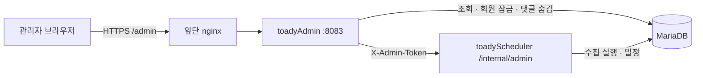

# TOADY 관리자 사이트 (`toadyAdmin`)

서비스 운영에 필요한 지표·회원·댓글·수집 관리를 한곳에 모은 관리자 앱입니다. Kotlin·Spring Boot 3.5·Thymeleaf로 만들었고, 사용자 API·수집기와 별도 컨테이너로 실행합니다. 모바일에서도 쓸 수 있게 반응형으로 구성했습니다.

## 화면

| 화면 | 주소 | 내용 |
| --- | --- | --- |
| 지표 | `/admin/` | 오늘 방문·가입·관심 저장·알림 구독, 최근 14일 방문, 최근 8주 방문·재방문·활성 탐색자, 유입 경로, 방문 → 상세 → 저장 → 알림 흐름과 신규 방문자 재방문율, 많이 본 공고·화면, 지도 기능 사용 |
| 회원 | `/admin/members` | 이메일·닉네임 검색, 상태별 목록, 잠금·해제(다음 요청부터 막힘) |
| 댓글 | `/admin/comments` | 최신·숨긴 댓글 검색, 숨기기(원댓글이면 답글 포함), 되살리기 |
| 공고·알림 | `/admin/operations` | 유형별 마지막 수집 시각, 주변 시세 비교 계산 상태, 웹 푸시 전달 현황 |
| 수집 | `/admin/jobs` | 기간 수동 수집, 중지·다시 실행, 자동 일정(cron·재조회 일수), 실행 이력 |

## 구조



```text
com.toady.admin
├── metrics        # 방문·재방문·유입·흐름 지표, 운영자 브라우저 제외
├── members        # 회원 검색·잠금
├── comments       # 댓글 검색·숨김·복구
├── operations     # 수집·시세 계산·푸시 상태
├── jobs           # 스케줄러 내부 API 클라이언트
├── announcements  # 공고 이름·상세 조회
├── security       # 로그인·실패 제한·세션 쿠키
└── web            # 컨트롤러
```

## 설계 포인트

- **권한 최소화**: 관리자 전용 DB 계정(`toady_admin`)은 화면에 쓰는 테이블·컬럼만 읽고, 회원 잠금·댓글 숨김만 바꿀 수 있습니다. 비밀번호 해시와 푸시 구독 키는 읽지 못합니다([database.sql](../database.sql) 19번).
- **로그인**: 환경변수 계정 하나(BCrypt로 해시해 비교), 같은 IP에서 15분 안에 5번 실패하면 15분 동안 막습니다. 세션 쿠키는 `Path=/admin`·`SameSite=Strict`, 모든 변경 요청에 CSRF 토큰을 요구합니다.
- **수집 제어**: 실행기와 자동 일정 타이머는 수집기 프로세스에 있으므로, 관리자 사이트는 공유 토큰으로 보호한 수집기 내부 API를 호출합니다. 수집기가 꺼져 있어도 지표·회원·댓글 화면은 동작합니다.
- **댓글 숨김 기록**: 작성자가 지운 글과 관리자가 숨긴 글은 모두 `DELETE_YN='Y'`라 구분되지 않으므로 숨김 기록(`TB_COMMENT_ADMIN_HIDE`)을 따로 남깁니다. 되살리기는 관리자가 숨긴 글만, 원댓글을 되살리면 그때 함께 숨긴 답글만 돌아옵니다(따로 숨긴 답글은 그대로).
- **지표의 정직함**: 재방문은 첫 방문 전 28일 동안 방문이 없던 신규 방문자만 보고, 첫 방문 7~13일 뒤 다시 왔는지로 셉니다. 알림 비교는 첫 주에 알림을 켠 사람과 아닌 사람을 나눠, 재방문하면서 켠 경우로 비율이 부풀지 않게 했습니다. 운영자 브라우저는 과거 기록까지 집계에서 뺍니다.

## 실행

```bash
cp .env.example .env.local   # DB·관리자 계정·스케줄러 토큰
./run-local.sh               # http://localhost:8083/admin/
./run-local.sh test          # 테스트 15개(H2, 외부 연결 없음)
```

| 환경변수 | 용도 |
| --- | --- |
| `DB_URL`, `DB_USERNAME`, `DB_PASSWORD` | 관리자 전용 DB 계정 |
| `ADMIN_USERNAME`, `ADMIN_PASSWORD` | 관리자 로그인(비밀번호 12자 이상, 서버가 BCrypt로 해시해 메모리에 보관) |
| `ADMIN_SECURE_COOKIE` | 운영(HTTPS)에서 `true` |
| `SCHEDULER_BASE_URL`, `SCHEDULER_INTERNAL_TOKEN` | 수집기 내부 API 주소와 공유 토큰(32자 이상) |

## 운영 배포

1. [database.sql](../database.sql) 19번으로 `toady_admin` 계정과 권한을 만듭니다.
2. `openssl rand -base64 48`로 만든 토큰을 수집기 `.env.prod`의 `SCHEDULER_INTERNAL_TOKEN`과 이 앱의 `.env.prod`에 같은 값으로 넣습니다.
3. 서버에 `~/toady/toadyAdmin/.env.prod`를 만듭니다(`chmod 600`). 파일이 비어 있으면 배포 스크립트가 관리자 컨테이너를 띄우지 않습니다.
4. 앞단 nginx의 `/admin`을 이 앱으로 연결하고, 로그인 실패 제한이 실제 접속 주소를 쓰도록 `X-Real-IP`를 덮어씁니다.

```nginx
location /admin {
    proxy_set_header Host $host;
    proxy_set_header X-Real-IP $remote_addr;   # 필수: 접속자가 보낸 값을 덮어쓴다
    proxy_pass http://$toady_admin;            # set $toady_admin toadyAdmin:8083;
}
```

관리자 사이트는 지금 공개 사이트와 같은 도메인의 `/admin` 아래에 있습니다. 장기적으로는 별도 하위 도메인으로 분리하는 것이 더 안전합니다.
