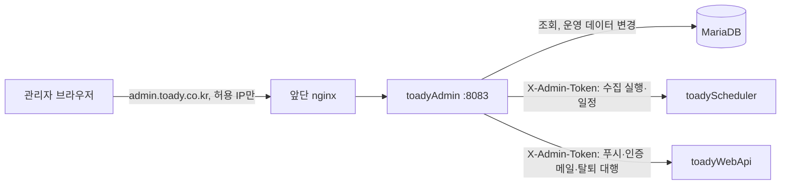

# toadyAdmin

TOADY를 운영하면서 필요한 것들을 모아 둔 관리자 사이트입니다. 지표를 보고, 회원을 제재하고, 이야기와 신고를 처리하고, 공지·FAQ·생활권을 고치고, 수집을 돌리는 일을 여기서 합니다. 사용자 API, 수집기와는 컨테이너를 나눴고 휴대폰에서도 쓸 수 있게 만들었습니다.

Kotlin, Spring Boot 3.5, Thymeleaf, Spring Security, JdbcTemplate

주소는 `https://admin.toady.co.kr/admin/`이고, 앞단 nginx가 허용한 IP에서만 열립니다.

## 화면

| 화면 | 주소 | 하는 일 |
| --- | --- | --- |
| 지표 | `/admin/` | 오늘 방문·가입·관심 저장·알림 구독, 최근 14일 방문, 8주 방문·재방문, 유입 경로, 방문 → 상세 → 저장 → 알림 흐름, 많이 본 공고 |
| 유입·커뮤니티 | `/admin/insights` | 많이 찾은 검색어와 결과 없던 검색어, 공유 유입, 단지별 이야기 활동, 시험 계정 빼고 보기 |
| 회원 | `/admin/members` | 이메일·닉네임 검색, 잠금과 해제, 단계별 제재(경고, 이야기 쓰기 정지, 닉네임 초기화) |
| 이야기 | `/admin/comments` | 최신·숨긴 이야기 검색, 숨기기(원글이면 답글까지), 되살리기 |
| 신고 | `/admin/reports` | 이야기·쪽지·회원 신고를 오래된 순으로. 쪽지는 신고된 것과 앞뒤 한 통씩만 보임 |
| 금칙어 | `/admin/moderation` | 이야기·쪽지 금칙어 추가·멈춤·삭제, 문장 넣어 시험해 보기 |
| 공고 | `/admin/announcements` | 공고 찾기, 숨기기(목록·검색·사이트맵·RSS에서 빠짐), 상세 위 운영 안내, 이 공고만 다시 수집, 운영팀 이야기 쓰기·고정 |
| 위치 확인 | `/admin/locations` | 지번 없는 지구·블록 주소 공고에 확인한 주소 넣기(앱이 지도 검색으로 한 번 더 확인) |
| 데이터 점검 | `/admin/data-check` | 주소·일정 누락, 날짜 형식 불일치, 주택형 누락 |
| 공고·알림 상태 | `/admin/operations` | 유형별 마지막 수집 시각, 시세 비교 계산 상태, 웹 푸시 전달 현황 |
| 수집 | `/admin/jobs` | 기간 정해 수동 수집, 중지·다시 실행, 자동 일정(cron 여러 개를 `\|`로), 실행 이력 |
| 사이트 공지 | `/admin/notices` | 기간·노출 위치·종류를 정한 공지 띠 |
| 자주 묻는 질문 | `/admin/faq` | 질문 추가·수정·숨김(앱과 검색엔진용 페이지에 같이 반영) |
| 생활권 | `/admin/areas` | 생활권 추가·수정(검색, 생활권 페이지, 사이트맵, 알림에 반영) |
| 푸시 발송 | `/admin/push` | 회원 번호로 시험 발송, 확인 문구를 넣어야 되는 전체 발송(하루 2번까지) |
| 메일 발송 | `/admin/mail` | 최근 24시간 Gmail 한도 사용량, 일정 알림 발송 결과 |
| 서비스 설정 | `/admin/settings` | 쪽지 조건·한도, 메일 한도, 실거래 API 하루 한도, 운영팀 계정 |
| 집계 제외 | `/admin/exclusions` | 지표에서 뺄 운영자 브라우저 |
| 작업 이력 | `/admin/audit` | 관리자 화면에서 바꾼 것과 회원 상세를 연 기록(고치거나 지울 수 없음) |

회원 상세에서는 메모 남기기, 인증 메일 다시 보내기, 그 회원 이야기 모두 숨기기, 탈퇴 처리 대행을 할 수 있습니다.

## 구조



```text
com.toady.admin
├── metrics        방문·재방문·유입·흐름 지표, 집계에서 뺄 브라우저
├── insights       검색어, 공유 유입, 단지별 이야기 지표
├── members        회원 검색, 잠금, 제재
├── comments       이야기 숨김·복구
├── reports        신고 처리, 쪽지 정지
├── moderation     금칙어
├── announcements  공고 숨김·안내, 위치 확인, 데이터 점검
├── content        공지, FAQ, 생활권, 서비스 설정
├── operations     수집·시세 계산·푸시 상태, 메일 발송 현황
├── jobs           수집기 내부 API 클라이언트
├── support        API 내부 API 클라이언트(푸시, 인증 메일, 탈퇴 대행), 회원 메모
├── audit          작업 이력
├── security       로그인, 실패 제한, 로그인 유지, 쿠키
└── web            컨트롤러
```

## 만들면서 정한 것들

- 관리자 전용 DB 계정(`toady_admin`)은 화면에 필요한 테이블·컬럼만 읽고, 운영에 필요한 것만 바꿀 수 있게 권한을 좁혔습니다. 비밀번호 해시, 푸시 구독 키, 관심 공고 메모는 읽지 못하고, 작업 이력은 추가만 됩니다([database.sql](../database.sql) 19·25·26·27번).
- 로그인 계정은 환경변수로 하나만 둡니다. 비밀번호는 시작할 때 BCrypt로 해시해 메모리에 들고 있고, 같은 IP에서 15분 안에 5번 틀리면 15분 동안 막습니다.
- 세션은 30분 동안 아무것도 안 하면 끝납니다. "로그인 유지"를 고르면 서명된 쿠키로 14일 동안 다시 로그인됩니다. 비밀번호나 서명 키를 바꾸면 로그인 유지가 모두 풀립니다. 쿠키는 `Path=/admin`, `SameSite=Strict`이고, 바꾸는 요청은 모두 CSRF 토큰이 필요합니다.
- 수집 실행기와 자동 일정 타이머는 수집기 안에 있어서, 관리자 사이트는 공유 토큰으로 수집기 내부 API를 부릅니다. 수집기가 꺼져 있어도 다른 화면은 그대로 열립니다.
- 작성자가 지운 이야기와 관리자가 숨긴 이야기는 DB에서 둘 다 `DELETE_YN='Y'`라 구분이 안 됩니다. 그래서 숨김 기록을 따로 남기고, 되살리기는 관리자가 숨긴 것만 됩니다.
- 재방문은 첫 방문 전 28일 동안 오지 않았던 신규 방문자만 대상으로, 첫 방문 7~13일 뒤에 다시 왔는지로 셉니다. 알림 효과는 첫 주에 알림을 켠 사람과 아닌 사람을 나눠서 봅니다. 다시 와서 켠 사람 때문에 수치가 부풀지 않게 하려는 것입니다.

## 실행

```bash
cp .env.example .env.local
./run-local.sh            # http://localhost:8083/admin/
./gradlew test            # 30개, H2, 외부 연결 없음
```

| 환경변수 | 용도 |
| --- | --- |
| `DB_URL`, `DB_USERNAME`, `DB_PASSWORD` | 관리자 전용 DB 계정 |
| `ADMIN_USERNAME`, `ADMIN_PASSWORD` | 관리자 로그인(비밀번호 12자 이상) |
| `ADMIN_REMEMBER_KEY`, `ADMIN_REMEMBER_DAYS` | 로그인 유지 쿠키 서명 키(32자 이상, 없으면 로그인 유지 끔)와 기간(기본 14일, 최대 30일) |
| `ADMIN_SECURE_COOKIE` | 운영(HTTPS)에서 `true` |
| `SCHEDULER_BASE_URL`, `SCHEDULER_INTERNAL_TOKEN` | 수집기 내부 API 주소와 공유 토큰 |
| `API_BASE_URL`, `ADMIN_API_TOKEN` | API 내부 API 주소와 공유 토큰(API의 `ADMIN_API_TOKEN`과 같은 값) |
| `GMAIL_ROLLING_LIMIT`, `GMAIL_AUTH_RESERVE` | 메일 발송 현황 화면의 한도 표시 |
| `TOADY_SITE_URL` | "서비스에서 보기" 링크 앞부분(기본 `https://www.toady.co.kr`, 로컬은 `http://localhost:3000`) |

## 운영에 처음 올릴 때

1. [database.sql](../database.sql) 19번으로 `toady_admin` 계정과 권한을 만듭니다. 이후 구역(25~27번)의 관리자 권한도 같이 적용합니다.
2. `openssl rand -hex 32`로 만든 값을 수집기의 `SCHEDULER_INTERNAL_TOKEN`과 이 앱에 같은 값으로 넣습니다. API와 쓰는 `ADMIN_API_TOKEN`도 같은 방식으로 따로 만듭니다.
3. 서버에 `~/toady/toadyAdmin/.env.prod`를 만들고 `chmod 600` 합니다. 이 파일이 비어 있으면 배포 스크립트가 관리자 컨테이너를 띄우지 않습니다.
4. 앞단 nginx의 `admin.toady.co.kr` 블록에서 이 앱으로 넘기고, 허용 IP는 서버의 `conf.d/admin-allow.inc`에 둡니다. 로그인 실패 제한이 실제 접속 주소를 쓰도록 `proxy_set_header X-Real-IP $remote_addr;`가 꼭 있어야 합니다. 설정 원본은 루트의 [nginx/toady.conf](../nginx/toady.conf)입니다.
