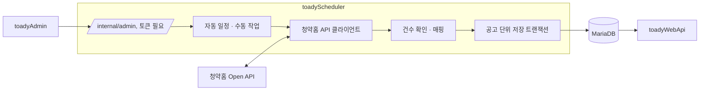

# toadyScheduler

한국부동산원 청약홈 Open API에서 분양 공고, 주택형, 경쟁률, 당첨가점, 특별공급 신청현황을 받아 MariaDB에 넣는 수집기입니다. 사용자 API(`toadyWebApi`)와 JVM·컨테이너를 나눠서, 외부 API를 기다리거나 대량으로 저장하는 동안에도 사용자 요청이 느려지지 않게 했습니다. 화면은 없고 관리자 사이트(`toadyAdmin`)가 내부 API로 수집 실행, 중지, 자동 일정을 다룹니다.

Java 21, Spring Boot 3.5, Spring Data JPA, JdbcTemplate, MariaDB

## 구조



```text
com.toady.web
├── apt         청약홈 클라이언트, 페이지 수집, 매핑, 저장, advisory lock
├── admin       수집 작업 실행기, 실행 이력, 자동 일정(DB 설정), 내부 API
├── retention   오래된 기록 정리
├── health      /internal/health (DB 연결 포함)
└── config
```

## 수집 작업

| 작업 | 기본 일정(한국시간) | 내용 |
| --- | --- | --- |
| 공고·주택형 | 매일 03:15 | 모집공고일 기준 최근 90일의 5개 유형 공고와 주택형 |
| 경쟁률·가점·특별공급 | 매일 04:15, 20:15 | 최근 90일 공고의 경쟁률, 당첨가점, 특별공급 신청현황 |
| 일정 맞춤 경쟁률·가점 | 매시 정각, 18~21시와 7~11시는 10분마다 | 접수일·당첨자 발표일에 걸린 공고만 |
| 기록 정리 | 매일 04:40 | 보관 기간이 지난 기록 삭제 |

- 매번 90일 전까지 다시 조회하는 이유는 가점이 늦게 공개되거나 정정공고가 올라오기 때문입니다. 청약홈 기술문서에는 갱신 주기가 "매일"로만 되어 있어서 정확한 공개 시각은 알 수 없고, 위 시각은 운영하면서 정한 값입니다.
- 일정 맞춤 수집은 DB에 저장된 일정을 보고 대상만 고릅니다.
  - 접수 중이거나 접수 다음 날인 공고: 경쟁률과 특별공급을 실행마다 다시 받음
  - 당첨자 발표 당일 공고: 가점을 실행마다 받음
  - 그 뒤 7일 동안 결과가 비어 있는 공고: 3시간 간격으로만 다시 확인(원래 가점이 없는 국민주택 같은 공고를 10분마다 부르지 않게)
  - 대상이 없으면 외부 API를 부르지 않습니다.
- 일정 하나에 cron 여러 개를 `|`로 이을 수 있습니다. 10분보다 짧은 간격은 저장할 때 막습니다.
- 90일보다 오래된 데이터는 관리자 사이트에서 기간을 정해 수동으로 수집합니다.

정리 대상과 보관 기간: 방문 로그 90일, 행동 기록 180일, 알림 이력 90일, 생활권 새 공고 판정 1년, 쪽지 180일(신고 걸린 쪽지는 남김), 처리 끝난 신고 1년, 관리자 작업 기록과 검색어 통계 1년, 끝난 일정 맞춤 수집 이력 90일. 한 번에 1만 행씩 나눠 지웁니다.

## 데이터를 지키는 방법

- 응답의 `matchCount`에 닿을 때까지 페이지를 넘기고, 중간에 건수가 바뀌거나 모자라거나 넘치면 저장하지 않고 실패로 둡니다. 주택형 응답의 관리번호·공고번호가 요청한 것과 같은지, 키가 비거나 겹치지 않는지도 봅니다.
- 제공처가 빈 응답을 주면 기존 주택형·경쟁률을 지우지 않습니다. 정상 응답이면 공고 단위로 한 트랜잭션 안에서 교체해서 같은 공고를 여러 번 받아도 중복이 생기지 않습니다.
- MariaDB advisory lock과 활성 작업 제약으로 수집이 겹치지 않게 합니다. 겹친 자동 실행은 5분 뒤에 한 번만 다시 시도합니다. 자주 도는 일정 맞춤 수집은 다른 작업의 재시도가 기다리고 있으면 양보합니다.
- 401·403·429를 받으면 바로 멈추고, 끝난 구간은 그대로 둔 채 실패 이유를 실행 이력에 남깁니다.
- 시작할 때 이전 프로세스가 남긴 진행 중 작업을 "중단"으로 정리하고, 종료할 때는 진행 중인 구간이 상태를 남길 수 있게 최대 20초 기다립니다.
- DB에 이 버전이 모르는 작업 종류나 읽지 못하는 cron이 있으면 그 행만 건너뜁니다. 한 행 때문에 자동 수집 전체가 멈추지 않게 하려는 것입니다.

## 내부 API

로그인 화면이나 세션은 없고, 아래 경로만 엽니다(나머지는 403).

| 경로 | 조건 |
| --- | --- |
| `GET /internal/health` | 항상(DB 연결 포함) |
| `/internal/admin/**` | `SCHEDULER_ADMIN_ENABLED=true`이고 `X-Admin-Token`이 32자 이상 공유 토큰과 같을 때(고정 시간 비교) |

운영에서는 `127.0.0.1:8082`로만 포트를 열고, 관리자 사이트는 같은 Compose 네트워크 안에서 부릅니다. 관리 기능을 켜면 자동 일정은 DB(`TB_SCHEDULER_ADMIN_SCHEDULE`)의 값을 따르고, 관리자 사이트에서 바꾼 일정은 30초 안에 반영됩니다.

## 실행

```bash
cp .env.example .env.local
./gradlew bootRun       # 8082
./gradlew test          # 72개, 외부 API·실제 DB 없이
```

| 환경변수 | 용도 |
| --- | --- |
| `DB_URL`, `DB_USERNAME`, `DB_PASSWORD` | MariaDB 접속(운영 계정은 `toady_sources`, 수집 테이블 쓰기·삭제 권한 필요) |
| `APPLYHOME_API_KEY` | 청약홈 Open API 인증키 |
| `APPLYHOME_SYNC_CRON`, `APPLYHOME_COMPETITION_CRON`, `APPLYHOME_LOOKBACK_DAYS` | 공고·경쟁률 자동 일정의 처음 값과 재조회 일수(`-`면 꺼진 채로 등록) |
| `SCHEDULER_ADMIN_ENABLED`, `SCHEDULER_INTERNAL_TOKEN` | 내부 API 사용 여부, 관리자 사이트와 같은 공유 토큰 |
| `DATA_RETENTION_CRON` | 기록 정리 일정(`-`면 끔) |

자동 일정은 DB에 행이 없을 때만 이 값으로 처음 등록하고, 그 뒤로는 관리자 사이트에서 저장한 값을 씁니다. 관리 테이블은 루트 [database.sql](../database.sql) 1번 구역에 있으니 테이블을 만들기 전에는 관리 기능을 켜지 않습니다.

## 테스트

- 청약홈 응답 매핑(문서의 소문자 필드와 실제 대문자 필드 둘 다), 페이지 순회와 건수 확인, 빈 응답 보호, 유형별 저장
- 수집 작업 실행·중지·중단 정리, 자동 일정 저장과 재시도, 내부 API 토큰 검사
- 여러 cron 일정의 다음 실행 시각과 간격 검사, 일정 맞춤 수집의 대상 선정과 재확인 간격
- 기록 정리(나눠 지우기, 지우면 안 되는 행은 남기기)
- `database.sql` 전체를 H2(MariaDB 모드)에서 실행해 SQL 문법 확인
- 실제 청약홈 API를 부르는 백필 테스트는 기본으로 꺼져 있고, 직접 켰을 때만 돕니다.
