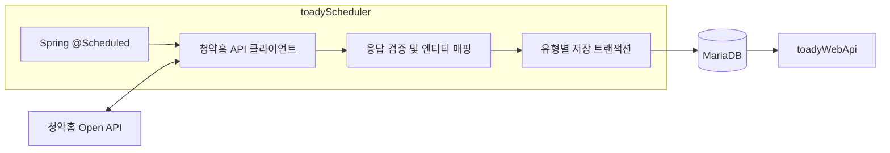

# TOADY 공공데이터 수집 배치 스케줄러 (`toadyScheduler`)

한국부동산원 청약홈 Open API에서 분양 공고, 주택형, 청약 경쟁률 및 당첨 가점 데이터를 수집해 MariaDB에 저장하는 Spring Boot 배치 애플리케이션입니다.

## 기술 스택

- Java 21, Spring Boot 3.5
- Spring Data JPA, JDBC, MariaDB
- Spring `RestTemplate` 기반 청약홈 Open API 클라이언트
- JUnit 5, Spring Boot Test

## 아키텍처

스케줄러는 사용자 요청을 처리하는 `toadyWebApi`와 별도의 애플리케이션·컨테이너에서 실행됩니다. 배치 작업과 API 처리는 서로 다른 JVM 프로세스이지만, MariaDB와 배포 호스트를 공유하므로 DB 장애나 호스트 자원 문제까지 분리되는 것은 아닙니다.



청약홈 API 호출에는 연결 타임아웃 10초와 읽기 타임아웃 60초가 설정되어 있습니다. 스케줄러 동기화는 MariaDB advisory lock을 사용하며, 다른 인스턴스가 같은 작업을 실행 중이면 중복 실행하지 않고 오류로 처리합니다.

## Thymeleaf 수집 관리자

과거 데이터는 자동 재조회 범위(기본 90일) 밖이면 자동으로 복구되지 않습니다. 관리자 화면에서 **모집공고일 기준** 기간을 지정해 수집할 수 있습니다. 가점 발표일이나 청약 접수일 기준이 아닙니다.

| 작업 | 실행 내용 |
| --- | --- |
| 전체 수집 | 월별로 공고·주택형을 수집한 뒤 모든 경쟁률·가점·특별공급 결과 수집 |
| 공고 · 주택형 | 5개 공고 유형의 상세·주택형 동기화 |
| 경쟁률 · 가점 · 특별공급 | 8개 결과 API 동기화 |
| APT 당첨 가점 | APT 공고를 찾아 가점 API만 조회; 과거 가점 복원용 |

- 시작일·종료일을 지정하면 월별 구간으로 나눠 백그라운드에서 실행합니다. 페이지를 닫아도 수집은 계속됩니다.
- 실행 내역은 최근 50건을 표시하고, 상태·월별 진행률·요청자·결과·작업 ID를 저장합니다. 화면은 5초마다 실행 상태만 갱신해 입력 중인 설정을 보존합니다.
- 중지 요청은 현재 구간 완료 후 반영됩니다. 이전 구간에 저장된 데이터는 되돌리지 않습니다. 다시 실행은 같은 기간의 새 작업을 만듭니다.
- 프로세스가 종료된 작업은 마지막 응답 후 10분이 지나면 중단 상태로 정리합니다. 자동 재개하지 않으므로 기간을 확인한 뒤 다시 실행합니다.
- 수동·자동 작업을 같은 실행기로 관리하고 DB의 활성 작업 제약과 기존 advisory lock으로 동시 실행을 막습니다. 진행 중인 작업과 겹친 자동 실행은 대기열에 쌓지 않고 건너뛰며 서버 로그에 남깁니다.
- 가점 결과의 반영 건수는 API 응답 처리 건수이며 신규 삽입 건수와 다릅니다. 0건이면 기간 기준과 원본의 가점 공개 여부를 확인해야 합니다.

### 1. 테이블 생성

DB 관리 계정으로 저장소 루트의 **`database.sql`을 직접 실행**하세요. 관리자 테이블은 파일의 1번 구역에 있습니다. 댓글·경쟁률 테이블 생성문도 같은 파일에 모았으며, 모든 생성문은 없는 테이블만 추가합니다. 기존 도시형 PK 변경과 권한 명령은 참고용 주석으로 남겨 자동 실행되지 않습니다.

```bash
mariadb -h DB호스트 -u 관리계정 -p DB이름 < database.sql
```

- `TB_SCHEDULER_ADMIN_JOB`: 수동·자동 실행 이력, 진행 상태, 중지 요청
- `TB_SCHEDULER_ADMIN_SCHEDULE`: 자동 실행 여부·cron·재조회 일수

앱 DB 계정에는 위 두 테이블의 SELECT·INSERT·UPDATE 권한이 필요합니다. 원본 수집 테이블에는 기존 수집 권한과 도시형 스냅샷 교체에 필요한 DELETE 권한이 필요합니다. 테이블을 생성하기 전에는 관리자 기능을 활성화하지 마세요.

### 2. 관리자 활성화

로컬 `.env.local` 또는 운영 서버 `toadyScheduler/.env.prod`에 직접 설정합니다. 비밀번호는 12자 이상, UTF-8 기준 72바이트 이하여야 하며 실제 값은 커밋하지 않습니다.

```dotenv
SCHEDULER_ADMIN_ENABLED=true
SCHEDULER_ADMIN_USERNAME=admin
SCHEDULER_ADMIN_PASSWORD=직접_정한_관리자_비밀번호
SCHEDULER_ADMIN_SECURE_COOKIE=false
```

기본값은 비활성화입니다. 비활성화 상태에서는 기존 `@Scheduled` 수집이 계속 동작하고, 관리자 테이블·비밀번호 없이 배포할 수 있습니다. 활성화하면 기존 정적 스케줄 대신 DB 설정으로 동작합니다. 첫 활성화 때 공고·경쟁률 스케줄은 현재 cron 환경 설정을 가져오고, 전체 수집·가점 단독 스케줄은 꺼진 상태로 등록합니다.

관리자 화면에서 저장한 스케줄은 재시작 후에도 유지되며 다른 인스턴스에는 최대 30초 뒤 반영됩니다. 첫 등록 이후에는 cron 환경변수를 바꾸어도 DB 설정을 덮어쓰지 않습니다. 모든 스케줄을 끄면 자동 수집도 멈춥니다. 서로 같은 내용을 수집하는 스케줄을 중복 활성화하지 않도록 주의하세요.

### 3. 접속

로컬 직접 실행은 기본 `http://localhost:8082/admin`이며 `SERVER_PORT`로 포트를 변경할 수 있습니다. Compose는 `SERVER_PORT=8082`와 `8082:8082` 매핑으로 호스트와 컨테이너 포트를 맞춥니다. 서버의 보안 그룹·방화벽에서 TCP 8082 접속을 허용하면 `http://서버주소:8082/admin`으로 접속할 수 있습니다.

관리자 화면은 `SCHEDULER_ADMIN_ENABLED=true`와 관리자 비밀번호를 설정해야 활성화됩니다. 외부 도메인으로 HTTPS를 제공하려면 별도 Nginx 프록시를 구성하고 `SCHEDULER_ADMIN_SECURE_COOKIE=true`를 설정하세요. 로그인·실행·설정 변경·로그아웃에는 CSRF 보호를 적용하며 세션은 30분 동안 유지됩니다.

## 스케줄 및 데이터 흐름

분양정보 기술문서(2026-01-29)와 경쟁률·특별공급 기술문서(2024-12-03)는 모두 갱신주기를 **매일**로 명시합니다. 정확한 공개 시각과 실시간 갱신은 보장하지 않으므로 아래 시각은 운영 정책입니다. 주말·공휴일도 실행해 지연 반영과 정정을 재확인합니다.

| 작업 | 한국시간 실행 시각 | 기본 cron |
| --- | --- | --- |
| 공고·주택형 | 매일 03:15 | `0 15 3 * * *` |
| 경쟁률·당첨 가점·특별공급 신청현황 | 매일 04:15, 20:15 | `0 15 4,20 * * *` |

04:15 실행은 야간 반영분을, 20:15 실행은 당일 변경분을 확인하기 위한 재조회입니다. API가 해당 시각 전에 갱신된다는 의미는 아닙니다. 실행 시간이 길면 실제 시작 시각은 지연될 수 있습니다.

### 공고 및 주택형 동기화

- 기본 실행 시각: 매일 03:15, `Asia/Seoul`
- 조회 범위: 실행일 기준 90일 전부터 오늘까지의 모집공고일
- 대상 유형: APT, URBAN, REMAINING, PUBLIC_RENTAL, OPTIONAL
- 상세 공고를 조회·저장한 후 공고별 복합키(`houseManageNo`, `pblancNo`)를 사용해 주택형 데이터를 조회·저장합니다.

공고 상세와 주택형 데이터는 각각 저장 서비스의 트랜잭션으로 처리되며, 외부 API 조회부터 모든 데이터 저장까지 하나의 트랜잭션으로 실행되지는 않습니다. 일반 유형은 JPA `merge`로 저장합니다. 도시형 주택형은 공고별 전체 응답을 받은 뒤, 한 트랜잭션에서 최신 스냅샷으로 반영합니다. 변경 없는 행과 ID는 유지하고, 사라지거나 값이 바뀐 행은 삭제·삽입하며 같은 응답의 중복 행은 제거합니다. 성공적으로 조회된 빈 응답도 기존 주택형을 비우는 스냅샷으로 처리합니다. 수집 DB 계정에는 DELETE 권한도 필요합니다.

### 경쟁률·가점 수집

- 기본 실행 시각: 매일 04:15와 20:15, `Asia/Seoul`
- APT 일반 경쟁률, 특별공급 신청현황, 당첨 가점과 URBAN·REMAINING·PUBLIC_RENTAL·OPTIONAL·취소후재공급 경쟁률을 수집합니다.
- 취소후재공급은 잔여세대 공고 중 `HOUSE_SECD=06`, 일반 무순위는 `HOUSE_SECD=04`의 공고 키로 조회합니다. 일반 APT 공고 키와 혼용하지 않습니다.
- 조회 범위는 실행일 기준 90일 전부터 오늘까지의 모집공고입니다. 한 달 이후 발표되는 가점이나 정정 데이터를 다시 확인하도록 기존 범위를 넓혔습니다.

각 테이블의 식별 키 기준으로 MariaDB `INSERT ... ON DUPLICATE KEY UPDATE`를 사용해 신규 행을 삽입하고 기존 행을 갱신합니다.

페이지는 `matchCount`에 도달할 때까지 조회합니다. 도중에 건수가 바뀌거나 예상보다 적거나 많은 행이 오면 실패 처리해 불완전한 응답을 최신 스냅샷으로 저장하지 않습니다. 문서의 소문자 필드명과 예제의 대문자 필드명은 둘 다 처리합니다.

90일보다 오래된 공고의 정정은 자동 범위 밖입니다. 필요하면 `APPLYHOME_LOOKBACK_DAYS`를 늘리거나 명시적 기간의 백필을 실행합니다. 범위를 늘리면 공고별 상세 API 호출도 증가하므로 발급받은 API 호출 한도에 맞춰 조정합니다.

## 환경 변수

애플리케이션 실행에 다음 설정을 환경변수로 전달합니다.

| 변수 | 필수 | 설명 |
| --- | --- | --- |
| `DB_URL` | 예 | MariaDB JDBC URL (예: `jdbc:mariadb://localhost:3306/toady`) |
| `DB_USERNAME` | 예 | 데이터베이스 사용자 |
| `DB_PASSWORD` | 예 | 데이터베이스 비밀번호 |
| `APPLYHOME_API_KEY` | 공고 API 호출 시 예 | 청약홈 Open API 서비스 키 |
| `APPLYHOME_SYNC_CRON` | 아니오 | 공고 동기화 cron. 기본 `0 15 3 * * *` |
| `APPLYHOME_COMPETITION_CRON` | 아니오 | 경쟁률·가점·특별공급 cron. 기본 `0 15 4,20 * * *` |
| `APPLYHOME_LOOKBACK_DAYS` | 아니오 | 공고일 재조회 범위. 기본 `90`, 양수 |

기존 `APPLYHOME_COMPETITION_POLL_CRON`·`APPLYHOME_COMPETITION_FINAL_CRON`은 사용하지 않습니다. 배포 서버에서는 새 `APPLYHOME_COMPETITION_CRON` 값으로 변경한 뒤 컨테이너를 재생성해야 합니다. 이 저장소의 로컬 `.env.local`·`.env.prod`에는 새 스케줄을 반영하지만 원격 서버의 환경 파일은 자동으로 변경되지 않습니다.

운영 데이터베이스와 API 키는 저장소에 기록하지 말고 안전한 환경변수나 배포 환경의 비밀 설정으로 관리하세요. 스키마 자동 생성은 비활성화되어 있으므로 대상 테이블이 사전에 준비되어 있어야 합니다.

## 로컬 빌드 및 테스트

필요 환경: Java 21, MariaDB, Gradle Wrapper.

```bash
# 기본 테스트: 수집 흐름 단위 테스트 및 H2 기반 스냅샷 저장 회귀 검증
./gradlew test

# 배치 애플리케이션 실행
DB_URL='jdbc:mariadb://localhost:3306/toady' \
DB_USERNAME='your-db-user' \
DB_PASSWORD='your-db-password' \
APPLYHOME_API_KEY='your-service-key' \
./gradlew bootRun
```

### 외부 API 백필 통합 테스트

백필 테스트는 외부 청약홈 API와 지정된 데이터베이스를 실제로 사용합니다. 기본 테스트에서는 비활성화되어 있으며, 필요한 DB·API 설정을 준비하고 별도 테스트 환경에서만 실행하세요. 종료일을 지정하지 않으면 실행일이 종료일로 사용됩니다.

```bash
# 공고 및 주택형 이력: 시작일~오늘
./gradlew test --tests '*ApplyhomeBackfillIntegrationTest' \
  -Dapplyhome.integration.enabled=true \
  -Dapplyhome.test.start-date=2020-02-01

# 경쟁률 및 가점 이력: 시작일~오늘
./gradlew test --tests '*ApplyhomeCompetitionBackfillIntegrationTest' \
  -Dapplyhome.competition.integration.enabled=true \
  -Dapplyhome.competition.test.start-date=2020-02-01
```

백필 작업은 외부 API 호출과 DB 쓰기를 많이 발생시킬 수 있습니다. 운영 데이터베이스에서 실행하지 마세요.

공유 DB 설정 SQL은 루트 `database.sql` 한 파일에서 관리하며 필요할 때 직접 실행합니다. [DB 변경 관리](../README.md#공유-db-변경-관리)를 확인하세요.

## Docker

```bash
docker build -t toady-scheduler .
docker run --rm \
  -e DB_URL='jdbc:mariadb://host.docker.internal:3306/toady' \
  -e DB_USERNAME='your-db-user' \
  -e DB_PASSWORD='your-db-password' \
  -e APPLYHOME_API_KEY='your-service-key' \
  toady-scheduler
```

컨테이너에서 접근 가능한 MariaDB와 대상 테이블이 준비되어 있어야 합니다. `host.docker.internal`은 로컬 Docker에서 호스트 머신의 DB에 접근하는 예시이며, 다른 배포 환경에서는 해당 환경의 DB 주소를 사용하세요.
