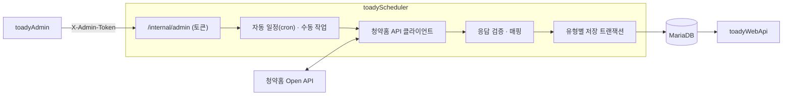

# TOADY 수집기 (`toadyScheduler`)

한국부동산원 청약홈 Open API에서 분양 공고·주택형·경쟁률·당첨가점·특별공급 현황을 수집해 MariaDB에 저장하는 Spring Boot 앱입니다. 사용자 API(`toadyWebApi`)와 다른 JVM·컨테이너에서 돌아, 외부 API 대기와 대량 적재가 사용자 요청에 영향을 주지 않게 했습니다. 화면은 없고, 관리자 사이트(`toadyAdmin`)가 토큰으로 보호한 내부 API로 수집 실행·중지·자동 일정을 제어합니다.

## 구조



```text
com.toady.web
├── apt         # 청약홈 클라이언트 · 페이지 수집 · 매핑 · 저장(공고·주택형·경쟁률·가점·특별공급) · advisory lock
├── admin       # 수집 작업 실행기 · 실행 이력 · 자동 일정(DB 설정) · 내부 API · 보안 설정
├── retention   # 로그 보관 기간 정리
├── health      # /internal/health(DB 연결 포함 준비 상태)
└── config
```

## 수집 대상과 일정

| 작업 | 기본 일정(한국시간) | 내용 |
| --- | --- | --- |
| 공고·주택형 | 매일 03:15 | APT·도시형/오피스텔·잔여세대·공공지원민간임대·임의공급 공고 상세와 주택형 |
| 경쟁률·가점·특별공급 | 매일 04:15, 20:15 | APT 일반 경쟁률·당첨가점·특별공급 신청현황, 나머지 유형과 취소후재공급 경쟁률 |
| 로그 보관 기간 정리 | 매일 04:40 | 방문 로그 90일, 행동 집계 180일, 알림 이력 90일, 생활권 판정 365일(1만 건씩 나눠 삭제) |

- 매번 오늘부터 90일 전까지의 모집공고를 다시 조회해 늦게 공개되는 가점과 정정공고를 반영합니다(`APPLYHOME_LOOKBACK_DAYS`).
- 기술문서의 갱신 주기는 '매일'이며 정확한 공개 시각은 보장되지 않으므로, 위 시각은 운영 정책입니다.
- 범위 밖의 과거 데이터는 관리자 사이트에서 모집공고일 기준 기간을 지정해 수집합니다(전체 · 공고·주택형 · 경쟁률·가점 · APT 가점만).

## 데이터를 지키는 방식

- **건수 검증**: 응답의 `matchCount`에 닿을 때까지 페이지를 돌고, 도중에 건수가 바뀌거나 예상보다 적거나 많으면 저장하지 않고 실패로 둡니다. 주택형 응답의 관리번호·공고번호가 요청과 같은지, 복합키 누락·중복이 없는지도 확인합니다.
- **빈 응답 보호**: 제공처가 빈 응답을 주면 기존 주택형·경쟁률을 지우지 않습니다. 정상 응답이면 공고 단위로 한 트랜잭션에서 교체하고, 실패하면 이전 데이터로 롤백합니다. 도시형 주택형은 변경 없는 행의 ID를 유지하고 바뀐 행만 교체합니다.
- **동시 실행 방지**: MariaDB advisory lock과 활성 작업 제약으로 수동·자동 수집이 겹치지 않게 합니다. 겹친 자동 실행은 5분 뒤 한 번만 다시 시도하고, 그 사이 자동 일정을 끄거나 바꾸면 미뤄 둔 재시도도 취소합니다.
- **제공처 거절**: 401·403·429를 받으면 그 자리에서 멈추고, 이미 끝난 기간은 유지한 채 실패 사유와 앞 구간의 일부 실패 내역을 실행 이력에 남깁니다.
- **중단 정리**: 시작할 때 이전 프로세스가 남긴 활성 작업을 '중단'으로 정리하고, 종료할 때는 진행 중인 구간이 상태를 기록하도록 최대 20초 기다립니다.

## 내부 API와 접근 제어

브라우저 로그인·세션이 없고 다음 경로만 엽니다(나머지는 403).

| 경로 | 조건 |
| --- | --- |
| `GET /internal/health` | 항상(DB 연결 포함 준비 상태) |
| `/internal/admin/**` | `SCHEDULER_ADMIN_ENABLED=true`이고 `X-Admin-Token`이 32자 이상 공유 토큰과 일치할 때(고정 시간 비교) |

운영 Compose는 `127.0.0.1:8082`로만 포트를 열고, 관리자 사이트는 같은 Compose 네트워크에서 호출합니다. 관리 기능을 켜면 자동 일정이 DB(`TB_SCHEDULER_ADMIN_SCHEDULE`)의 설정으로 동작하며, 관리자 사이트에서 바꾼 일정은 다른 인스턴스에도 30초 안에 반영됩니다.

## 실행과 설정

```bash
cp .env.example .env.local
./gradlew bootRun       # SERVER_PORT 기본 8082
./gradlew test          # 62개, 외부 API·실제 DB 없이 실행
```

| 환경변수 | 용도 |
| --- | --- |
| `DB_URL`, `DB_USERNAME`, `DB_PASSWORD` | MariaDB 접속(수집 테이블 쓰기·삭제 권한 필요) |
| `APPLYHOME_API_KEY` | 청약홈 Open API 인증키 |
| `APPLYHOME_SYNC_CRON`, `APPLYHOME_COMPETITION_CRON`, `APPLYHOME_LOOKBACK_DAYS` | 관리 기능을 끈 상태의 자동 일정과 재조회 기간 |
| `SCHEDULER_ADMIN_ENABLED`, `SCHEDULER_INTERNAL_TOKEN` | 내부 API 사용 여부와 관리자 사이트와 같은 공유 토큰 |
| `DATA_RETENTION_CRON` | 로그 보관 기간 정리 일정 |

관리 테이블(실행 이력·자동 일정)은 루트 [database.sql](../database.sql) 1번 구역에 있습니다. 테이블을 만들기 전에는 관리 기능을 켜지 않습니다.

## 테스트

- 청약홈 응답 매핑(문서의 소문자 필드와 실제 대문자 필드 모두), 페이지 순회·건수 검증, 빈 응답 보호, 유형별 저장
- 수집 작업 실행·중지·중단 정리, 자동 일정 저장·재시도, 내부 API 토큰 검사
- 로그 보관 기간 정리(나눠 삭제, 기준 행 유지)
- `database.sql` 전체를 H2(MariaDB 모드)에서 실행해 SQL 문법과 구역 형식을 확인
- 실제 청약홈 API를 부르는 백필 통합 테스트는 기본으로 꺼져 있고 명시적으로 켤 때만 실행합니다.
