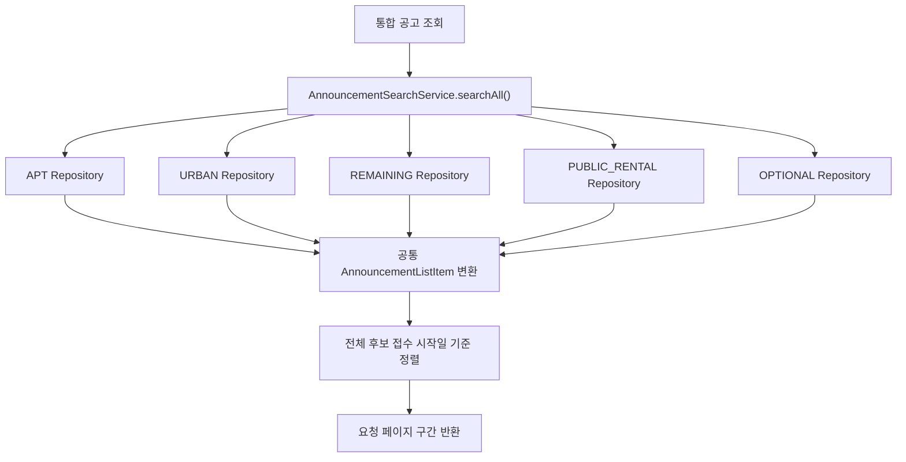

# TOADY Web API

Spring Boot 기반의 분양 공고 통합 조회 및 커뮤니티 백엔드입니다. 아파트·도시형·잔여세대 등 서로 다른 공고 유형을 공통 API로 검색하고, 공고 상세 정보와 댓글 기능을 제공합니다.

## 주요 기능

- 5개 공고 유형(APT, URBAN, REMAINING, PUBLIC_RENTAL, OPTIONAL)의 통합 검색 및 페이지 조회
- 공고 유형별 상세 정보, 경쟁률, APT 당첨 가점 및 특별공급 현황 조회
- 전체 기간 공고 자동완성 검색: 주택명 또는 주소 키워드로 검색하고 접수 시작일 최신순으로 제한된 결과 반환
- JWT 로그인 및 회원가입·이메일 인증·비밀번호 재설정
- 공고 댓글 목록 조회, 작성, 수정, 삭제
- Swagger UI를 통한 API 명세 확인

## 기술 스택

| 구분 | 기술 |
| --- | --- |
| 언어 및 프레임워크 | Java 21, Spring Boot 3.5 |
| 데이터 접근 | Spring Data JPA, Hibernate |
| 데이터베이스 | MariaDB |
| 인증 | Spring Security, JJWT 기반 JWT |
| API 문서 | Springdoc OpenAPI / Swagger UI |
| 테스트 | JUnit 5, Spring Boot Test, H2 |
| 컨테이너 | Docker, Eclipse Temurin 21 |

## 주요 설계

### 공고 유형 통합 검색

공고 유형별로 테이블과 접수일 필드가 다르므로 각 JPA Repository에서 공통 검색 조건을 적용하고, 결과를 `AnnouncementListItem`으로 변환해 합칩니다. 요청 페이지에 필요한 만큼 유형별 후보를 조회한 뒤 접수 시작일 기준으로 전역 정렬하고 페이지를 구성합니다. 유형별 선행 조회량을 제한하기 위해 통합 검색은 `(page + 1) × size ≤ 10000` 범위만 허용합니다.

검색 조건은 공고 유형, 지역 코드, 주택명 키워드, 접수 시작일 범위이며, 유형을 지정하지 않으면 5개 유형을 모두 조회합니다. 접수일 컬럼과 데이터 형식은 유형별로 다르기 때문에 조회와 정렬 시 해당 차이를 반영합니다.



### 전체 기간 자동완성

`GET /api/v1/announcements/suggestions`는 특정 월에 한정하지 않고 5개 공고 유형에서 키워드를 검색합니다. 각 유형에서 제한된 수의 후보를 가져와 접수 시작일 최신순으로 합친 뒤 요청한 최대 건수만 반환합니다. 빈 키워드는 빈 목록을 반환하며, 기본 limit은 10이고 허용 범위는 1~20입니다.

### 복합키 매핑

공고 상세 엔티티는 `houseManageNo`와 `pblancNo`를 `@IdClass`로 매핑합니다. 주택형·경쟁률 등 관련 엔티티는 각각 필요한 식별자 클래스를 사용해 복합 식별자를 표현합니다.

### 인증 및 인가

JWT 인증을 사용하며 요청마다 DB의 계정 상태와 비밀번호에 연결된 토큰 검증값을 확인합니다. 잠금·탈퇴·비밀번호 변경 후에는 기존 토큰을 거부합니다. 검증값은 서버 키로 계산하며 비밀번호 해시 자체를 JWT에 넣지 않습니다. 이 검증값이 없는 기존 토큰은 재로그인이 필요합니다. 통합 목록 응답에는 삭제되지 않은 댓글·답글의 `commentCount`가 포함됩니다. 반환할 페이지의 정확한 공고 키를 한 번의 그룹 집계로 조회해 공고마다 추가 쿼리를 실행하지 않습니다. 공고 조회 API는 비회원도 호출할 수 있으며, 댓글 작성·수정·삭제는 `ROLE_USER` 권한이 필요합니다. 비밀번호는 Spring Security의 BCrypt 인코더를 사용합니다. 가입 인증 링크는 24시간, 비밀번호 재설정 코드는 10분 동안 유효합니다. 가입 인증·재발송과 비밀번호 재설정은 계정 행을 먼저 잠근 뒤 필요한 코드 행을 잠가 같은 계정의 변경을 직렬화합니다. 비밀번호 변경 시 해당 계정의 미사용 재설정 코드를 모두 폐기합니다. 코드 발급은 메일 발송이 실패하면 롤백하여 즉시 재요청할 수 있습니다. 로그인 화면 또는 `/certify`에서 가입 인증 메일을 다시 요청할 수 있습니다. 재발송은 4분 간격이며, 새 링크 발송이 성공하면 이전 가입 링크는 폐기됩니다. 메일 본문은 `TB_CERTIFY.CERTIFY_MESSAGE TEXT NOT NULL`에 저장합니다. 가입·비밀번호 재설정 메일은 `EmailTemplates`의 공통 HTML 레이아웃을 사용하며, 외부 이미지 없이 인증 버튼·코드와 유효시간을 표시합니다. 닉네임과 링크는 HTML 이스케이프하고 인증 코드는 `SecureRandom`으로 생성합니다.

## 코드 구성

- `AnnouncementService`: 기존 공고 조회 계약의 진입점
- `AnnouncementSearchService`: 유형별·통합 검색과 자동완성
- `AnnouncementListMapper`: 유형별 엔티티를 통합 목록 DTO로 변환
- `AnnouncementDetailService`: 상세·주택형 조회와 존재 확인
- `AnnouncementCompetitionService`: 경쟁률·가점·특별공급 조회
- `AnnouncementCommentService`: 댓글 및 답글 처리
- `HealthController`: DB 연결을 포함한 `/internal/health` 준비 상태 응답

## API 요약

| Method | Endpoint | 설명 | 접근 |
| --- | --- | --- | --- |
| `POST` | `/webApi/certify/resend-account-verification` | 가입 인증 메일 재발송 (`userEmail`, 4분 간격) | 공개 |
| `GET` | `/api/v1/announcements` | 5개 유형 공고 통합 검색 및 페이지 조회 | 공개 |
| `GET` | `/api/v1/announcements/suggestions` | 전체 기간 공고 자동완성 검색 | 공개 |
| `GET` | `/api/v1/{type}/announcements` | 공고 유형별 검색 | 공개 |
| `GET` | `/api/v1/{type}/announcements/{houseManageNo}/{pblancNo}` | 공고 상세 조회 | 공개 |
| `GET` | `/api/v1/{type}/announcements/{houseManageNo}/{pblancNo}/competition-rates` | 경쟁률 조회 | 공개 |
| `GET` | `/api/v1/apt/announcements/{houseManageNo}/{pblancNo}/scores` | APT 당첨 가점 조회 | 공개 |
| `GET` | `/api/v1/apt/announcements/{houseManageNo}/{pblancNo}/special-supply-status` | APT 특별공급 신청현황 조회 | 공개 |
| `GET` | `/api/v1/{type}/announcements/{houseManageNo}/{pblancNo}/comments` | 댓글 목록 조회 | 공개 |
| `POST` | `/api/v1/{type}/announcements/{houseManageNo}/{pblancNo}/comments` | 댓글 작성 | 로그인 필요 |
| `PATCH` | `/api/v1/{type}/announcements/{houseManageNo}/{pblancNo}/comments/{commentSeq}` | 본인 댓글 수정 | 로그인 필요 |
| `DELETE` | `/api/v1/{type}/announcements/{houseManageNo}/{pblancNo}/comments/{commentSeq}` | 본인 댓글 삭제 | 로그인 필요 |

`{type}`은 `apt`, `urban`, `remaining`, `public-rental`, `optional` 중 하나입니다. 경쟁률 조회는 `cancel-resupply`도 지원합니다. 취소후재공급 공고의 상세 유형은 `remaining`으로 유지하고 `houseSecd=06`일 때 경쟁률만 `cancel-resupply`로 조회합니다. 전체 API 명세는 애플리케이션 실행 후 `http://localhost:8080/swagger-ui/index.html`에서 확인할 수 있습니다. 예제 환경 설정의 `SERVER_PORT=8081`을 사용하면 프론트 개발 프록시와 연결됩니다.

### 자동완성 요청 예시

```http
GET /api/v1/announcements/suggestions?keyword=자이&limit=10
```

응답은 공통 `ResData` 형식이며, `data`는 자동완성 결과 배열입니다.

```json
{
  "data": [
    {
      "type": "apt",
      "houseManageNo": "2026000123",
      "pblancNo": "2026000123",
      "houseNm": "메이플자이",
      "houseSecdNm": "민영",
      "subscrptAreaCodeNm": "서울",
      "hssplyAdres": "서울특별시 서초구",
      "rceptBgnde": "2026-08-12",
      "rceptEndde": "2026-08-14"
    }
  ],
  "resultCode": "SUCCESS",
  "resultMessage": "성공"
}
```

## 로컬 실행

필요 환경: Java 21, MariaDB, Gradle Wrapper.

기본 설정은 이 디렉터리의 `.env` 파일을 읽습니다. 실제 비밀값은 Git에서 제외하고 예제만 공개합니다.

```bash
cp .env.example .env
# .env의 DB 접속 정보를 수정하고 JWT_SECRET에 아래 명령의 출력값을 넣습니다.
openssl rand -base64 64 | tr -d '\n'

# 외부 DB 없이 실행할 수 있는 기본 테스트
bash ./gradlew test

# 준비된 MariaDB와 스키마를 사용해 실행
bash ./gradlew bootRun
```

예제의 `SERVER_PORT=8081`은 프론트 개발 서버의 프록시 대상입니다. 환경변수를 별도로 설정하지 않은 기본 서버 포트는 `8080`입니다. 이메일 기능에는 SMTP 설정이 필요합니다. SMTP 연결·읽기·쓰기 타임아웃은 각각 기본 5초이며 `MAIL_CONNECTION_TIMEOUT_MS`, `MAIL_READ_TIMEOUT_MS`, `MAIL_WRITE_TIMEOUT_MS`로 밀리초 단위로 조정합니다. 로컬 전용 `application-local.yml`이나 `.env.local`에 의존하지 않으므로 새 clone에서도 동일한 설정 경로를 사용합니다.

애플리케이션은 `spring.jpa.hibernate.ddl-auto=none`으로 실행되므로 데이터베이스와 필요한 테이블을 별도로 준비해야 합니다. 댓글·경쟁률·관리자 테이블 생성문과 기존 DB 변경 참고 SQL은 루트 `database.sql`에 모았습니다. 실행 방법과 전체 초기 스키마 미제공 범위는 [DB 변경 관리](../README.md#공유-db-변경-관리)를 확인하세요.

## 테스트 및 Docker

빠른 회귀 검증은 H2로, 실제 PK·MariaDB SQL 및 DML 권한 검증은 별도 작업으로 나눕니다.

```bash
# 개발 DB 검증: .env.local 또는 TOADY_TEST_DB_URL / USERNAME / PASSWORD 설정 사용
bash ./gradlew mariadbTest
```

`mariadbTest`는 기존 테이블의 PK와 읽기 전용 날짜 정렬을 확인하고, 고유한 테스트 행의 INSERT·UPDATE·DELETE를 실행한 뒤 롤백합니다. 기존 행은 변경하지 않습니다. 개발 계정에는 SELECT·INSERT·UPDATE·DELETE가 필요합니다. 운영 DB 설정을 지정하지 마세요.

CREATE TEMPORARY TABLE 권한이 있는 별도 테스트 계정에서는 다음 명령으로 임시 테이블의 SQL·트랜잭션 검증도 실행할 수 있습니다. CI는 격리된 MariaDB 서비스에서 이 검증까지 수행합니다.

```bash
bash ./gradlew mariadbTest -Dtoady.mariadb.temporary.enabled=true
```


테스트는 H2 데이터베이스를 사용해 애플리케이션 컨텍스트, 주요 API 흐름, 통합 공고 검색 및 자동완성 동작을 확인합니다.

```bash
./gradlew clean test
```

Docker 이미지 빌드는 프로젝트 루트에서 실행합니다. 컨테이너 실행 시 데이터베이스 접속 정보와 JWT 키를 환경변수로 전달해야 하며, 컨테이너에서 접근 가능한 MariaDB가 준비되어 있어야 합니다.

```bash
docker build -t toady-web-api .
docker run --rm -p 8080:8080 \
  -e DB_URL='jdbc:mariadb://host.docker.internal:3306/toady' \
  -e DB_USERNAME='your-db-user' \
  -e DB_PASSWORD='your-db-password' \
  -e JWT_SECRET='your-base64-encoded-secret' \
  toady-web-api
```

`host.docker.internal`은 로컬 Docker 컨테이너에서 호스트 머신의 데이터베이스에 접근할 때 사용하는 예시입니다. 배포 환경에 맞는 DB 주소와 환경변수를 설정하세요.

### 입력 검증과 댓글 페이지 이동

회원가입은 메일 발송 실패뿐 아니라 인증 링크 생성 등 저장 이후의 모든 예외에 대해 회원·인증 정보를 함께 롤백합니다. 잘못된 JWT 서명 키나 서비스 도메인은 시작 시 거부해 정상 배포로 판정되지 않도록 합니다. 인증 JSON의 누락·null·잘못된 타입과 게시판 조회의 잘못된 조건은 400 공통 응답으로 처리합니다.

댓글은 등록 번호 내림차순입니다. 기존 `page` 조회를 유지하며, `beforeCommentSeq`를 지정하면 해당 번호보다 이전 댓글만 조회합니다(`page=0` 필요). 커서 응답의 `totalElements`와 `totalPages`는 커서 이전에 남아 있는 댓글 범위의 값입니다. 프론트는 최초 댓글 수를 유지하며 이전 번호를 따라 조회해, 도중 신규 등록·삭제가 있어도 오프셋 이동으로 댓글을 건너뛰거나 중복 조회하지 않습니다.

게시판은 `useYn=Y`, `deleteYn=N`과 예약 게시 시작·종료 시각을 함께 적용합니다. 지역 조회는 enum 이름(`PAJUSI`)과 저장 코드(`PAJU`)를 모두 받아 실제 저장 코드로 검색합니다.

### 익명 방문 로그

배포 전에 루트 `database.sql`의 **7번 TB_PAGE_VIEW 생성문**을 운영 DB에 실행합니다. API 계정에는 해당 테이블의 INSERT 권한이 필요합니다. DDL은 자동 실행하지 않습니다. `ANALYTICS_ENABLED=false`로 수집을 끌 수 있습니다.

`POST /api/v1/analytics/page-views`는 eventId·visitorId·sessionId(UUID)와 허용된 path만 받으며, 서버 한국시간으로 저장합니다. 같은 eventId는 한 번만 저장합니다. 정상·중복·수집 중지는 204, 잘못된 입력은 400, DB 장애는 503입니다. JWT가 필요하지 않으며 조회 통계 API는 외부에 공개하지 않습니다. 일별 방문자·세션·조회 수와 페이지별 집계 SQL은 `database.sql`에 있습니다.

원본 IP, 회원 ID, User-Agent, Referer, 쿼리 문자열은 저장하지 않습니다. 운영 Nginx의 요청 로그 보관 정책은 별도로 설정해야 합니다. 기본 보관 기간은 자동 강제하지 않으며, 운영자는 보관 정책을 정하고 집계 보존 및 삭제 작업을 설정해야 합니다. 90일 정리 SQL 예시도 제공합니다. 원본 삭제 후 해당 기간의 통계는 다시 계산할 수 없습니다.

이 통계는 브라우저 이벤트 기반 추정치입니다. 저장소 삭제·차단, 봇, 전송 실패에 따라 오차가 있고 공개 수집 API에 대한 위조를 막는 보안 지표가 아닙니다. 운영 프록시에서 수집 엔드포인트의 요청 빈도를 제한하는 것을 권장합니다. 저장 실패는 DEBUG 로그에 남으며 브라우저는 한 번만 재시도합니다.

### 관심 공고와 Gmail 일정 알림

배포 전에 `database.sql` 8·9번과 미적용 시 7번을 실행합니다. 새 테이블에 앱 계정의 SELECT·INSERT·UPDATE·DELETE 권한이 필요합니다. `TB_MAIL_BUDGET (ID=1)` 초기 행도 필수이며 DDL은 자동 실행하지 않습니다. 기존 인증 메일도 발송량 제한을 사용하므로 알림이 꺼져 있어도 8번 테이블은 필요합니다.

- 인증된 `/api/v1/me/favorites`: GET 목록, POST `/{type}/{house}/{notice}` 저장/수정, DELETE 같은 경로 해제. 사용자 번호는 JWT에서만 가져옵니다. 최대 50개, 메모 2,000자, 체크리스트 비트 0~31입니다. 공고 요약과 날짜는 서버의 원본으로 계산합니다.
- POST `/api/v1/me/favorites/disable-emails`: 해당 회원의 모든 공고 알림을 해제합니다. 메일 하단에서 `/my` 설정으로 이동할 수 있습니다.
- 공개 `/api/v1/living-areas`, `/api/v1/planner/settings`, POST `/api/v1/planner/summaries`(최대 50개 키)로 비회원 조회를 지원합니다. 공유 HTML은 `/api/v1/public/announcements/{type}/{house}/{notice}`, 사이트맵은 `/api/v1/public/sitemap.xml`과 `/api/v1/public/sitemaps/{type}/{page}.xml`입니다. HTML에는 회원 메모를 포함하지 않습니다.
- 생활권 공개 HTML은 `/api/v1/public/areas`, `/api/v1/public/areas/{slug}`이고 생활권 사이트맵은 `/api/v1/public/sitemaps/areas.xml`입니다. 공고 HTML과 같은 `LivingAreas.match` 기준(주소·단지명의 생활권 보조 키워드)을 사용합니다.
- 공개 모음 HTML `/api/v1/public/zupzup`, `/api/v1/public/weekly`, 생활권 공개 캘린더 `/api/v1/public/areas/{slug}/calendar.ics`(30분 캐시, 알림 없음), 가점 비교 기준 `/api/v1/public/score-benchmarks`(1시간 캐시, 공고별 공개 최저·최고 당첨가점)를 제공합니다.
- 경쟁률 예상 투표: `GET/POST /api/v1/polls/rate/apt/{house}/{notice}`. 익명 방문자 ID당 한 표(마감 전 변경 가능), 접수 마감일 이후·1순위 경쟁률 공개 후에는 409로 받지 않고 실제 최고 경쟁률 구간을 함께 반환합니다. `database.sql` 12번 테이블이 필요합니다.
- 회원 캘린더 구독: `GET/POST/DELETE /api/v1/me/calendar-feed`(조회·발급 또는 재발급·해지), 공개 `GET /api/v1/public/calendar/{token}.ics`. 토큰은 256비트 무작위 값이며 재발급·해지·탈퇴·잠금 시 404를 반환합니다. 메모는 내보내지 않습니다. `database.sql` 11번 테이블이 필요합니다.
- `POST /api/v1/analytics/page-views`는 선택 필드 `referrerHost`(소문자 도메인만)를 받습니다. `REFERRER_HOST` 컬럼이 없으면 경고 로그를 남기고 10분간 유입 없이 저장한 뒤 다시 시도합니다.
- `PLANNER_REMINDERS_ENABLED=true`일 때 API 서버에서 한국시간 08:00~18:30, 30분마다 알림을 검사합니다. 오늘/내일 관심 공고 일정이 있는 인증·정상 회원에게 하루 한 통을 보냅니다. 서버 중단 후 같은 시간대에 복구하면 재검사합니다. 개인별 공급 자격에 따른 맞춤 판정이 아닌 공개된 접수·발표·계약 일정 안내입니다. 변경 감지 알림이나 지역 신규 공고 추천은 포함하지 않습니다.
- SMTP는 기존 Gmail 하나만 사용합니다. `GMAIL_ROLLING_LIMIT=400`, `GMAIL_AUTH_RESERVE=100`이 기본값입니다. 실제 Gmail 할당량 보장이 아니라 보수적인 애플리케이션 제한입니다. 최근 24시간의 AUTH/REMINDER 시도량을 DB 잠금 아래 함께 계산하며, 실패한 SMTP 시도도 차감합니다. 인증 용량 확보를 위해 REMINDER는 최대 300회입니다. 이 계정에서 별도로 보내는 개인 메일은 집계하지 못합니다.
- 알림 할당량 부족은 다음 검사로 미룹니다. SMTP 결과가 불명확하면 UNKNOWN, 다른 실패는 FAILED로 남기고 그 날짜에는 자동 재전송하지 않습니다. 프로세스 중단 후 15분 넘은 SENDING도 UNKNOWN으로 정리합니다. 중복·누락이 전혀 없는 전달 보장은 아니며 재시도보다 중복 방지를 우선합니다. DB를 조회해 상태를 점검할 수 있습니다. 주소·본문이 없는 발송 시도 이력은 7일 이후 정리합니다. 알림 수신 이력과 관심 메모는 별도 보관 정책이 필요합니다.

추가 회귀 테스트 `PlannerIntegrationTest`는 회원 간 격리, 입력 검증, 생활권/주소 검색, HTML 이스케이프, 동시 발송 할당량, 묶음 메일 중복과 전체 해제를 검증합니다. 테스트에서는 SMTP를 모킹하며 실제 메일을 발송하지 않습니다. 운영 MariaDB DDL·Nginx 연동과 실제 Gmail 도착 여부는 별도 배포 확인 대상입니다.

일정 요약은 `ScheduleEvents`에서 날짜별로 정리합니다. 같은 날의 해당·경기·기타지역 순위를 합치고, 상세 접수 일정과 겹치는 일반 시작/마감 표시는 생략합니다. 원래 접수 기간은 요약의 startDate/endDate로 유지합니다. `ScheduleEventsTest`는 예시 10개 일정이 6개 날짜로 합쳐져도 발표·계약 일정과 지역 구분이 남는지 검증합니다. 이 규칙은 API 요약·일정 이메일·공유 HTML에 함께 적용되며 DB 변경은 필요하지 않습니다.

### 가입 인증과 메일 요청 제한

- 가입 인증(`POST /webApi/certify/certify-check`)은 메일 링크의 코드와 가입 비밀번호(`userPassword`)가 모두 맞아야 완료됩니다. 비밀번호가 틀리면 코드를 소비하지 않습니다. 이메일 인증을 마치지 않은 계정에 같은 이메일로 다시 가입하면 비밀번호·닉네임을 새 정보로 덮어써, 남이 먼저 가입해 둔 비밀번호가 활성화되는 선점을 막습니다.
- 메일을 보내는 요청(가입, 인증 재발송, 비밀번호 찾기)은 요청자 IP별로 10분 5회·하루 20회까지 받고 초과하면 429를 반환합니다(`MailRequestLimitFilter`). IP는 앞단 프록시(사설·루프백 주소)에서 온 요청의 `X-Real-IP`만 신뢰합니다.
- 통합 공고 검색은 `(page+1)×size ≤ 1000`, 공개 HTML(`/areas`, `/zupzup`, `/weekly`)은 5분간 서버에서 재사용합니다.

### 웹 푸시 알림

- 구독: `GET /api/v1/push/config`(사용 여부·VAPID 공개키), `PUT /api/v1/push/subscription`(엔드포인트·키·범위 저장, 로그인 상태면 회원 관심 공고로 연결), `POST /api/v1/push/subscription/lookup`, `POST /api/v1/push/unsubscribe`, `POST /api/v1/push/test`(구독한 본인 브라우저에만, 30초에 한 번). 엔드포인트는 접근 로그에 남지 않도록 본문으로만 받고, 서버가 임의 주소로 요청하지 않도록 FCM·Mozilla·Apple·WNS 푸시 서비스 호스트만 허용합니다.
- 발송: `PUSH_DIGEST_ENABLED=true`일 때 한국시간 18:00~20:30, 30분마다 확인해 구독마다 하루 한 번 '관심 공고의 내일 일정'과 '구독 생활권의 새 공고'를 하나의 알림으로 묶어 보냅니다. 같은 tag·Topic이라 재시도해도 겹쳐 쌓이지 않습니다. 푸시 서비스가 404·410을 주면 구독을 바로 삭제합니다. 생활권 새 공고는 `TB_PUSH_AREA_SEEN`에 처음 확인한 시각을 남겨, 구독자가 마지막으로 알림을 받은 뒤 처음 보인 공고만 보냅니다(첫 기록 때 기존 공고는 제외).
- 암호화는 RFC 8291(aes128gcm)·RFC 8292(VAPID ES256)를 JDK 기본 암호 기능으로 직접 구현했습니다(`WebPushCrypto`). 필요한 연산이 P-256 ECDH·HKDF·AES-GCM·ES256뿐이라 BouncyCastle·비동기 HTTP 클라이언트를 끌어오는 라이브러리 없이 처리하고, RFC 8291 부록 A 테스트 벡터로 결과를 검증합니다.
- 환경변수: `WEB_PUSH_VAPID_PUBLIC_KEY`(비압축 P-256 공개키 base64url), `WEB_PUSH_VAPID_PRIVATE_KEY`(32바이트 개인키 base64url), `WEB_PUSH_SUBJECT`(`mailto:` 또는 `https://`, 비우면 `TOADY_WEB_DOMAIN`), `PUSH_DIGEST_ENABLED`. 키가 없거나 서로 맞지 않으면 푸시 전체가 꺼지고 웹의 알림 켜기 화면도 숨겨집니다. 키를 바꾸면 기존 구독은 모두 무효가 되므로 한 번 정한 키를 유지합니다.
- `database.sql` 13번 테이블(`TB_PUSH_SUBSCRIPTION`, `TB_PUSH_AREA_SEEN`)이 필요합니다. `PushIntegrationTest`는 실제 푸시 서비스 대신 전송을 가로채 브라우저처럼 복호화해 내용·410 삭제·하루 1회를 검증합니다.

### 접속할 때 브라우저 자체 로그인 창이 뜨는 경우

일반 서비스 API는 Bearer JWT를 사용하고 HTTP Basic·폼 로그인은 비활성화합니다. 공개 API는 로그인 없이 조회하며, 회원 전용 API의 인증 실패는 WWW-Authenticate 헤더 없이 JSON 401로 반환합니다. 브라우저에 사용자 이름/비밀번호 창이 뜨면 응답의 `WWW-Authenticate: Basic` 여부와 실제 API 포트의 실행 프로세스를 확인합니다. 오래 실행 중인 백엔드에 최신 설정이 반영되지 않았다면 API를 재시작해야 합니다. 웹 로그인 계정을 브라우저 자체 인증 창에 입력하는 방식으로 해결하지 않습니다.

### 동네 아파트 실거래가

청약 상세의 **동네 실거래**에서 공고와 같은 법정동의 최근 3개월 신고 거래를 조회합니다. 국토교통부 일반 매매 API `RTMSDataSvcAptTrade/getRTMSDataSvcAptTrade`를 사용하며, 취소 거래를 제외하고 최근 20건과 전체 일치 건수를 제공합니다. 전용면적 필터는 선택 면적 ±5㎡입니다. 시군구·월별 응답은 서버 메모리에 6시간 캐시합니다. 오류나 불완전한 페이지는 빈 거래로 표시하지 않습니다.

공공데이터포털의 **국토교통부 아파트 매매 실거래가 자료** 활용신청 후 인증키를 서버 환경변수 `MOLIT_TRADE_SERVICE_KEY`에 설정하세요. 일반·인코딩 키 모두 지원하며 프런트엔드에는 전달하지 않습니다. 로컬은 Git에서 제외된 `.env`, 운영은 Docker Compose가 읽는 `/home/ec2-user/toady/toadyWebApi/.env.prod`에 설정하고 API 컨테이너를 재생성해야 합니다. DB 테이블 추가는 필요하지 않습니다. 주소의 법정동 확인에는 기존 카카오 지도 JavaScript SDK의 Geocoder를 사용합니다. 네이버 검색 API는 사용하지 않습니다.

### 공유용 HTML·이미지

`/api/v1/public/announcements/{type}/{house}/{notice}?tabType=rate`는 JavaScript 없이 공고별 제목·설명·OG/Twitter 태그를 제공합니다. `tabType`은 detail/rate/map/comment를 허용합니다. 공개 PNG는 `/api/v1/public/announcement-images/{type}/{house}/{notice}.png?tabType=rate`에서 생성하며 원본 공고의 공개 정보만 담습니다. 없는 공고는 404, 응답 캐시는 5분입니다. Docker 런타임에 한글 렌더링용 Noto CJK 폰트를 설치합니다. 이미지·메타태그 수정 후 카카오의 기존 URL 캐시 초기화가 필요할 수 있습니다.

청약홈 공통 상세 양식의 모집공고문 링크는 `GET /api/v1/notice-documents/{type}/{house}/{notice}`로 조회합니다. 저장된 공고에 한해 공식 호스트와 공고 번호가 일치하는 첨부 링크를 추출하며, 정상 결과는 1시간, 조회 실패는 1분 동안 캐시합니다. 파일을 복제하거나 별도 테이블에 저장하지 않습니다. 원문 양식 변경이나 연결 실패 시 상세의 원문 확인 경로를 제공합니다.

경쟁률 공유 미리보기는 공개된 APT 당첨가점이 있으면 전체 공개 주택형·지역의 최저/최고 점수를 설명과 PNG 카드에 표시합니다. 0·누락·미공개 및 유효 범위 밖 점수는 제외하고 지역별 평균을 다시 평균내지 않습니다. 미리보기 이미지 버전은 `v=2`입니다.
