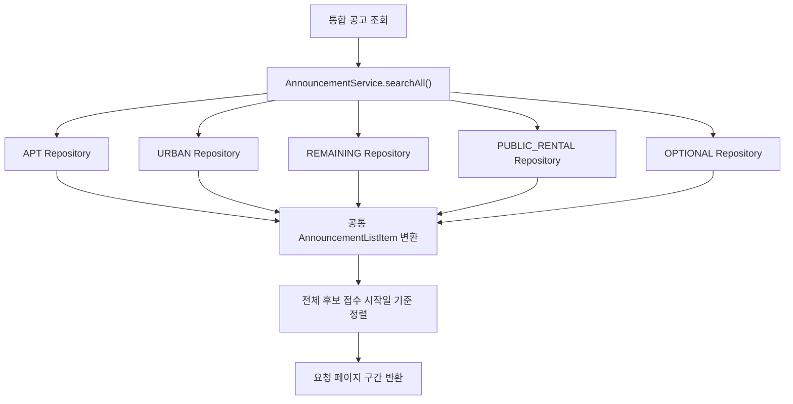

# TOADY Web API

Spring Boot 기반의 분양 공고 통합 조회 및 커뮤니티 백엔드입니다. 아파트·도시형·잔여세대 등 서로 다른 공고 유형을 공통 API로 검색하고, 공고 상세 정보와 댓글 기능을 제공합니다.

## 주요 기능

- 5개 공고 유형(APT, URBAN, REMAINING, PUBLIC_RENTAL, OPTIONAL)의 통합 검색 및 페이지 조회
- 공고 유형별 상세 정보, 경쟁률, APT 당첨 가점 및 특별공급 현황 조회
- 전체 기간 공고 자동완성 검색: 주택명 또는 주소 키워드로 검색하고 접수 시작일 최신순으로 제한된 결과 반환
- JWT 로그인 및 회원가입·이메일 인증·비밀번호 재설정
- 공고 댓글 목록 조회, 작성, 수정, 삭제
- Swagger UI를 통한 API 명세 확인

## 기술 스택

| 구분 | 기술 |
| --- | --- |
| 언어 및 프레임워크 | Java 21, Spring Boot 3.5 |
| 데이터 접근 | Spring Data JPA, Hibernate |
| 데이터베이스 | MariaDB |
| 인증 | Spring Security, JJWT 기반 JWT |
| API 문서 | Springdoc OpenAPI / Swagger UI |
| 테스트 | JUnit 5, Spring Boot Test, H2 |
| 컨테이너 | Docker, Eclipse Temurin 21 |

## 주요 설계

### 공고 유형 통합 검색

공고 유형별로 테이블과 접수일 필드가 다르므로 각 JPA Repository에서 공통 검색 조건을 적용하고, 결과를 `AnnouncementListItem`으로 변환해 합칩니다. 요청 페이지에 필요한 만큼 유형별 후보를 조회한 뒤 접수 시작일 기준으로 전역 정렬하고 페이지를 구성합니다.

검색 조건은 공고 유형, 지역 코드, 주택명 키워드, 접수 시작일 범위이며, 유형을 지정하지 않으면 5개 유형을 모두 조회합니다. 접수일 컬럼과 데이터 형식은 유형별로 다르기 때문에 조회와 정렬 시 해당 차이를 반영합니다.



### 전체 기간 자동완성

`GET /api/v1/announcements/suggestions`는 특정 월에 한정하지 않고 5개 공고 유형에서 키워드를 검색합니다. 각 유형에서 제한된 수의 후보를 가져와 접수 시작일 최신순으로 합친 뒤 요청한 최대 건수만 반환합니다. 빈 키워드는 빈 목록을 반환하며, 기본 limit은 10이고 허용 범위는 1~20입니다.

### 복합키 매핑

공고 상세 엔티티는 `houseManageNo`와 `pblancNo`를 `@IdClass`로 매핑합니다. 주택형·경쟁률 등 관련 엔티티는 각각 필요한 식별자 클래스를 사용해 복합 식별자를 표현합니다.

### 인증 및 인가

JWT 기반 무상태 인증을 사용합니다. 공고 조회 API는 비회원도 호출할 수 있으며, 댓글 작성·수정·삭제는 `ROLE_USER` 권한이 필요합니다. 비밀번호는 Spring Security의 BCrypt 인코더를 사용합니다.

## API 요약

| Method | Endpoint | 설명 | 접근 |
| --- | --- | --- | --- |
| `GET` | `/api/v1/announcements` | 5개 유형 공고 통합 검색 및 페이지 조회 | 공개 |
| `GET` | `/api/v1/announcements/suggestions` | 전체 기간 공고 자동완성 검색 | 공개 |
| `GET` | `/api/v1/{type}/announcements` | 공고 유형별 검색 | 공개 |
| `GET` | `/api/v1/{type}/announcements/{houseManageNo}/{pblancNo}` | 공고 상세 조회 | 공개 |
| `GET` | `/api/v1/{type}/announcements/{houseManageNo}/{pblancNo}/competition-rates` | 경쟁률 조회 | 공개 |
| `GET` | `/api/v1/apt/announcements/{houseManageNo}/{pblancNo}/scores` | APT 당첨 가점 조회 | 공개 |
| `GET` | `/api/v1/apt/announcements/{houseManageNo}/{pblancNo}/special-supply-status` | APT 특별공급 신청현황 조회 | 공개 |
| `GET` | `/api/v1/{type}/announcements/{houseManageNo}/{pblancNo}/comments` | 댓글 목록 조회 | 공개 |
| `POST` | `/api/v1/{type}/announcements/{houseManageNo}/{pblancNo}/comments` | 댓글 작성 | 로그인 필요 |
| `PATCH` | `/api/v1/{type}/announcements/{houseManageNo}/{pblancNo}/comments/{commentSeq}` | 본인 댓글 수정 | 로그인 필요 |
| `DELETE` | `/api/v1/{type}/announcements/{houseManageNo}/{pblancNo}/comments/{commentSeq}` | 본인 댓글 삭제 | 로그인 필요 |

`{type}`은 `apt`, `urban`, `remaining`, `public-rental`, `optional` 중 하나입니다. 전체 API 명세는 애플리케이션 실행 후 `http://localhost:8080/swagger-ui/index.html`에서 확인할 수 있습니다. 로컬 프로파일은 기본 포트 `8081`을 사용합니다.

### 자동완성 요청 예시

```http
GET /api/v1/announcements/suggestions?keyword=자이&limit=10
```

응답은 공통 `ResData` 형식이며, `data`는 자동완성 결과 배열입니다.

```json
{
  "data": [
    {
      "type": "apt",
      "houseManageNo": "2026000123",
      "pblancNo": "2026000123",
      "houseNm": "메이플자이",
      "houseSecdNm": "민영",
      "subscrptAreaCodeNm": "서울",
      "hssplyAdres": "서울특별시 서초구",
      "rceptBgnde": "2026-08-12",
      "rceptEndde": "2026-08-14"
    }
  ],
  "resultCode": "SUCCESS",
  "resultMessage": "성공"
}
```

## 로컬 실행

필요 환경: Java 21, MariaDB, Gradle Wrapper.

기본 프로파일은 `DB_URL`, `DB_USERNAME`, `DB_PASSWORD`, `JWT_SECRET` 환경변수가 필요합니다. 로컬 프로파일은 `.env.local` 파일을 읽으며 기본 서버 포트는 `8081`입니다. 프로젝트 루트에 아래 형식으로 `.env.local`을 준비하고 실제 접속 정보와 Base64 인코딩 JWT 서명 키를 설정합니다.

```properties
DB_URL=jdbc:mariadb://localhost:3306/toady
DB_USERNAME=your-db-user
DB_PASSWORD=your-db-password
JWT_SECRET=your-base64-encoded-secret
MAIL_USERNAME=
MAIL_PASSWORD=
```

`JWT_SECRET`은 운영용 비밀값을 저장소에 커밋하지 말고 안전한 방법으로 관리하세요. 회원가입 및 비밀번호 재설정 이메일 기능을 사용하려면 SMTP 설정도 필요합니다.

```bash
# 테스트
./gradlew test

# 로컬 프로파일로 실행
./gradlew bootRun --args='--spring.profiles.active=local'
```

애플리케이션은 `spring.jpa.hibernate.ddl-auto=none`으로 실행되므로 데이터베이스와 필요한 테이블을 별도로 준비해야 합니다. 댓글 테이블 DDL은 `src/main/resources/db/schema/TB_LTTOT_PBLANC_COMMENT.sql`에 있습니다.

## 테스트 및 Docker

테스트는 H2 데이터베이스를 사용해 애플리케이션 컨텍스트, 주요 API 흐름, 통합 공고 검색 및 자동완성 동작을 확인합니다.

```bash
./gradlew clean test
```

Docker 이미지 빌드는 프로젝트 루트에서 실행합니다. 컨테이너 실행 시 데이터베이스 접속 정보와 JWT 키를 환경변수로 전달해야 하며, 컨테이너에서 접근 가능한 MariaDB가 준비되어 있어야 합니다.

```bash
docker build -t toady-web-api .
docker run --rm -p 8080:8080 \
  -e DB_URL='jdbc:mariadb://host.docker.internal:3306/toady' \
  -e DB_USERNAME='your-db-user' \
  -e DB_PASSWORD='your-db-password' \
  -e JWT_SECRET='your-base64-encoded-secret' \
  toady-web-api
```

`host.docker.internal`은 로컬 Docker 컨테이너에서 호스트 머신의 데이터베이스에 접근할 때 사용하는 예시입니다. 배포 환경에 맞는 DB 주소와 환경변수를 설정하세요.
